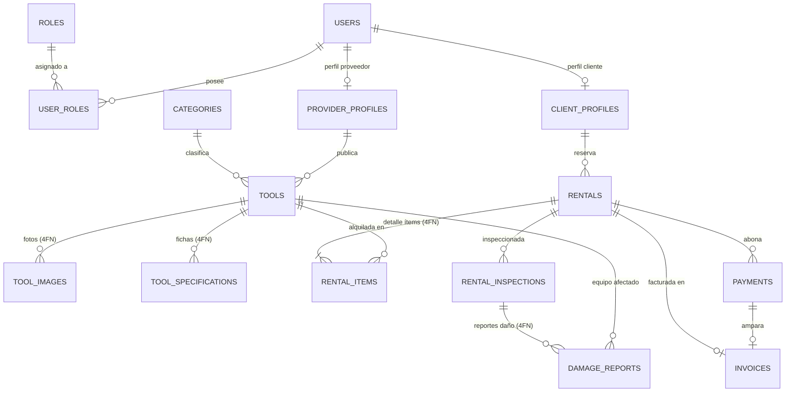

# ToolRent — Plataforma de Renta de Herramientas y Equipos de Construcción


> **ToolRent** es una plataforma integral de renta de maquinaria pesada, herramientas industriales y equipos de construcción para Colombia. Implementa **Arquitectura Hexagonal**, **Domain-Driven Design (DDD)** con 8 módulos Maven desacoplados, **Spring Boot 3.3 (Java 17)**, **PostgreSQL 16**, base de datos relacional auditada y normalizada en **Cuarta Forma Normal (4FN)**, seguridad JWT con control de acceso basado en roles (RBAC), documentación interactiva OpenAPI/Swagger y un frontend SPA con **Vite + Tailwind CSS v3** moldeado según el sistema de diseño oficial de ToolRent.

## 🚀 Tecnologías Principales
- **Java 17 LTS (Eclipse Temurin)**
- **Spring Boot 3.4.x / 3.3.x**
  - Spring Web MVC
  - Spring Data JPA / Hibernate
  - Spring Security 6 (Autenticación JWT Stateless)
  - Spring Boot Actuator
- **PostgreSQL 16** (Motor relacional en 4FN)
- **Flyway** (Control de versiones y migraciones de BD)
- **Docker & Docker Compose** (Despliegue contenerizado orquestado)
- **Swagger / OpenAPI 3** (Documentación viva de contratos REST con Bearer Auth)
- **Vite + Tailwind CSS v3** (Frontend SPA responsivo por roles con sistema de diseño ToolRent)
- **Maven** (Arquitectura multi-módulo desacoplada)

## Diagrama Relacional (Modelo de Datos)




## 🗄️ Scripts de Base de Datos y Normalización (4FN)

El modelo de datos cumple rigurosamente con la **Cuarta Forma Normal (4FN)** (eliminación total de dependencias multivaluadas) y cuenta con **al menos 20 registros por cada entidad** en sus conjuntos de datos semilla. Se proporcionan scripts listos para ejecución tanto en el entorno contenerizado activo (PostgreSQL) como en MySQL para verificación directa de evaluación:

- 🐘 **PostgreSQL 16 (Motor Activo en Docker):**
  - DDL Esquema 4FN: [`db/schema.sql`](db/schema.sql)
  - DML Población Semilla ($\ge 20$ reg/entidad): [`db/data.sql`](db/data.sql)
  - Migraciones Flyway: `backend/bootstrap/src/main/resources/db/migration/`
- 🐬 **MySQL 8.0+ (Soporte Directo para Evaluación):**
  - DDL Esquema 4FN: [`db/mysql_schema.sql`](db/mysql_schema.sql)
  - DML Población Semilla ($\ge 20$ reg/entidad): [`db/mysql_data.sql`](db/mysql_data.sql)
- 📖 **Justificación Teórica de 4FN y Métricas de Entidades:** [`db/README.md`](db/README.md)

## Cómo Clonar y Ejecutar
### Pre-requisitos
- Docker y Docker Compose instalados.
- JDK 17 (Java 17 LTS - Eclipse Temurin recomendado para compilar localmente fuera de Docker).
- Maven 3.9+ (opcional, el contenedor usa multistage con Maven).

### Pasos
1. **Clonar el Repositorio**
```bash
git clone https://github.com/andresguerra321/proyecto-springboot.git
cd proyecto-springboot
```

2. **Ejecutar con Docker Compose**
El proyecto contiene un `docker-compose.yml` en la raíz. Solo necesitas ejecutar:
```bash
docker-compose up -d --build
```
Esto levantará la base de datos PostgreSQL, ejecutará las migraciones de Flyway automáticamente y desplegará la API en el puerto `8085`.

3. **Ejecutar el Frontend (Vite + Tailwind CSS v3)**
El frontend se conecta de manera directa y en tiempo real a la API de Spring Boot (`http://localhost:8085/api/v1`):
```bash
cd frontend
npm install
npm run dev
```
La aplicación web interactiva estará disponible de inmediato en:
👉 **`http://localhost:5173/`**

Para compilar la versión optimizada de producción del frontend:
```bash
npm run build
npm run preview
```

### Mapeo de Puertos y URLs del Sistema

| Servicio / Componente | Puerto Local | URL / Host | Descripción |
| :--- | :---: | :--- | :--- |
| **PostgreSQL 16** | `5434` | `localhost:5434` | Base de datos relacional 4FN (`renta_herramientas_db`) |
| **Spring Boot API** | `8085` | `http://localhost:8085/api/v1` | API REST Spring Boot 3 con JWT y Arquitectura Hexagonal |
| **Swagger UI** | `8085` | `http://localhost:8085/swagger-ui.html` | Documentación interactiva de contratos con Bearer Auth |
| **Actuator / Health** | `8085` | `http://localhost:8085/api/v1/health` | Estado del backend (`{"status":"UP"}`) |
| **Frontend Web SPA** | `5173` | `http://localhost:5173/` | Single Page Application reactiva conectada al backend |

### Cuentas y Credenciales de Prueba (Seed Data)
La base de datos se inicializa con **4 usuarios oficiales**, **5 herramientas activas del proveedor** y **0 alquileres** para realizar pruebas completas de extremo a extremo:

> **Contraseña universal para todas las cuentas semilla:** `Password123*`

| Rol | Usuario (`username`) | Correo Electrónico | Perfil / Panel Autorizado |
| :--- | :--- | :--- | :--- |
| **ADMIN** | `admin_principal` | `admin@rentaequipos.com` | `#/admin` (Analítica, usuarios, auditoría contable) |
| **PROVEEDOR** | `prov_maquinaria_bog` | `contacto@maquinariabogota.com` | `#/provider` (Maquinaria y Equipos Bogotá S.A.S.) |
| **CLIENTE 1** | `cliente_carlos_gomez` | `carlos.gomez@constructora.com` | `#/client` (Carlos Alberto Gómez Peña) |
| **CLIENTE 2** | `cliente_maria_rodriguez` | `maria.rodriguez@ingenieria.com` | `#/client` (María Camila Rodríguez León) |

*(El modal de inicio de sesión incluye 4 botones de acceso rápido con autollenado instantáneo).*

### 🐧 Despliegue en Linux Ubuntu (1 o 2 Comandos)
Para desplegar la plataforma completa en **Ubuntu Linux**, ejecuta el script automatizado que instala Docker si hace falta y levanta los contenedores:
```bash
chmod +x deploy-ubuntu.sh && ./deploy-ubuntu.sh
```
Para ver la guía paso a paso completa con métodos manuales y nativos, consulta:
👉 **[Guía Completa de Despliegue en Ubuntu Linux](docs/GUIA_DESPLIEGUE_UBUNTU.md)**


## Ejemplo de `application.yml` (Configuración Principal)
El archivo principal está en `backend/bootstrap/src/main/resources/application.yml`:

```yaml
server:
  port: 8080

spring:
  application:
    name: renta-equipos-api
  datasource:
    url: jdbc:postgresql://${DB_HOST:localhost}:${DB_PORT:5432}/${DB_NAME:renta_herramientas_db}
    username: ${DB_USER:postgres}
    password: ${DB_PASSWORD:postgres123}
    driver-class-name: org.postgresql.Driver
  jpa:
    hibernate:
      ddl-auto: validate
    show-sql: true
    properties:
      hibernate:
        format_sql: true
  flyway:
    enabled: true
    baseline-on-migrate: true

application:
  security:
    jwt:
      secret-key: ${JWT_SECRET:404E635266556A586E3272357538782F413F4428472B4B6250645367566B5970}
      expiration: 86400000 # 1 dia
```

## Autenticación, Roles y Swagger
El sistema utiliza **JWT (JSON Web Tokens)** para la seguridad de las rutas, dividiendo el acceso con los roles `ADMIN`, `PROVEEDOR` y `CLIENTE`.

**Rutas Públicas (No requieren Token):**
- `/api/v1/auth/register`: Registro de usuarios.
- `/api/v1/auth/login`: Autenticación para obtener el JWT.
- `GET /api/v1/tools/**`: Exploración pública del catálogo de herramientas y categorías.
- Rutas de Swagger y Documentación: `/swagger-ui/**`, `/v3/api-docs/**`.

**Explicación de Roles:**
- **CLIENTE:** Puede explorar herramientas, crear solicitudes de reserva, realizar pagos en línea y consultar sus facturas.
- **PROVEEDOR:** Puede crear, modificar (`PUT`) y eliminar (`DELETE`) herramientas de su inventario, así como gestionar solicitudes de reserva.
- **ADMIN:** Tiene acceso total, administra usuarios (`GET /api/v1/users`), supervisa alquileres y consulta reportes avanzados de rentabilidad.

### Uso de JWT en Swagger
1. Visita Swagger UI en: `http://localhost:8085/swagger-ui.html`
2. Ejecuta `POST /api/v1/auth/login` con tus credenciales.
3. Copia el token del campo `token` de la respuesta JSON.
4. Haz clic en el botón verde **"Authorize"** en Swagger UI.
5. Pega el token (Swagger lo enviará automáticamente como `Bearer <token>`).

---

## 🚀 Matriz Completa de Endpoints REST

| Módulo | Método | Endpoint | Rol / Acceso | Descripción |
| :--- | :---: | :--- | :--- | :--- |
| **Auth** | `POST` | `/api/v1/auth/register` | Público | Registro de cliente o proveedor |
| **Auth** | `POST` | `/api/v1/auth/login` | Público | Autenticación y obtención de JWT |
| **Users** | `GET` | `/api/v1/users/me` | Autenticado | Perfil y roles del usuario actual |
| **Users** | `GET` | `/api/v1/users/{id}` | Propietario, `ADMIN` | Detalle de usuario (Protegido contra IDOR) |
| **Users** | `GET` | `/api/v1/users` | `ADMIN` | Listado general de usuarios |
| **Profiles** | `GET` | `/api/v1/clients/me` | `CLIENTE` | Perfil comercial del cliente logueado |
| **Profiles** | `GET` | `/api/v1/clients` | `PROVEEDOR`, `ADMIN` | Listar clientes registrados |
| **Profiles** | `GET` | `/api/v1/providers/me` | `PROVEEDOR` | Perfil de empresa proveedora logueada |
| **Profiles** | `GET` | `/api/v1/providers` | Público | Listar empresas proveedoras |
| **Profiles** | `PATCH` | `/api/v1/providers/{id}/verify` | `ADMIN` | Aprobar y verificar cuenta comercial de proveedor |
| **Catalog** | `GET` | `/api/v1/tools` | Público | Catálogo con filtros (`status`, `categoryId`, `providerId`, `search`) |
| **Catalog** | `GET` | `/api/v1/tools/categories` | Público | Listado maestro de categorías |
| **Catalog** | `GET` | `/api/v1/tools/{id}` | Público | Detalle técnico e imágenes de equipo |
| **Catalog** | `GET` | `/api/v1/tools/{id}/availability` | Público | **Disponibilidad por rango de fechas (`?from=&to=`) y fechas ocupadas** |
| **Catalog** | `POST` | `/api/v1/tools` | `PROVEEDOR`, `ADMIN` | Registrar nueva herramienta |
| **Catalog** | `PUT` | `/api/v1/tools/{id}` | `PROVEEDOR`, `ADMIN` | Actualizar herramienta existente |
| **Catalog** | `DELETE` | `/api/v1/tools/{id}` | `PROVEEDOR`, `ADMIN` | Eliminar herramienta del catálogo |
| **Catalog** | `POST` | `/api/v1/tools/{id}/images` | `PROVEEDOR`, `ADMIN` | Asociar imagen por URL |
| **Catalog** | `POST` | `/api/v1/tools/{id}/images/upload` | `PROVEEDOR`, `ADMIN` | **Subir archivo de imagen (Multipart) a `/uploads/**`** |
| **Rental** | `POST` | `/api/v1/rentals` | `CLIENTE` | Crear reserva (con validación de solapamiento de fechas) |
| **Rental** | `GET` | `/api/v1/rentals` | `ADMIN` | Listar todas las reservas del sistema |
| **Rental** | `GET` | `/api/v1/rentals/{id}` | Autenticado | Detalle de reserva e ítems contratados |
| **Rental** | `GET` | `/api/v1/rentals/client/{clientId}` | Propietario, `ADMIN` | Historial de reservas de un cliente (Protegido contra IDOR) |
| **Rental** | `GET` | `/api/v1/rentals/provider/{providerId}` | Proveedor dueño, `ADMIN` | **Solicitudes de alquiler para equipos del proveedor (Anti-IDOR)** |
| **Rental** | `PATCH` | `/api/v1/rentals/{id}/confirm` | `PROVEEDOR`, `ADMIN` | Confirmar solicitud de reserva |
| **Rental** | `PATCH` | `/api/v1/rentals/{id}/start` | `PROVEEDOR`, `ADMIN` | Entrega de equipo (pasa a `IN_PROGRESS`) |
| **Rental** | `PATCH` | `/api/v1/rentals/{id}/complete` | `PROVEEDOR`, `ADMIN` | Devolución y cierre (libera herramientas a `AVAILABLE`) |
| **Rental** | `PATCH` | `/api/v1/rentals/{id}/cancel` | Autenticado | Cancelar reserva (libera herramientas a `AVAILABLE`) |
| **Inspections** | `POST` | `/api/v1/inspections` | `PROVEEDOR`, `ADMIN` | Registrar inspección física (`DELIVERY` o `RETURN`) |
| **Inspections** | `GET` | `/api/v1/inspections/rental/{rentalId}` | Autenticado | Consultar actas de inspección de un alquiler |
| **Inspections** | `POST` | `/api/v1/inspections/{id}/damages` | `PROVEEDOR`, `ADMIN` | **Reportar avería / daño físico (pasa equipo a `MAINTENANCE` o `RETIRED`)** |
| **Inspections** | `GET` | `/api/v1/inspections/damages` | Autenticado | Listar daños y costos de reparación |
| **Billing** | `POST` | `/api/v1/billing/payments` | `CLIENTE` | Procesar pago y emitir factura legal |
| **Billing** | `GET` | `/api/v1/billing/payments/{id}` | Autenticado | Consultar comprobante de pago |
| **Billing** | `GET` | `/api/v1/billing/invoices/{id}` | Autenticado | Consultar factura legal (con IVA 19%) |
| **Billing** | `GET` | `/api/v1/billing/invoices/rental/{rentalId}` | Autenticado | Factura asociada a una reserva |
| **Billing** | `GET` | `/api/v1/billing/invoices/{id}/html` | Autenticado | **Factura oficial en HTML imprimible con estilos `@media print`** |
| **Reporting** | `GET` | `/api/v1/reporting/income` | `ADMIN` | Reporte financiero de ingresos brutos |
| **Reporting** | `GET` | `/api/v1/reporting/most-rented-tools` | `ADMIN` | Ranking de herramientas más rentadas |
| **Reporting** | `GET` | `/api/v1/reporting/frequent-clients` | `ADMIN` | Top clientes con más transacciones |
| **Reporting** | `GET` | `/api/v1/reporting/tool-availability` | `ADMIN`, `PROVEEDOR` | Métricas de stock: disponibles, rentadas, mantenimiento y retiradas |
| **Reporting** | `GET` | `/api/v1/reporting/provider/{providerId}` | `PROVEEDOR`, `ADMIN` | **4 KPIs del Proveedor: total equipos, equipos en renta, ganancias y pendientes** |

---

## 🔒 Decisiones de Seguridad y Arquitectura

### 1. Configuración de CORS (Cross-Origin Resource Sharing)
Para permitir que cualquier frontend desacoplado (Single Page Application en React, Vue, Vite o Vanilla JS en `localhost:5173`, `localhost:3000`, `127.0.0.1:5500`) consuma la API sin bloqueos del navegador:
- Configurado en `SecurityConfig.java` con `CorsConfigurationSource`.
- Orígenes permitidos: `*` mediante `allowedOriginPatterns`.
- Métodos permitidos: `GET`, `POST`, `PUT`, `PATCH`, `DELETE`, `OPTIONS`.
- Cabeceras autorizadas: `Authorization`, `Content-Type`, `Accept`, `X-Requested-With`.
- Credenciales: `allowCredentials = true`.

### 2. Almacenamiento de Token JWT en el Cliente (`localStorage` vs. Cookies)
- **Decisión del Proyecto:** Se opta por almacenar el token JWT en el cliente (`localStorage` o `sessionStorage`) y enviarlo mediante el encabezado `Authorization: Bearer <token>`.
- **Análisis de Seguridad:**
  - *Ventaja:* Facilita una arquitectura 100% desacoplada y libre de estado (stateless) para clientes móviles y SPAs.
  - *Riesgo Conocido:* `localStorage` es accesible mediante JavaScript, por lo que es vulnerable ante ataques Cross-Site Scripting (XSS).
  - *Mitigaciones Aplicadas:*
    1. El frontend implementa codificación y renderizado seguro (`textContent`, plantillas sin `eval` ni `innerHTML` sin escapar).
    2. Los tokens JWT tienen expiración temporal configurada (`jwt.expiration-ms=86400000`).
    3. Para entornos bancarios de producción con el frontend bajo el mismo dominio de segundo nivel, la recomendación es migrar a cookies `HttpOnly; Secure; SameSite=Strict`.

### 3. Mitigación contra IDOR (Insecure Direct Object References)
- Se valida la pertenencia de los recursos (`users/{id}`, `rentals/client/{clientId}`, `rentals/provider/{providerId}`) contra el usuario autenticado extraído del JWT. Un cliente o proveedor no puede consultar el historial de reservas de otro usuario alterando el parámetro en la URL.

### 4. Mitigación contra Escalada de Privilegios en Registro Público (`AuthUseCase.java`)
- El endpoint público `/api/v1/auth/register` restringe la creación no autenticada exclusivamente a los roles `ROLE_CLIENTE` o `ROLE_PROVEEDOR`.
- Cualquier intento de autorregistrarse como `ROLE_ADMIN` (por ejemplo vía Postman o cURL) es interceptado y denegado (`BusinessRuleViolationException`), requiriendo que la solicitud provenga de un Administrador previamente autenticado.

### 5. Blindaje en Subida de Archivos contra Stored XSS y Path Traversal (`ToolController.java`)
- **Anti-Stored XSS:** Se valida estrictamente el `Content-Type` MIME del archivo (`image/jpeg`, `image/png`, `image/webp`) y se rechazan de forma explícita formatos vectoriales (`.svg`, `.html`) que puedan contener etiquetas `<script>` embebidas.
- **Anti-Path Traversal:** El nombre de archivo se limpia descartando rutas relativas (`Paths.get(...).getFileName()`), se sanitizan caracteres no alfanuméricos (`[^a-zA-Z0-9._-]`), se le asigna un prefijo UUID único y se verifica mediante `targetPath.normalize().startsWith(uploadDir)` que el archivo no pueda escribirse fuera de la carpeta de uploads.

### 6. Inmunidad Estructural contra Inyección SQL (SQLi)
- **Búsqueda en Catálogo (`?search=`):** El filtrado de texto por nombre, marca y descripción se procesa en memoria mediante Java Streams en `ToolUseCase.java` (`.toLowerCase().contains(...)`), imposibilitando la inyección de sentencias SQL maliciosas.
- **Identificadores Fuertes (`{id}`):** Todos los endpoints utilizan `java.util.UUID` fuertemente tipado en Spring MVC. Cualquier intento de inyección en la URL (ej. `1 OR 1=1`) es rechazado de inmediato a nivel de framework con HTTP `400 Bad Request`.

---

## 🧪 Pruebas del Sistema

### 1. Colección de Postman
Encuentra la colección lista para importar en:
📂 [`docs/postman_collection.json`](docs/postman_collection.json)

> **Tip:** Al ejecutar la petición *Login* en Postman, el script integrado guarda el token JWT automáticamente en la variable `{{token}}` para todas las peticiones protegidas.

### 2. Pruebas Unitarias con Maven
Para ejecutar la suite de pruebas automatizadas (Value Objects, UseCases, Repositories y Contexto de Integración H2) sin necesidad de levantar Docker:
```bash
cd backend
./mvnw clean test
```
*(En Windows usa `mvnw.cmd clean test`)*

---
Consulta [COMPILACION.md](docs/COMPILACION.md) para más detalles del empaquetado, [DESPLIEGUE.md](docs/DESPLIEGUE.md) para las estrategias de despliegue, [TESTING_INTEGRIDAD.md](docs/TESTING_INTEGRIDAD.md) para la guía paso a paso de pruebas de integridad, y [HANDOFF.md](docs/HANDOFF.md) para el informe de traspaso técnico del proyecto.


