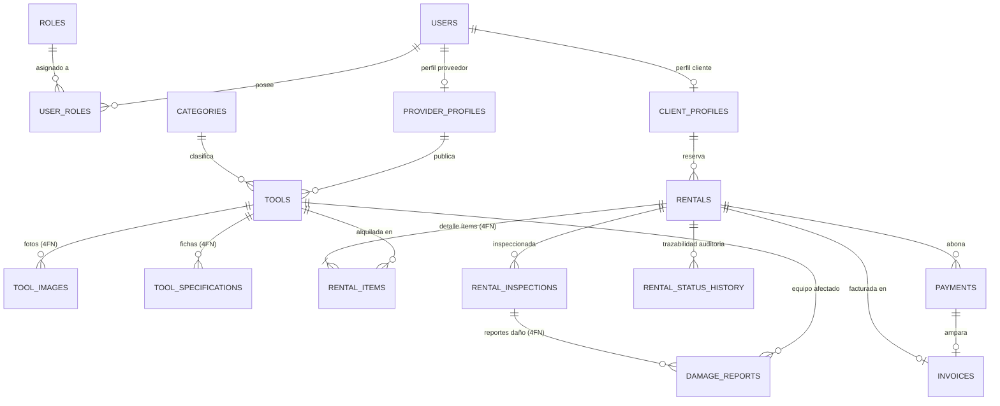

# ToolRent — Plataforma de Renta de Herramientas y Equipos de Construcción


> **ToolRent** es una plataforma integral de renta de maquinaria pesada, herramientas industriales y equipos de construcción para Colombia. Desarrollada en **Arquitectura Hexagonal** y **Domain-Driven Design (DDD)** con 8 módulos Maven desacoplados, **Spring Boot 3.4 (Java 17)**, **PostgreSQL 16**, base de datos relacional auditada y normalizada en **Cuarta Forma Normal (4FN)**, seguridad JWT stateless (RBAC), control de concurrencia optimista (`@Version`), documentación interactiva OpenAPI/Swagger, colección lista de Postman y frontend SPA con **Vite + Tailwind CSS v3**.

---

### ⚡ Accesos Rápidos
- [🚀 1. Inicialización Rápida (Docker + Backend + Swagger + Postman)](#-1-inicialización-rápida-del-proyecto)
- [🎯 2. Guía del Examen (Aprobación, Rechazo, Base de Datos y Capturas)](#-2-guía-rápida-del-examen-reservas-y-alquileres)
- [🔑 3. Cuentas y Credenciales de Prueba](#-3-cuentas-y-credenciales-de-prueba)
- [📮 4. Uso de Swagger UI y Postman](#-4-uso-de-swagger-ui-y-postman)
- [🏗️ 5. Arquitectura Hexagonal y Módulos](#-5-arquitectura-hexagonal-y-módulos-maven)
- [🗄️ 6. Modelo de Datos Relacional y 4FN](#-6-modelo-de-datos-relacional-y-normalización-4fn)
- [🚀 7. Matriz Completa de Endpoints REST](#-7-matriz-completa-de-endpoints-rest)
- [🔒 8. Decisiones de Seguridad](#-8-decisiones-de-seguridad-y-arquitectura)
- [📚 9. Documentación Detallada (Accesos Directos)](#-9-documentación-detallada-accesos-directos)

---

## 🚀 1. Inicialización Rápida del Proyecto

Sigue estos pasos para tener **todo corriendo en menos de 2 minutos** tanto en Linux como en Windows:

### Paso 1: Levantar la Base de Datos con Docker
El proyecto incluye un contenedor Docker oficial de PostgreSQL 16 configurado en el archivo `docker-compose.yml`. Desde la raíz del repositorio ejecuta:

```bash
docker compose up -d postgres
```
- **Host / Puerto:** `localhost:5434` *(mapeado para evitar colisiones con el puerto 5432 local)*.
- **Base de Datos:** `renta_herramientas_db`
- **Usuario / Contraseña:** `postgres` / `postgres`
- Verifica que el contenedor esté saludable con: `docker ps`

> 💡 *Si en la sala de computo no hay Docker y se usa PostgreSQL nativo en Linux (puerto estándar `5432`), la app arranca igual definiendo:*  
> `SPRING_DATASOURCE_URL=jdbc:postgresql://localhost:5432/renta_herramientas_db ./mvnw spring-boot:run -pl bootstrap`

---

### Paso 2: Compilar y Arrancar el Backend Spring Boot
El repositorio ya tiene `mvnw` configurado con permisos ejecutables (`100755`) y saltos de línea Unix (LF).

* **En Linux / macOS:**
  ```bash
  cd backend
  chmod +x mvnw
  ./mvnw spring-boot:run -pl bootstrap
  ```

* **En Windows (PowerShell):**
  ```powershell
  cd backend
  .\mvnw.cmd spring-boot:run -pl bootstrap
  ```

* **Para correr la suite completa de pruebas unitarias:**
  ```bash
  cd backend && ./mvnw clean test
  ```
  *(Verás `BUILD SUCCESS` con los 8 módulos compilados y 21 tests de rental en verde)*.

Al iniciar, **Flyway ejecutará automáticamente todas las migraciones (`V1` a `V6`)**, creando el esquema 4FN, las tablas de auditoría y los datos semilla iniciales.

El servidor estará listo en: **`http://localhost:8085`**  
Verificación de salud: `http://localhost:8085/api/v1/health` (`{"status":"UP"}`)

---

### Paso 3: Abrir Swagger UI (Documentación Interactiva)
Abre tu navegador en:  
👉 **`http://localhost:8085/swagger-ui.html`**

**Para autorizarte en Swagger en 15 segundos:**
1. Ve a la sección **Auth** y ejecuta `POST /api/v1/auth/login` con:
   ```json
   { "username": "prov_maquinaria_bog", "password": "Password123*" }
   ```
2. Copia el valor del campo `token` de la respuesta JSON.
3. Haz clic en el botón verde **Authorize** (arriba a la derecha).
4. Pega el token y pulsa **Authorize**. ¡Listo! Todas las llamadas que hagas en Swagger incluirán el JWT automáticamente.

---

### Paso 4: Importar y Usar en Postman
El proyecto incluye la colección completa oficial lista para usar en:  
📂 **[`docs/postman_collection.json`](docs/postman_collection.json)**

1. Abre Postman y haz clic en **Import** -> selecciona `docs/postman_collection.json`.
2. La variable `{{baseUrl}}` viene configurada en `http://localhost:8085`.
3. Ve a la carpeta **1. Autenticación (Auth)** y ejecuta **Inicio de Sesión (Login)**.
4. El script integrado guarda el token JWT automáticamente en la variable `{{token}}` para todas las peticiones protegidas.

---

### Paso 5: Levantar el Frontend Web SPA (Opcional)
Si deseas interactuar con la interfaz gráfica web conectada en tiempo real:
```bash
cd frontend
npm install
npm run dev
```
La aplicación web estará disponible en: 👉 **`http://localhost:5173/`**  
*(El modal de inicio de sesión incluye botones de acceso rápido con autollenado por roles).*

---

## 🎯 2. Guía Rápida del Examen (Reservas y Alquileres)

Resumen directo para cumplir con los requerimientos del examen práctico (aprobación, rechazo, base de datos y capturas):

### Endpoints del Examen
| Acción | Método y URL | Rol Requerido | Efecto Principal |
| :--- | :--- | :--- | :--- |
| **Aprobar Reserva** | `POST /api/reservas/{id}/aprobar` | `PROVEEDOR` o `ADMIN` | Pasa a `CONFIRMED`, revalida disponibilidad, auto-rechaza reservas en conflicto de fechas y notifica al cliente |
| **Rechazar Reserva** | `POST /api/reservas/{id}/rechazar` | `PROVEEDOR` o `ADMIN` | Pasa a `REJECTED`, registra el motivo (`reason`) y notifica al cliente |
| **Listar Pendientes** | `GET /api/reservas?status=PENDING` | `PROVEEDOR` o `ADMIN` | Lista solo reservas que esperan decisión |
| **Historial de Estados** | `GET /api/reservas/{id}/historial` | Cliente, Proveedor o Admin | Lista la trazabilidad de auditoría (`rental_status_history`) |
| **Calendario Ocupación** | `GET /api/v1/tools/{id}/calendar` | Público | Lista los rangos de fechas (`bookedRanges`) ocupados para los próximos 365 días |

---

### 📸 Paso a Paso Exacto para Tomar las 3 Capturas del Examen

```
┌──────────────────────────────────────────────────────────────────────────┐
│                   ORDEN DE EJECUCIÓN PARA EL EXAMEN                      │
├──────────────────────────────────────────────────────────────────────────┤
│ 1. POST /api/v1/auth/login        → Obtener token de prov_maquinaria_bog  │
│ 2. POST /api/v1/rentals           → Crear reserva PENDING de prueba       │
│ 3. POST /api/reservas/{id}/aprobar → [CAPTURA 1]: Status 200 + CONFIRMED  │
│ 4. SQL en DBeaver / psql          → [CAPTURA 2]: Fila en BD = CONFIRMED   │
│ 5. POST /api/reservas/{id}/rechazar→ [CAPTURA 3]: Status 200 + REJECTED   │
│ 6. git add . && git commit && push→ [REQUISITO 4]: Código en GitHub       │
└──────────────────────────────────────────────────────────────────────────┘
```

#### 📸 CAPTURA 1: Postman - Aprobar Reserva Exitosa
1. Haz login como proveedor (`prov_maquinaria_bog` / `Password123*`) y copia el token.
2. Si no tienes una reserva pendiente, crea una rápida como cliente (`cliente_carlos_gomez`) vía `POST /api/v1/rentals` o usando el atajo SQL de abajo.
3. Ejecuta:
   - **Método:** `POST`
   - **URL:** `http://localhost:8085/api/reservas/{id}/aprobar`
   - **Header:** `Authorization: Bearer <TOKEN_PROVEEDOR>`
   - **Body:** Vacío.
4. **Respuesta:** Status `200 OK` con `"status": "CONFIRMED"`.
> 📷 **En la captura:** Muestra el método POST, la URL, el Status 200 verde y el JSON con `"status": "CONFIRMED"`.

#### 📸 CAPTURA 2: Base de Datos - DBeaver / pgAdmin / psql
Abre DBeaver (o consola `psql`) conectado a `localhost:5434` (base `renta_herramientas_db`) y ejecuta:
```sql
SELECT id, rental_code, status, total_amount, updated_at 
FROM rentals 
WHERE id = '<ID_DE_TU_RESERVA>';
```
> 📷 **En la captura:** Muestra la fila de la consulta con la columna `status` en **`CONFIRMED`**.  
> *(Puntos extra: muestra también `SELECT * FROM rental_status_history WHERE rental_id = '...';` para evidenciar la auditoría de estados).*

#### 📸 CAPTURA 3: Postman - Rechazar Reserva con Motivo
1. Sobre otra reserva en estado `PENDING`, ejecuta:
   - **Método:** `POST`
   - **URL:** `http://localhost:8085/api/reservas/{id}/rechazar`
   - **Headers:** `Authorization: Bearer <TOKEN_PROVEEDOR>` y `Content-Type: application/json`
   - **Body (raw JSON):**
     ```json
     {
       "reason": "Herramienta comprometida en mantenimiento preventivo no programado"
     }
     ```
2. **Respuesta:** Status `200 OK` con `"status": "REJECTED"` y `"rejectionReason": "Herramienta comprometida en mantenimiento preventivo..."`.
> 📷 **En la captura:** Muestra el método POST, la URL, el Status 200 verde y el JSON con `"status": "REJECTED"` y `"rejectionReason"`.

---

### 💡 Atajo SQL para Insertar una Reserva PENDING en 2 segundos
Si deseas tener una reserva lista para aprobar sin pasar por el formulario de cliente, ejecuta esto en DBeaver:
```sql
INSERT INTO rentals (id, rental_code, client_id, start_date, end_date, total_days, subtotal, deposit, total_amount, status, created_at, updated_at)
VALUES ('a1b2c3d4-e5f6-7890-abcd-1234567890ab', 'RNT-EXAMEN-001', 'e0000000-0000-0000-0000-000000000001', '2026-11-01', '2026-11-05', 4, 340000.00, 480000.00, 820000.00, 'PENDING', NOW(), NOW())
ON CONFLICT (id) DO UPDATE SET status = 'PENDING';

INSERT INTO rental_items (id, rental_id, tool_id, daily_price, total_price, status)
VALUES ('b1b2c3d4-e5f6-7890-abcd-1234567890ab', 'a1b2c3d4-e5f6-7890-abcd-1234567890ab', '11111111-0000-0000-0000-000000000001', 85000.00, 340000.00, 'RESERVED')
ON CONFLICT (id) DO NOTHING;
```
*(UUID para aprobar/rechazar en Postman: `a1b2c3d4-e5f6-7890-abcd-1234567890ab`)*.

---

### 🛡️ Reglas de Negocio Robustas que suman puntos
- **409 Conflict:** Si la herramienta ya está reservada en esas fechas por otra reserva aprobada, responde `409 Conflict` con `HerramientaNoDisponibleException` (en lugar de un 400 genérico).
- **400 Bad Request:** Si intentas aprobar o rechazar una reserva que ya no está en `PENDING` (evita aprobaciones dobles).
- **403 Forbidden:** Si un proveedor intenta aprobar un alquiler sobre herramientas de otra empresa (protección Anti-IDOR con `ProviderOwnershipGuard`).
- **Auto-Rechazo en Cascada:** Al aprobar una reserva, cualquier otra reserva `PENDING` que compita por las mismas herramientas en fechas superpuestas se rechaza automáticamente.
- **Control de Concurrencia Optimista:** Con `@Version` en `RentalJpaEntity` para evitar colisiones entre administradores/proveedores concurrentes (*lost update*).
- **Expiración Automática (`@Scheduled`):** Tarea programada cada hora que rechaza reservas pendientes con más de 48 horas de antigüedad.

---

## 🔑 3. Cuentas y Credenciales de Prueba

La base de datos se inicializa con **4 usuarios oficiales**, **5 herramientas activas del proveedor** y **0 alquileres** para realizar pruebas limpias:

> **Contraseña universal para todas las cuentas semilla:** `Password123*`

| Rol | Usuario (`username`) | Correo Electrónico | Perfil / Empresa | ID Perfil (BD) |
| :--- | :--- | :--- | :--- | :--- |
| **ADMIN** | `admin_principal` | `admin@rentaequipos.com` | Administrador General | `a0000000-0000-0000-0000-000000000001` |
| **PROVEEDOR** | `prov_maquinaria_bog` | `contacto@maquinariabogota.com` | Maquinaria y Equipos Bogotá S.A.S. | `d0000000-0000-0000-0000-000000000001` |
| **CLIENTE 1** | `cliente_carlos_gomez` | `carlos.gomez@constructora.com` | Carlos Alberto Gómez Peña | `e0000000-0000-0000-0000-000000000001` |
| **CLIENTE 2** | `cliente_maria_rodriguez` | `maria.rodriguez@ingenieria.com` | María Camila Rodríguez León | `e0000000-0000-0000-0000-000000000002` |

---

## 📮 4. Uso de Swagger UI y Postman

### Mapeo de Puertos y Servicios
| Servicio / Componente | Puerto Local | URL / Host | Descripción |
| :--- | :---: | :--- | :--- |
| **PostgreSQL 16** | `5434` | `localhost:5434` | Base de datos relacional 4FN (`renta_herramientas_db`) |
| **Spring Boot API** | `8085` | `http://localhost:8085/api/v1` | API REST Spring Boot 3 con JWT |
| **Swagger UI** | `8085` | `http://localhost:8085/swagger-ui.html` | Documentación interactiva OpenAPI con Bearer Auth |
| **Actuator Health** | `8085` | `http://localhost:8085/api/v1/health` | Estado del backend (`{"status":"UP"}`) |
| **Frontend Web SPA** | `5173` | `http://localhost:5173/` | Single Page Application Vite + Tailwind CSS |

---

## 🏗️ 5. Arquitectura Hexagonal y Módulos Maven

El backend se organiza en **8 módulos Maven desacoplados** según la arquitectura de Puertos y Adaptadores (Hexagonal) y Domain-Driven Design (DDD):

```
backend/
├── pom.xml                 # Reactor POM padre (Spring Boot 3.4.x / Java 17)
├── shared-kernel/          # Value Objects (Money, DateRange), Eventos de Dominio y Excepciones
├── identity/               # Usuarios, Roles (RBAC), Autenticación JWT y Perfiles
├── catalog/                # Herramientas, Categorías, Fichas Técnicas, Fotos y Seguridad Anti-IDOR
├── rental/                 # Alquileres, Reservas (Aprobar/Rechazar), Historial, Inspecciones y Schedulers
├── billing/                # Pagos, Facturas legales con IVA (19%) y Recargos por mora
├── reporting/              # Informes analíticos, KPIs de proveedor y reportes financieros
└── bootstrap/              # Punto de entrada (@SpringBootApplication), Migraciones Flyway y Configuración
```

---

## 🗄️ 6. Modelo de Datos Relacional y Normalización 4FN

El modelo cumple con la **Cuarta Forma Normal (4FN)**, eliminando dependencias multivaluadas y redundancia:



---

## 🚀 7. Matriz Completa de Endpoints REST

| Módulo | Método | Endpoint | Rol / Acceso | Descripción |
| :--- | :---: | :--- | :--- | :--- |
| **Auth** | `POST` | `/api/v1/auth/register` | Público | Registro de cliente o proveedor |
| **Auth** | `POST` | `/api/v1/auth/login` | Público | Autenticación y obtención de JWT |
| **Users** | `GET` | `/api/v1/users/me` | Autenticado | Perfil y roles del usuario actual |
| **Users** | `GET` | `/api/v1/users` | `ADMIN` | Listado general de usuarios |
| **Users** | `PUT` | `/api/v1/users/{id}` | `ADMIN` | **Cambiar rol o email de un usuario** |
| **Catalog** | `GET` | `/api/v1/tools` | Público | Catálogo con filtros (`status`, `category`, `search`) |
| **Catalog** | `GET` | `/api/v1/tools/{id}/availability` | Público | Disponibilidad por rango de fechas (`?from=&to=`) |
| **Catalog** | `GET` | `/api/v1/tools/{id}/calendar` | Público | **Calendario de rangos ocupados (`bookedRanges`) a 365 días** |
| **Catalog** | `POST` | `/api/v1/tools` | `PROVEEDOR`, `ADMIN` | Registrar nueva herramienta |
| **Catalog** | `PUT` | `/api/v1/tools/{id}` | `PROVEEDOR`, `ADMIN` | Actualizar herramienta |
| **Catalog** | `DELETE` | `/api/v1/tools/{id}` | `PROVEEDOR`, `ADMIN` | Eliminar herramienta |
| **Rental** | `POST` | `/api/v1/rentals` | `CLIENTE` | Crear solicitud de reserva (`PENDING`) |
| **Rental** | `POST` | `/api/reservas/{id}/aprobar` | `PROVEEDOR`, `ADMIN` | **Aprobar reserva (`PENDING` -> `CONFIRMED`)** |
| **Rental** | `POST` | `/api/reservas/{id}/rechazar` | `PROVEEDOR`, `ADMIN` | **Rechazar reserva con motivo (`PENDING` -> `REJECTED`)** |
| **Rental** | `GET` | `/api/reservas` | `PROVEEDOR`, `ADMIN` | Listar reservas (filtro `?status=PENDING`) |
| **Rental** | `GET` | `/api/reservas/{id}/historial` | Autenticado | **Historial y trazabilidad de cambios de estado** |
| **Rental** | `PATCH` | `/api/v1/rentals/{id}/confirm` | `PROVEEDOR`, `ADMIN` | Confirmar reserva (delega en aprobarReserva) |
| **Rental** | `PATCH` | `/api/v1/rentals/{id}/start` | `PROVEEDOR`, `ADMIN` | Entrega de equipo (pasa a `IN_PROGRESS`) |
| **Rental** | `PATCH` | `/api/v1/rentals/{id}/complete` | `PROVEEDOR`, `ADMIN` | Devolución, cálculo de recargo por mora y liberación |
| **Rental** | `PATCH` | `/api/v1/rentals/{id}/cancel` | Autenticado | Cancelación (regla de 24h previas para cliente) |
| **Rental** | `PATCH` | `/api/v1/rentals/{id}/extend` | Autenticado | Extender reserva recalculando tarifas |
| **Billing** | `POST` | `/api/v1/billing/payments` | `CLIENTE` | Procesar pago y emitir factura legal con IVA (19%) |
| **Billing** | `GET` | `/api/v1/billing/invoices/{id}/html` | Autenticado | Factura en HTML imprimible (`@media print`) |
| **Reporting** | `GET` | `/api/v1/reporting/provider/{providerId}` | `PROVEEDOR`, `ADMIN` | KPIs: equipos, rentas activas, ganancias y pendientes |

---

## 🔒 8. Decisiones de Seguridad y Arquitectura

1. **Control de Acceso Basado en Roles (RBAC):** Protegido con `@PreAuthorize("hasAnyRole(...)")` en adaptadores REST y filtrado por roles en JWT.
2. **Mitigación Anti-IDOR (`ProviderOwnershipGuard`):** Valida que un proveedor solo pueda aprobar, rechazar o inspeccionar alquileres que incluyan herramientas de su propia empresa.
3. **Control de Concurrencia Optimista (`@Version`):** En `RentalJpaEntity` para prevenir *lost updates* si dos operadores intentan aprobar la misma reserva simultáneamente.
4. **Protección en Registro Público:** `/api/v1/auth/register` restringe la creación exclusivamente a `ROLE_CLIENTE` o `ROLE_PROVEEDOR`. Es imposible auto-asignarse `ROLE_ADMIN`.
5. **CORS Abierto para SPAs:** Configurado en `SecurityConfig.java` para permitir peticiones desde cualquier origen local (`localhost:5173`, `localhost:3000`).

---

## 📚 9. Documentación Detallada (Accesos Directos)

Para temas específicos que el profesor o evaluador pueda consultar, usa estos accesos directos:

- 🐧 **[Guía Maestra para Linux y Postman](docs/GUIA_PASO_A_PASO_EXAMEN_LINUX_POSTMAN.md):** Manual detallado de comandos de terminal Ubuntu, verificación de dependencias y paso a paso con las 3 capturas obligatorias.
- 👥 **[Guía de Roles y Migraciones Flyway](docs/GUIA_ROLES_Y_MIGRACIONES.md):** Cómo cambiar el rol de un usuario a ADMIN desde Swagger y cómo crear una nueva migración Flyway (`V7`).
- 🗄️ **[Documentación de Base de Datos y 4FN](db/README.md):** Justificación matemática y normalización en Cuarta Forma Normal con scripts para PostgreSQL y MySQL.
- 🚀 **[Guía de Despliegue en Ubuntu Linux](docs/GUIA_DESPLIEGUE_UBUNTU.md):** Automatización de instalación y despliegue en servidores Debian/Ubuntu.
