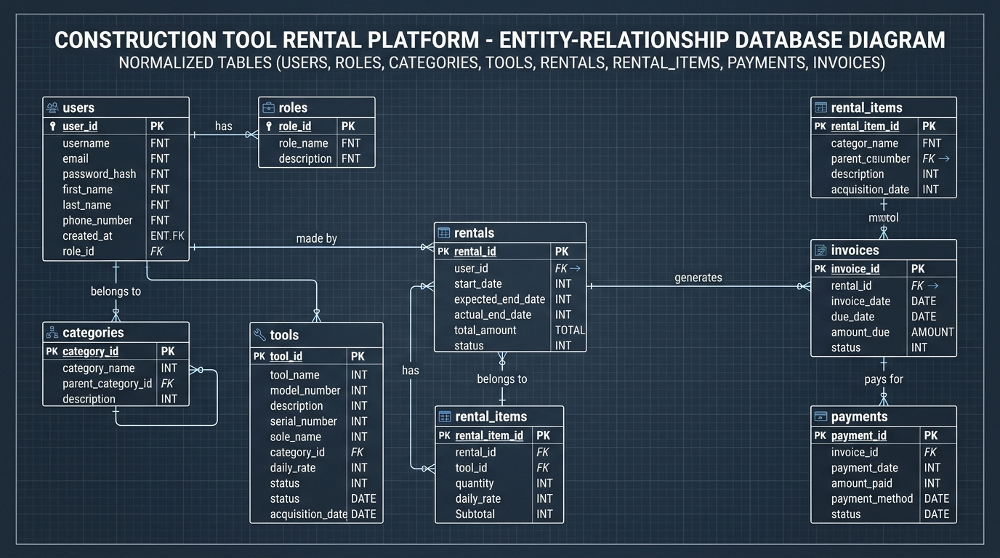
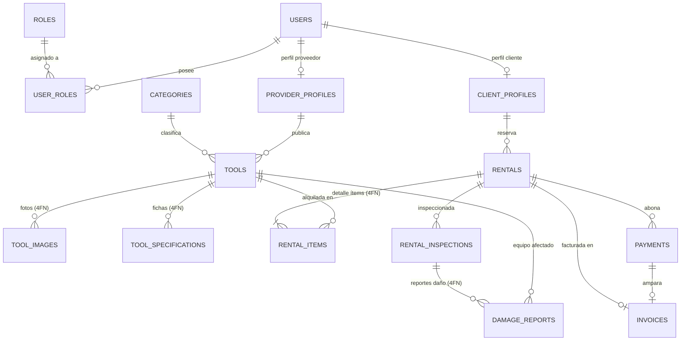

# Campus Renta Equipos - Proyecto Spring Boot

Sistema de alquiler de herramientas industriales utilizando Arquitectura Hexagonal y Spring Boot 3, modularizado por dominio (`identity`, `catalog`, `rental`, `billing`, `reporting`).

## Tecnologías Principales
- **Java 21**
- **Spring Boot 3.3.x**
  - Spring Web
  - Spring Data JPA
  - Spring Security (JWT)
  - Spring Boot Actuator
- **PostgreSQL 16**
- **Flyway** (Migraciones de base de datos)
- **Docker & Docker Compose**
- **Swagger / OpenAPI 3** para documentación interactiva de APIs
- **Maven** (Multi-módulo)

## Diagrama Relacional (Modelo de Datos)





## Cómo Clonar y Ejecutar
### Pre-requisitos
- Docker y Docker Compose instalados.
- JDK 21 (si deseas compilar localmente fuera de Docker).
- Maven 3.9+ (opcional, el contenedor usa multistage con Maven).

### Pasos
1. **Clonar el Repositorio**
```bash
git clone https://github.com/andresguerra321/proyecto-springboot.git
cd proyecto-springboot
```

2. **Ejecutar con Docker Compose**
El proyecto contiene un `docker-compose.yml` en la raíz. Solo necesitas ejecutar:
```bash
docker-compose up -d --build
```
Esto levantará la base de datos PostgreSQL, ejecutará las migraciones de Flyway automáticamente y desplegará la API en el puerto `8085`.

## Ejemplo de `application.yml` (Configuración Principal)
El archivo principal está en `backend/bootstrap/src/main/resources/application.yml`:

```yaml
server:
  port: 8080

spring:
  application:
    name: renta-equipos-api
  datasource:
    url: jdbc:postgresql://${DB_HOST:localhost}:${DB_PORT:5432}/${DB_NAME:renta_herramientas_db}
    username: ${DB_USER:postgres}
    password: ${DB_PASSWORD:postgres123}
    driver-class-name: org.postgresql.Driver
  jpa:
    hibernate:
      ddl-auto: validate
    show-sql: true
    properties:
      hibernate:
        format_sql: true
  flyway:
    enabled: true
    baseline-on-migrate: true

application:
  security:
    jwt:
      secret-key: ${JWT_SECRET:404E635266556A586E3272357538782F413F4428472B4B6250645367566B5970}
      expiration: 86400000 # 1 dia
```

## Autenticación, Roles y Swagger
El sistema utiliza **JWT (JSON Web Tokens)** para la seguridad de las rutas, dividiendo el acceso con los roles `ADMIN`, `PROVEEDOR` y `CLIENTE`.

**Rutas Públicas (No requieren Token):**
- `/api/v1/auth/register`: Registro de usuarios.
- `/api/v1/auth/login`: Autenticación para obtener el JWT.
- `GET /api/v1/tools/**`: Exploración pública del catálogo de herramientas y categorías.
- Rutas de Swagger y Documentación: `/swagger-ui/**`, `/v3/api-docs/**`.

**Explicación de Roles:**
- **CLIENTE:** Puede explorar herramientas, crear solicitudes de reserva, realizar pagos en línea y consultar sus facturas.
- **PROVEEDOR:** Puede crear, modificar (`PUT`) y eliminar (`DELETE`) herramientas de su inventario, así como gestionar solicitudes de reserva.
- **ADMIN:** Tiene acceso total, administra usuarios (`GET /api/v1/users`), supervisa alquileres y consulta reportes avanzados de rentabilidad.

### Uso de JWT en Swagger
1. Visita Swagger UI en: `http://localhost:8085/swagger-ui.html`
2. Ejecuta `POST /api/v1/auth/login` con tus credenciales.
3. Copia el token del campo `token` de la respuesta JSON.
4. Haz clic en el botón verde **"Authorize"** en Swagger UI.
5. Pega el token (Swagger lo enviará automáticamente como `Bearer <token>`).

---

## 🚀 Matriz Completa de Endpoints REST

| Módulo | Método | Endpoint | Rol / Acceso | Descripción |
| :--- | :---: | :--- | :--- | :--- |
| **Auth** | `POST` | `/api/v1/auth/register` | Público | Registro de cliente o proveedor |
| **Auth** | `POST` | `/api/v1/auth/login` | Público | Autenticación y obtención de JWT |
| **Users** | `GET` | `/api/v1/users/me` | Autenticado | Perfil y roles del usuario actual |
| **Users** | `GET` | `/api/v1/users` | `ADMIN` | Listado general de usuarios |
| **Catalog** | `GET` | `/api/v1/tools` | Público | Catálogo con filtros (`status`, `categoryId`, `search`) |
| **Catalog** | `GET` | `/api/v1/tools/categories` | Público | Listado maestro de categorías |
| **Catalog** | `GET` | `/api/v1/tools/{id}` | Público | Detalle técnico e imágenes de equipo |
| **Catalog** | `POST` | `/api/v1/tools` | `PROVEEDOR`, `ADMIN` | Registrar nueva herramienta |
| **Catalog** | `PUT` | `/api/v1/tools/{id}` | `PROVEEDOR`, `ADMIN` | Actualizar herramienta existente |
| **Catalog** | `DELETE` | `/api/v1/tools/{id}` | `PROVEEDOR`, `ADMIN` | Eliminar herramienta del catálogo |
| **Rental** | `POST` | `/api/v1/rentals` | `CLIENTE` | Crear nueva reserva de herramientas |
| **Rental** | `GET` | `/api/v1/rentals` | Autenticado | Listar reservas del sistema |
| **Rental** | `GET` | `/api/v1/rentals/{id}` | Autenticado | Detalle de reserva e ítems |
| **Rental** | `GET` | `/api/v1/rentals/client/{clientId}` | Autenticado | Historial de reservas de un cliente |
| **Rental** | `PATCH` | `/api/v1/rentals/{id}/confirm` | `PROVEEDOR`, `ADMIN` | Confirmar reserva |
| **Rental** | `PATCH` | `/api/v1/rentals/{id}/start` | `PROVEEDOR`, `ADMIN` | Entrega de equipo (pasa a `IN_PROGRESS`) |
| **Rental** | `PATCH` | `/api/v1/rentals/{id}/complete` | `PROVEEDOR`, `ADMIN` | Devolución y cierre (libera herramientas) |
| **Rental** | `PATCH` | `/api/v1/rentals/{id}/cancel` | Autenticado | Cancelar reserva (libera herramientas) |
| **Billing** | `POST` | `/api/v1/billing/payments` | Autenticado | Procesar pago y emitir factura |
| **Billing** | `GET` | `/api/v1/billing/payments/{id}` | Autenticado | Consultar recibo de pago |
| **Billing** | `GET` | `/api/v1/billing/invoices/{id}` | Autenticado | Consultar factura legal (con IVA 19%) |
| **Billing** | `GET` | `/api/v1/billing/invoices/rental/{rentalId}` | Autenticado | Factura asociada a una reserva |
| **Reporting** | `GET` | `/api/v1/reporting/income` | `ADMIN` | Reporte financiero de ingresos |
| **Reporting** | `GET` | `/api/v1/reporting/most-rented-tools` | `ADMIN` | Top herramientas más rentadas |
| **Reporting** | `GET` | `/api/v1/reporting/frequent-clients` | `ADMIN` | Top clientes con más alquileres |

---

## 🧪 Pruebas del Sistema

### 1. Colección de Postman
Encuentra la colección lista para importar en:
📂 [`docs/postman_collection.json`](docs/postman_collection.json)

> **Tip:** Al ejecutar la petición *Login* en Postman, el script integrado guarda el token JWT automáticamente en la variable `{{token}}` para todas las peticiones protegidas.

### 2. Pruebas Unitarias con Maven
Para ejecutar la suite de pruebas unitarias automatizadas (Value Objects, UseCases y Domain Services) sin necesidad de levantar Docker:
```bash
cd backend
./mvnw clean test
```
*(En Windows usa `mvnw.cmd clean test`)*

---
Consulta [COMPILACION.md](docs/COMPILACION.md) para más detalles del empaquetado, y [DESPLIEGUE.md](docs/DESPLIEGUE.md) para las estrategias de despliegue desde cero.

