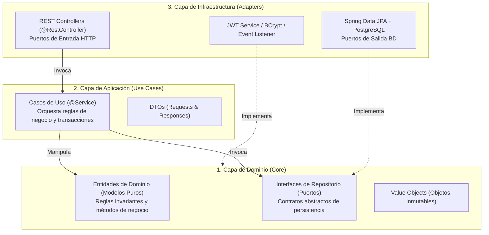
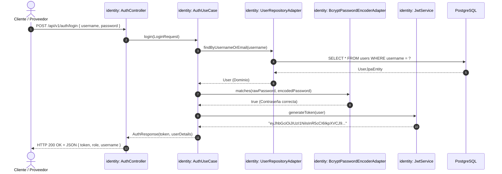
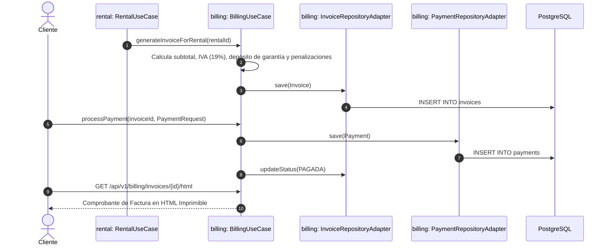

# MANUAL EXHAUSTIVO Y DICCIONARIO COMPLETO DEL BACKEND
## Plataforma de Renta de Herramientas y Equipos de Construcción

> **Versión del Sistema:** 1.0.0-SNAPSHOT  
> **Tecnologías Base:** Java 17, Spring Boot 3.4.3, PostgreSQL 16, Spring Security 6 + JJWT, Flyway Database Migrations, Springdoc OpenAPI 3 (Swagger UI).  
> **Patrones de Arquitectura:** Domain-Driven Design (DDD), Clean / Hexagonal Architecture (Ports & Adapters), Multi-Module Maven Monorepo.

---

## TABLA DE CONTENIDOS

1. [Fundamentos y Filosofía de Arquitectura](#1-fundamentos-y-filosof%C3%ADa-de-arquitectura)
   - 1.1 [Por qué un Proyecto Multi-Módulo Maven](#11-por-qu%C3%A9-un-proyecto-multi-m%C3%B3dulo-maven)
   - 1.2 [Principios de Arquitectura Hexagonal (Puertos y Adaptadores)](#12-principios-de-arquitectura-hexagonal-puertos-y-adaptadores)
   - 1.3 [Estructura Universal de un Módulo Hexagonal](#13-estructura-universal-de-un-m%C3%B3dulo-hexagonal)
   - 1.4 [Matriz de Dependencias entre Bounded Contexts](#14-matriz-de-dependencias-entre-bounded-contexts)
2. [Módulo Padre: renta-equipos-parent](#2-m%C3%B3dulo-padre-renta-equipos-parent)
3. [Módulo: shared-kernel](#3-m%C3%B3dulo-shared-kernel-n%C3%BAcleo-compartido)
4. [Módulo: identity](#4-m%C3%B3dulo-identity-identidad-perfiles-seguridad-y-notificaciones)
5. [Módulo: catalog](#5-m%C3%B3dulo-catalog-cat%C3%A1logo-de-herramientas-y-equipos)
6. [Módulo: rental](#6-m%C3%B3dulo-rental-ciclo-de-vida-de-alquileres-inspecciones-y-garant%C3%ADas)
7. [Módulo: billing](#7-m%C3%B3dulo-billing-facturaci%C3%B3n-pagos-y-conciliaci%C3%B3n)
8. [Módulo: reporting](#8-m%C3%B3dulo-reporting-anal%C3%ADtica-y-tableros-de-control)
9. [Módulo: bootstrap](#9-m%C3%B3dulo-bootstrap-ensamblador-y-servidor-ejecutable)
10. [Flujos de Negocio Extremo a Extremo (End-to-End Traces)](#10-flujos-de-negocio-extremo-a-extremo-end-to-end-traces)
    - 10.1 [Flujo 1: Registro, Autenticación y Emisión de JWT](#101-flujo-1-registro-autenticaci%C3%B3n-y-emisi%C3%B3n-de-jwt)
    - 10.2 [Flujo 2: Consulta de Catálogo y Reserva de Maquinaria](#102-flujo-2-consulta-de-cat%C3%A1logo-y-reserva-de-maquinaria)
    - 10.3 [Flujo 3: Aprobación, Entrega Física e Inspección de Salida](#103-flujo-3-aprobaci%C3%B3n-entrega-f%C3%ADsica-e-inspecci%C3%B3n-de-salida)
    - 10.4 [Flujo 4: Devolución, Reporte de Averías y Reclamos de Garantía](#104-flujo-4-devoluci%C3%B3n-reporte-de-aver%C3%ADas-y-reclamos-de-garant%C3%ADa)
    - 10.5 [Flujo 5: Facturación, Pagos y Conciliación Financiera](#105-flujo-5-facturaci%C3%B3n-pagos-y-conciliaci%C3%B3n-financiera)
11. [Glosario y Guía Rápida para Desarrolladores](#11-glosario-y-gu%C3%ADa-r%C3%A1pida-para-desarrolladores)

---

## 1. FUNDAMENTOS Y FILOSOFÍA DE ARQUITECTURA

### 1.1 Por qué un Proyecto Multi-Módulo Maven

El backend no está empaquetado como un monolito plano tradicional en el que todas las clases conviven en un único paquete `com.campus`. En su lugar, utiliza un **monorepo multi-módulo Maven**:

```
backend/
├── pom.xml                  (Parent POM - Define versiones y módulos)
├── shared-kernel/           (Módulo JAR de utilidades transversales)
├── identity/                (Módulo JAR de usuarios, JWT y seguridad)
├── catalog/                 (Módulo JAR de herramientas y categorías)
├── rental/                  (Módulo JAR de alquileres e inspecciones)
├── billing/                 (Módulo JAR de facturación y comprobantes)
├── reporting/               (Módulo JAR de reportes y analítica)
└── bootstrap/               (Módulo JAR ejecutable que agrupa a todos)
```

#### Beneficios Arquitecturales Clave:
1. **Desacoplamiento Estricto:** Si una clase en el módulo `catalog` intenta usar directamente una clase interna de `billing` sin que exista una relación formal, **el compilador de Maven bloquea la compilación inmediatamente**. Esto previene código espagueti.
2. **Independencia de Dominio:** Cada módulo tiene su propio ciclo de pruebas unitarias.
3. **Preparado para Microservicios:** Si el tráfico del sistema crece y se desea separar `catalog` o `billing` en servicios Cloud independientes (como microservicios en Kubernetes o AWS ECS), no es necesario reescribir la lógica; la carpeta ya está 100% aislada.
4. **Compilación y Empaquetado Limpio:** Solo el módulo `bootstrap` genera el `fat JAR` final con el servidor embebido Tomcat. Los demás módulos compilan como librerías ligeras (`.jar`).

---

### 1.2 Principios de Arquitectura Hexagonal (Puertos y Adaptadores)

Cada uno de los módulos de negocio (`identity`, `catalog`, `rental`, `billing`, `reporting`) sigue la **Regla de Dependencia de la Arquitectura Limpia**:

> *Las capas externas dependen de las internas. El dominio NUNCA depende de la base de datos, de la web, ni de ningún framework.*



---

### 1.3 Estructura Universal de un Módulo Hexagonal

Cualquier módulo del sistema presenta la siguiente división de directorios bajo `src/main/java/com/campus/rentaequipos/<modulo>/`:

| Carpeta | Capa | Función Arquitectural |
|---|---|---|
| `domain/model/` | **Dominio** | Entidades de negocio en Java puro. Contienen los estados válidos, transiciones y validaciones intrínsecas del negocio sin anotaciones de persistencia (`@Table`). |
| `domain/repository/` | **Dominio** | **Puertos de salida**. Interfaces Java puras (ej. `RentalRepository`) que declaran qué operaciones necesita el dominio (`save`, `findById`, etc.) sin importar si la BD es PostgreSQL, MongoDB o memoria. |
| `domain/port/` | **Dominio** | Contratos de servicios de infraestructura que el dominio requiere (ej. `PasswordEncoderPort`, `JwtTokenPort`). |
| `application/usecase/` | **Aplicación** | Clases de servicio con anotaciones `@Service` y `@Transactional`. Reciben DTOs, consultan o persisten mediante los puertos del dominio, hacen cumplir las reglas de negocio y emiten eventos. |
| `application/dto/` | **Aplicación** | Clases `Request` y `Response` (POJOs o Records) con validaciones `@NotNull`, `@NotBlank`, `@Positive`. Aíslan a los clientes externos del modelo interno. |
| `infrastructure/adapter/in/web/` o `rest/` | **Infraestructura** | Controladores `@RestController`. Adaptan solicitudes HTTP JSON en llamadas a métodos de los casos de uso y retornan respuestas con códigos de estado HTTP (200, 201, 204, etc.). |
| `infrastructure/adapter/out/persistence/` | **Infraestructura** | **Adaptadores de salida**. Implementan las interfaces de repositorio del dominio utilizando Spring Data JPA y mapean los datos hacia y desde las entidades de la base de datos. |
| `infrastructure/adapter/out/persistence/entity/` | **Infraestructura** | Entidades mapeadas con JPA (`@Entity`, `@Table`, `@Column`, `@Id`). Representan fielmente el esquema relacional en PostgreSQL. |
| `infrastructure/adapter/out/persistence/repository/` | **Infraestructura** | Interfaces de Spring Data que extienden `JpaRepository<Entity, ID>` para generar consultas SQL automáticas. |

---

### 1.4 Matriz de Dependencias entre Bounded Contexts

```
+------------------+--------------------------------------------------------------+
| Módulo           | Depende de (Maven Dependencies en pom.xml)                   |
+------------------+--------------------------------------------------------------+
| shared-kernel    | Ninguno (Dependencias estándar: Lombok, Validation)          |
| identity         | shared-kernel                                                |
| catalog          | shared-kernel                                                |
| rental           | shared-kernel, catalog (para validar herramientas)           |
| billing          | shared-kernel, rental (para liquidar alquileres)             |
| reporting        | shared-kernel, rental, catalog, billing, identity            |
| bootstrap        | TODOS los módulos anteriores (ensamblador ejecutable)        |
+------------------+--------------------------------------------------------------+
```

---

## Módulo Padre: renta-equipos-parent

> **Ubicación en el Proyecto:** [`backend`](file:///C:/Users/andre/OneDrive/Escritorio/proyectos/CAMPUS/proyecto springboot/backend)  
> **Contexto de Negocio:** Orquestación de versiones y gestión centralizada de dependencias Maven.  
> **Propósito:** Contenedor multimodular superior del proyecto backend. Centraliza el ciclo de compilación de Maven y asegura compatibilidad estricta de versiones.

### 📄 Archivo de Configuración de Módulo: [pom.xml](file:///C:/Users/andre/OneDrive/Escritorio/proyectos/CAMPUS/proyecto springboot/backend/pom.xml)

- **Ubicación:** `backend/pom.xml`
- **Rol:** Define el identificador del artefacto Maven (`<artifactId>`), empaquetado (`jar` o `pom`) y las dependencias directas del módulo.

#### Responsabilidades del POM Padre:
1. **Gestión de Versiones Centralizadas (`<properties>`):** Fija Java en versión `17`, Spring Boot en `3.4.3`, JJWT en `0.12.6`, Springdoc OpenAPI en `2.8.5` y Flyway en `10.20.1`.
2. **Declaración de Submódulos (`<modules>`):** Declara los 7 submódulos (`shared-kernel`, `identity`, `catalog`, `rental`, `billing`, `reporting`, `bootstrap`).
3. **Gestión de Dependencias (`<dependencyManagement>`):** Permite que los submódulos importen dependencias compartidas sin necesidad de especificar la versión en cada uno de ellos, garantizando coherencia en todo el build.


## Módulo: shared-kernel (Núcleo Compartido)

> **Ubicación en el Proyecto:** [`backend/shared-kernel`](file:///C:/Users/andre/OneDrive/Escritorio/proyectos/CAMPUS/proyecto springboot/backend/shared-kernel)  
> **Contexto de Negocio:** Transversal a todos los Bounded Contexts.  
> **Propósito:** Aloja componentes de dominio comunes, objetos de valor inmutables, excepciones universales de negocio y el interceptor global de errores REST.

### 📄 Archivo de Configuración de Módulo: [pom.xml](file:///C:/Users/andre/OneDrive/Escritorio/proyectos/CAMPUS/proyecto springboot/backend/shared-kernel/pom.xml)

- **Ubicación:** `backend/shared-kernel/pom.xml`
- **Rol:** Define el identificador del artefacto Maven (`<artifactId>`), empaquetado (`jar` o `pom`) y las dependencias directas del módulo.

### 📂 Estructura de Directorios del Módulo

#### 📁 Directorio: `backend/shared-kernel/src/main/java/com/campus/rentaequipos/shared/domain/event`
*Contiene 1 archivo(s) de código Java pertenecientes a la capa de **Dominio**.*  

##### 📄 [NotificationEvent.java](file:///C:/Users/andre/OneDrive/Escritorio/proyectos/CAMPUS/proyecto springboot/backend/shared-kernel/src/main/java/com/campus/rentaequipos/shared/domain/event/NotificationEvent.java)
- **Ruta Relativa:** `backend/shared-kernel/src/main/java/com/campus/rentaequipos/shared/domain/event/NotificationEvent.java`
- **Capa Arquitectural:** `Dominio`
- **Rol / Tipo:** `Evento de Dominio (Domain Event)`
- **Descripción de Funcionamiento:**
  Evento de dominio publicado a través del bus de eventos de Spring cuando ocurre una acción significativa en el sistema (ej. creación de alquiler, cambio de estado), desacoplando a los emisores de los suscriptores.

#### 📁 Directorio: `backend/shared-kernel/src/main/java/com/campus/rentaequipos/shared/domain/exception`
*Contiene 3 archivo(s) de código Java pertenecientes a la capa de **Dominio**.*  

##### 📄 [BusinessRuleViolationException.java](file:///C:/Users/andre/OneDrive/Escritorio/proyectos/CAMPUS/proyecto springboot/backend/shared-kernel/src/main/java/com/campus/rentaequipos/shared/domain/exception/BusinessRuleViolationException.java)
- **Ruta Relativa:** `backend/shared-kernel/src/main/java/com/campus/rentaequipos/shared/domain/exception/BusinessRuleViolationException.java`
- **Capa Arquitectural:** `Dominio`
- **Rol / Tipo:** `Excepción de Dominio`
- **Descripción de Funcionamiento:**
  Excepción personalizada de dominio que se dispara cuando una regla o invariante de negocio es vulnerada, permitiendo al manejador global interceptarla y devolver una respuesta semántica HTTP adecuada.

##### 📄 [DomainException.java](file:///C:/Users/andre/OneDrive/Escritorio/proyectos/CAMPUS/proyecto springboot/backend/shared-kernel/src/main/java/com/campus/rentaequipos/shared/domain/exception/DomainException.java)
- **Ruta Relativa:** `backend/shared-kernel/src/main/java/com/campus/rentaequipos/shared/domain/exception/DomainException.java`
- **Capa Arquitectural:** `Dominio`
- **Rol / Tipo:** `Excepción de Dominio`
- **Descripción de Funcionamiento:**
  Excepción personalizada de dominio que se dispara cuando una regla o invariante de negocio es vulnerada, permitiendo al manejador global interceptarla y devolver una respuesta semántica HTTP adecuada.

##### 📄 [EntityNotFoundException.java](file:///C:/Users/andre/OneDrive/Escritorio/proyectos/CAMPUS/proyecto springboot/backend/shared-kernel/src/main/java/com/campus/rentaequipos/shared/domain/exception/EntityNotFoundException.java)
- **Ruta Relativa:** `backend/shared-kernel/src/main/java/com/campus/rentaequipos/shared/domain/exception/EntityNotFoundException.java`
- **Capa Arquitectural:** `Dominio`
- **Rol / Tipo:** `Excepción de Dominio`
- **Descripción de Funcionamiento:**
  Excepción personalizada de dominio que se dispara cuando una regla o invariante de negocio es vulnerada, permitiendo al manejador global interceptarla y devolver una respuesta semántica HTTP adecuada.

#### 📁 Directorio: `backend/shared-kernel/src/main/java/com/campus/rentaequipos/shared/domain/valueobject`
*Contiene 2 archivo(s) de código Java pertenecientes a la capa de **Dominio**.*  

##### 📄 [DateRange.java](file:///C:/Users/andre/OneDrive/Escritorio/proyectos/CAMPUS/proyecto springboot/backend/shared-kernel/src/main/java/com/campus/rentaequipos/shared/domain/valueobject/DateRange.java)
- **Ruta Relativa:** `backend/shared-kernel/src/main/java/com/campus/rentaequipos/shared/domain/valueobject/DateRange.java`
- **Capa Arquitectural:** `Dominio`
- **Rol / Tipo:** `Objeto de Valor (Value Object Inmutable)`
- **Descripción de Funcionamiento:**
  Objeto de valor inmutable de dominio que modela conceptos con identidad basada en sus atributos (como montos de dinero o rangos de fechas), garantizando validaciones de negocio en su propia instanciación.
- **Métodos y Operaciones Clave:**
  - `of(LocalDate startDate, LocalDate endDate)`: `static DateRange`
  - `getStartDate()`: `LocalDate`
  - `getEndDate()`: `LocalDate`
  - `getDays()`: `long`
  - `overlaps(DateRange other)`: `boolean`
  - `includes(LocalDate date)`: `boolean`
  - `equals(Object o)`: `boolean`
  - `hashCode()`: `int`

##### 📄 [Money.java](file:///C:/Users/andre/OneDrive/Escritorio/proyectos/CAMPUS/proyecto springboot/backend/shared-kernel/src/main/java/com/campus/rentaequipos/shared/domain/valueobject/Money.java)
- **Ruta Relativa:** `backend/shared-kernel/src/main/java/com/campus/rentaequipos/shared/domain/valueobject/Money.java`
- **Capa Arquitectural:** `Dominio`
- **Rol / Tipo:** `Objeto de Valor (Value Object Inmutable)`
- **Descripción de Funcionamiento:**
  Objeto de valor inmutable de dominio que modela conceptos con identidad basada en sus atributos (como montos de dinero o rangos de fechas), garantizando validaciones de negocio en su propia instanciación.
- **Métodos y Operaciones Clave:**
  - `of(double amount)`: `static Money`
  - `of(BigDecimal amount)`: `static Money`
  - `getAmount()`: `BigDecimal`
  - `add(Money other)`: `Money`
  - `subtract(Money other)`: `Money`
  - `multiply(long factor)`: `Money`
  - `multiply(BigDecimal factor)`: `Money`
  - `isPositive()`: `boolean`

#### 📁 Directorio: `backend/shared-kernel/src/main/java/com/campus/rentaequipos/shared/infrastructure/exception`
*Contiene 2 archivo(s) de código Java pertenecientes a la capa de **Infraestructura**.*  

##### 📄 [ErrorResponse.java](file:///C:/Users/andre/OneDrive/Escritorio/proyectos/CAMPUS/proyecto springboot/backend/shared-kernel/src/main/java/com/campus/rentaequipos/shared/infrastructure/exception/ErrorResponse.java)
- **Ruta Relativa:** `backend/shared-kernel/src/main/java/com/campus/rentaequipos/shared/infrastructure/exception/ErrorResponse.java`
- **Capa Arquitectural:** `Infraestructura`
- **Rol / Tipo:** `Manejo Global de Excepciones (@RestControllerAdvice)`
- **Descripción de Funcionamiento:**
  Manejador global de excepciones (`@RestControllerAdvice`). Captura excepciones del sistema y de dominio para formatearlas en respuestas JSON legibles con códigos de estado HTTP estándar.

##### 📄 [GlobalExceptionHandler.java](file:///C:/Users/andre/OneDrive/Escritorio/proyectos/CAMPUS/proyecto springboot/backend/shared-kernel/src/main/java/com/campus/rentaequipos/shared/infrastructure/exception/GlobalExceptionHandler.java)
- **Ruta Relativa:** `backend/shared-kernel/src/main/java/com/campus/rentaequipos/shared/infrastructure/exception/GlobalExceptionHandler.java`
- **Capa Arquitectural:** `Infraestructura`
- **Rol / Tipo:** `Manejo Global de Excepciones (@RestControllerAdvice)`
- **Anotaciones de Clase:** `@RestControllerAdvice`
- **Dependencias Locales de Dominio:** `BusinessRuleViolationException`, `DomainException`, `EntityNotFoundException`
- **Descripción de Funcionamiento:**
  Manejador global de excepciones (`@RestControllerAdvice`). Captura excepciones del sistema y de dominio para formatearlas en respuestas JSON legibles con códigos de estado HTTP estándar.
- **Métodos y Operaciones Clave:**
  - `handleEntityNotFoundException(EntityNotFoundException ex, HttpServletRequest request)`: `ResponseEntity<ErrorResponse>`
  - `handleBusinessRuleViolationException(BusinessRuleViolationException ex, HttpServletRequest request)`: `ResponseEntity<ErrorResponse>`
  - `handleDomainException(DomainException ex, HttpServletRequest request)`: `ResponseEntity<ErrorResponse>`
  - `handleValidationException(MethodArgumentNotValidException ex, HttpServletRequest request)`: `ResponseEntity<ErrorResponse>`
  - `handleMethodArgumentTypeMismatch(org.springframework.web.method.annotation.MethodArgumentTypeMismatchException ex, HttpServletRequest request)`: `ResponseEntity<ErrorResponse>`
  - `handleIllegalArgumentException(IllegalArgumentException ex, HttpServletRequest request)`: `ResponseEntity<ErrorResponse>`
  - `handleIllegalStateException(IllegalStateException ex, HttpServletRequest request)`: `ResponseEntity<ErrorResponse>`
  - `handleGenericException(Exception ex, HttpServletRequest request)`: `ResponseEntity<ErrorResponse>`

### 🧪 Pruebas Unitarias e Integración (`src/test`)

- [DateRangeTest.java](file:///C:/Users/andre/OneDrive/Escritorio/proyectos/CAMPUS/proyecto springboot/backend/shared-kernel/src/test/java/com/campus/rentaequipos/shared/domain/valueobject/DateRangeTest.java): Prueba automatizada (`backend/shared-kernel/src/test/java/com/campus/rentaequipos/shared/domain/valueobject/DateRangeTest.java`) para validar el comportamiento y reglas del módulo.
- [MoneyTest.java](file:///C:/Users/andre/OneDrive/Escritorio/proyectos/CAMPUS/proyecto springboot/backend/shared-kernel/src/test/java/com/campus/rentaequipos/shared/domain/valueobject/MoneyTest.java): Prueba automatizada (`backend/shared-kernel/src/test/java/com/campus/rentaequipos/shared/domain/valueobject/MoneyTest.java`) para validar el comportamiento y reglas del módulo.


## Módulo: identity (Identidad, Perfiles, Seguridad y Notificaciones)

> **Ubicación en el Proyecto:** [`backend/identity`](file:///C:/Users/andre/OneDrive/Escritorio/proyectos/CAMPUS/proyecto springboot/backend/identity)  
> **Contexto de Negocio:** Bounded Context de Gestión de Identidad y Acceso (IAM).  
> **Propósito:** Controla el ciclo de vida de usuarios, autenticación basada en JWT, encriptación BCrypt, perfiles de clientes y proveedores, y el canal de notificaciones.

### 📄 Archivo de Configuración de Módulo: [pom.xml](file:///C:/Users/andre/OneDrive/Escritorio/proyectos/CAMPUS/proyecto springboot/backend/identity/pom.xml)

- **Ubicación:** `backend/identity/pom.xml`
- **Rol:** Define el identificador del artefacto Maven (`<artifactId>`), empaquetado (`jar` o `pom`) y las dependencias directas del módulo.

### 📂 Estructura de Directorios del Módulo

#### 📁 Directorio: `backend/identity/src/main/java/com/campus/rentaequipos/identity/application/dto`
*Contiene 13 archivo(s) de código Java pertenecientes a la capa de **Aplicación**.*  

##### 📄 [AuthResponse.java](file:///C:/Users/andre/OneDrive/Escritorio/proyectos/CAMPUS/proyecto springboot/backend/identity/src/main/java/com/campus/rentaequipos/identity/application/dto/AuthResponse.java)
- **Ruta Relativa:** `backend/identity/src/main/java/com/campus/rentaequipos/identity/application/dto/AuthResponse.java`
- **Capa Arquitectural:** `Aplicación`
- **Rol / Tipo:** `Objeto de Transferencia de Datos (DTO Request/Response)`
- **Descripción de Funcionamiento:**
  Objeto de transferencia de datos saliente (DTO Response). Proyecta los datos de las entidades internas en una estructura JSON segura y limpia para ser consumida por el frontend, ocultando información sensible o detalles de persistencia.
- **Métodos y Operaciones Clave:**
  - `jwtToken()`: `String`

##### 📄 [ClientProfileRequest.java](file:///C:/Users/andre/OneDrive/Escritorio/proyectos/CAMPUS/proyecto springboot/backend/identity/src/main/java/com/campus/rentaequipos/identity/application/dto/ClientProfileRequest.java)
- **Ruta Relativa:** `backend/identity/src/main/java/com/campus/rentaequipos/identity/application/dto/ClientProfileRequest.java`
- **Capa Arquitectural:** `Aplicación`
- **Rol / Tipo:** `Objeto de Transferencia de Datos (DTO Request/Response)`
- **Descripción de Funcionamiento:**
  Objeto de transferencia de datos entrante (DTO Request). Mapea el cuerpo JSON enviado por el cliente en las peticiones HTTP y aplica anotaciones de validación (Bean Validation: `@NotNull`, `@Size`, `@Min`, etc.).

##### 📄 [ClientProfileResponse.java](file:///C:/Users/andre/OneDrive/Escritorio/proyectos/CAMPUS/proyecto springboot/backend/identity/src/main/java/com/campus/rentaequipos/identity/application/dto/ClientProfileResponse.java)
- **Ruta Relativa:** `backend/identity/src/main/java/com/campus/rentaequipos/identity/application/dto/ClientProfileResponse.java`
- **Capa Arquitectural:** `Aplicación`
- **Rol / Tipo:** `Objeto de Transferencia de Datos (DTO Request/Response)`
- **Descripción de Funcionamiento:**
  Objeto de transferencia de datos saliente (DTO Response). Proyecta los datos de las entidades internas en una estructura JSON segura y limpia para ser consumida por el frontend, ocultando información sensible o detalles de persistencia.

##### 📄 [CreateNotificationRequest.java](file:///C:/Users/andre/OneDrive/Escritorio/proyectos/CAMPUS/proyecto springboot/backend/identity/src/main/java/com/campus/rentaequipos/identity/application/dto/CreateNotificationRequest.java)
- **Ruta Relativa:** `backend/identity/src/main/java/com/campus/rentaequipos/identity/application/dto/CreateNotificationRequest.java`
- **Capa Arquitectural:** `Aplicación`
- **Rol / Tipo:** `Objeto de Transferencia de Datos (DTO Request/Response)`
- **Descripción de Funcionamiento:**
  Objeto de transferencia de datos entrante (DTO Request). Mapea el cuerpo JSON enviado por el cliente en las peticiones HTTP y aplica anotaciones de validación (Bean Validation: `@NotNull`, `@Size`, `@Min`, etc.).

##### 📄 [LoginRequest.java](file:///C:/Users/andre/OneDrive/Escritorio/proyectos/CAMPUS/proyecto springboot/backend/identity/src/main/java/com/campus/rentaequipos/identity/application/dto/LoginRequest.java)
- **Ruta Relativa:** `backend/identity/src/main/java/com/campus/rentaequipos/identity/application/dto/LoginRequest.java`
- **Capa Arquitectural:** `Aplicación`
- **Rol / Tipo:** `Objeto de Transferencia de Datos (DTO Request/Response)`
- **Descripción de Funcionamiento:**
  Objeto de transferencia de datos entrante (DTO Request). Mapea el cuerpo JSON enviado por el cliente en las peticiones HTTP y aplica anotaciones de validación (Bean Validation: `@NotNull`, `@Size`, `@Min`, etc.).

##### 📄 [NotificationResponse.java](file:///C:/Users/andre/OneDrive/Escritorio/proyectos/CAMPUS/proyecto springboot/backend/identity/src/main/java/com/campus/rentaequipos/identity/application/dto/NotificationResponse.java)
- **Ruta Relativa:** `backend/identity/src/main/java/com/campus/rentaequipos/identity/application/dto/NotificationResponse.java`
- **Capa Arquitectural:** `Aplicación`
- **Rol / Tipo:** `Objeto de Transferencia de Datos (DTO Request/Response)`
- **Dependencias Locales de Dominio:** `Notification`
- **Descripción de Funcionamiento:**
  Objeto de transferencia de datos saliente (DTO Response). Proyecta los datos de las entidades internas en una estructura JSON segura y limpia para ser consumida por el frontend, ocultando información sensible o detalles de persistencia.
- **Métodos y Operaciones Clave:**
  - `fromDomain(Notification n)`: `static NotificationResponse`
  - `formatTimeAgo(LocalDateTime dt)`: `static String`

##### 📄 [ProviderProfileRequest.java](file:///C:/Users/andre/OneDrive/Escritorio/proyectos/CAMPUS/proyecto springboot/backend/identity/src/main/java/com/campus/rentaequipos/identity/application/dto/ProviderProfileRequest.java)
- **Ruta Relativa:** `backend/identity/src/main/java/com/campus/rentaequipos/identity/application/dto/ProviderProfileRequest.java`
- **Capa Arquitectural:** `Aplicación`
- **Rol / Tipo:** `Objeto de Transferencia de Datos (DTO Request/Response)`
- **Descripción de Funcionamiento:**
  Objeto de transferencia de datos entrante (DTO Request). Mapea el cuerpo JSON enviado por el cliente en las peticiones HTTP y aplica anotaciones de validación (Bean Validation: `@NotNull`, `@Size`, `@Min`, etc.).

##### 📄 [ProviderProfileResponse.java](file:///C:/Users/andre/OneDrive/Escritorio/proyectos/CAMPUS/proyecto springboot/backend/identity/src/main/java/com/campus/rentaequipos/identity/application/dto/ProviderProfileResponse.java)
- **Ruta Relativa:** `backend/identity/src/main/java/com/campus/rentaequipos/identity/application/dto/ProviderProfileResponse.java`
- **Capa Arquitectural:** `Aplicación`
- **Rol / Tipo:** `Objeto de Transferencia de Datos (DTO Request/Response)`
- **Descripción de Funcionamiento:**
  Objeto de transferencia de datos saliente (DTO Response). Proyecta los datos de las entidades internas en una estructura JSON segura y limpia para ser consumida por el frontend, ocultando información sensible o detalles de persistencia.

##### 📄 [RegisterRequest.java](file:///C:/Users/andre/OneDrive/Escritorio/proyectos/CAMPUS/proyecto springboot/backend/identity/src/main/java/com/campus/rentaequipos/identity/application/dto/RegisterRequest.java)
- **Ruta Relativa:** `backend/identity/src/main/java/com/campus/rentaequipos/identity/application/dto/RegisterRequest.java`
- **Capa Arquitectural:** `Aplicación`
- **Rol / Tipo:** `Objeto de Transferencia de Datos (DTO Request/Response)`
- **Descripción de Funcionamiento:**
  Objeto de transferencia de datos entrante (DTO Request). Mapea el cuerpo JSON enviado por el cliente en las peticiones HTTP y aplica anotaciones de validación (Bean Validation: `@NotNull`, `@Size`, `@Min`, etc.).

##### 📄 [UpdateUserRequest.java](file:///C:/Users/andre/OneDrive/Escritorio/proyectos/CAMPUS/proyecto springboot/backend/identity/src/main/java/com/campus/rentaequipos/identity/application/dto/UpdateUserRequest.java)
- **Ruta Relativa:** `backend/identity/src/main/java/com/campus/rentaequipos/identity/application/dto/UpdateUserRequest.java`
- **Capa Arquitectural:** `Aplicación`
- **Rol / Tipo:** `Objeto de Transferencia de Datos (DTO Request/Response)`
- **Descripción de Funcionamiento:**
  Objeto de transferencia de datos entrante (DTO Request). Mapea el cuerpo JSON enviado por el cliente en las peticiones HTTP y aplica anotaciones de validación (Bean Validation: `@NotNull`, `@Size`, `@Min`, etc.).

##### 📄 [UpdateUserStatusRequest.java](file:///C:/Users/andre/OneDrive/Escritorio/proyectos/CAMPUS/proyecto springboot/backend/identity/src/main/java/com/campus/rentaequipos/identity/application/dto/UpdateUserStatusRequest.java)
- **Ruta Relativa:** `backend/identity/src/main/java/com/campus/rentaequipos/identity/application/dto/UpdateUserStatusRequest.java`
- **Capa Arquitectural:** `Aplicación`
- **Rol / Tipo:** `Objeto de Transferencia de Datos (DTO Request/Response)`
- **Descripción de Funcionamiento:**
  Objeto de transferencia de datos entrante (DTO Request). Mapea el cuerpo JSON enviado por el cliente en las peticiones HTTP y aplica anotaciones de validación (Bean Validation: `@NotNull`, `@Size`, `@Min`, etc.).

##### 📄 [UserResponse.java](file:///C:/Users/andre/OneDrive/Escritorio/proyectos/CAMPUS/proyecto springboot/backend/identity/src/main/java/com/campus/rentaequipos/identity/application/dto/UserResponse.java)
- **Ruta Relativa:** `backend/identity/src/main/java/com/campus/rentaequipos/identity/application/dto/UserResponse.java`
- **Capa Arquitectural:** `Aplicación`
- **Rol / Tipo:** `Objeto de Transferencia de Datos (DTO Request/Response)`
- **Descripción de Funcionamiento:**
  Objeto de transferencia de datos saliente (DTO Response). Proyecta los datos de las entidades internas en una estructura JSON segura y limpia para ser consumida por el frontend, ocultando información sensible o detalles de persistencia.

##### 📄 [VerifySessionResponse.java](file:///C:/Users/andre/OneDrive/Escritorio/proyectos/CAMPUS/proyecto springboot/backend/identity/src/main/java/com/campus/rentaequipos/identity/application/dto/VerifySessionResponse.java)
- **Ruta Relativa:** `backend/identity/src/main/java/com/campus/rentaequipos/identity/application/dto/VerifySessionResponse.java`
- **Capa Arquitectural:** `Aplicación`
- **Rol / Tipo:** `Objeto de Transferencia de Datos (DTO Request/Response)`
- **Descripción de Funcionamiento:**
  Objeto de transferencia de datos saliente (DTO Response). Proyecta los datos de las entidades internas en una estructura JSON segura y limpia para ser consumida por el frontend, ocultando información sensible o detalles de persistencia.

#### 📁 Directorio: `backend/identity/src/main/java/com/campus/rentaequipos/identity/application/usecase`
*Contiene 3 archivo(s) de código Java pertenecientes a la capa de **Aplicación**.*  

##### 📄 [AuthUseCase.java](file:///C:/Users/andre/OneDrive/Escritorio/proyectos/CAMPUS/proyecto springboot/backend/identity/src/main/java/com/campus/rentaequipos/identity/application/usecase/AuthUseCase.java)
- **Ruta Relativa:** `backend/identity/src/main/java/com/campus/rentaequipos/identity/application/usecase/AuthUseCase.java`
- **Capa Arquitectural:** `Aplicación`
- **Rol / Tipo:** `Caso de Uso / Servicio de Aplicación (Application UseCase)`
- **Anotaciones de Clase:** `@Service`
- **Dependencias Locales de Dominio:** `AuthResponse`, `LoginRequest`, `RegisterRequest`, `VerifySessionResponse`, `ClientProfile`, `ProviderProfile`, `Role`, `User`, `JwtTokenPort`, `PasswordEncoderPort`, `ClientProfileRepository`, `ProviderProfileRepository`, `UserRepository`, `BusinessRuleViolationException`, `EntityNotFoundException`
- **Descripción de Funcionamiento:**
  Servicio de aplicación transaccional (`@Service`, `@Transactional`) que implementa la orquestación del caso de uso para **Auth**. Coordina las llamadas a los puertos de repositorio, ejecuta las validaciones de negocio, calcula costos y emite eventos hacia otros módulos.
- **Métodos y Operaciones Clave:**
  - `register(RegisterRequest request)`: `AuthResponse`
  - `login(LoginRequest request)`: `AuthResponse`
  - `verifySession(String username)`: `VerifySessionResponse`

##### 📄 [NotificationUseCase.java](file:///C:/Users/andre/OneDrive/Escritorio/proyectos/CAMPUS/proyecto springboot/backend/identity/src/main/java/com/campus/rentaequipos/identity/application/usecase/NotificationUseCase.java)
- **Ruta Relativa:** `backend/identity/src/main/java/com/campus/rentaequipos/identity/application/usecase/NotificationUseCase.java`
- **Capa Arquitectural:** `Aplicación`
- **Rol / Tipo:** `Caso de Uso / Servicio de Aplicación (Application UseCase)`
- **Anotaciones de Clase:** `@Service`
- **Dependencias Locales de Dominio:** `CreateNotificationRequest`, `NotificationResponse`, `Notification`, `User`, `NotificationRepository`, `UserRepository`
- **Descripción de Funcionamiento:**
  Servicio de aplicación transaccional (`@Service`, `@Transactional`) que implementa la orquestación del caso de uso para **Notification**. Coordina las llamadas a los puertos de repositorio, ejecuta las validaciones de negocio, calcula costos y emite eventos hacia otros módulos.
- **Métodos y Operaciones Clave:**
  - `getNotificationsForUser(String username)`: `List<NotificationResponse>`
  - `getUnreadCountForUser(String username)`: `long`
  - `markAsRead(UUID id, String username)`: `NotificationResponse`
  - `markAllAsRead(String username)`: `void`
  - `deleteNotification(UUID id, String username)`: `void`
  - `createNotification(UUID userId, String title, String message, String type, String category, String link)`: `NotificationResponse`
  - `createNotificationForUser(String username, CreateNotificationRequest req)`: `NotificationResponse`

##### 📄 [ProfileUseCase.java](file:///C:/Users/andre/OneDrive/Escritorio/proyectos/CAMPUS/proyecto springboot/backend/identity/src/main/java/com/campus/rentaequipos/identity/application/usecase/ProfileUseCase.java)
- **Ruta Relativa:** `backend/identity/src/main/java/com/campus/rentaequipos/identity/application/usecase/ProfileUseCase.java`
- **Capa Arquitectural:** `Aplicación`
- **Rol / Tipo:** `Caso de Uso / Servicio de Aplicación (Application UseCase)`
- **Anotaciones de Clase:** `@Service`
- **Dependencias Locales de Dominio:** `ClientProfileRequest`, `ClientProfileResponse`, `ProviderProfileRequest`, `ProviderProfileResponse`, `ClientProfile`, `ProviderProfile`, `User`, `ClientProfileRepository`, `ProviderProfileRepository`, `UserRepository`, `BusinessRuleViolationException`, `EntityNotFoundException`
- **Descripción de Funcionamiento:**
  Servicio de aplicación transaccional (`@Service`, `@Transactional`) que implementa la orquestación del caso de uso para **Profile**. Coordina las llamadas a los puertos de repositorio, ejecuta las validaciones de negocio, calcula costos y emite eventos hacia otros módulos.
- **Métodos y Operaciones Clave:**
  - `createClientProfile(ClientProfileRequest request)`: `ClientProfileResponse`
  - `getClientProfileById(UUID id)`: `ClientProfileResponse`
  - `getClientProfileByUserId(UUID userId)`: `ClientProfileResponse`
  - `getClientProfileByUsername(String username)`: `ClientProfileResponse`
  - `getAllClientProfiles()`: `List<ClientProfileResponse>`
  - `updateClientProfile(UUID id, ClientProfileRequest request)`: `ClientProfileResponse`
  - `deleteClientProfile(UUID id)`: `void`
  - `createProviderProfile(ProviderProfileRequest request)`: `ProviderProfileResponse`

#### 📁 Directorio: `backend/identity/src/main/java/com/campus/rentaequipos/identity/domain/model`
*Contiene 5 archivo(s) de código Java pertenecientes a la capa de **Dominio**.*  

##### 📄 [ClientProfile.java](file:///C:/Users/andre/OneDrive/Escritorio/proyectos/CAMPUS/proyecto springboot/backend/identity/src/main/java/com/campus/rentaequipos/identity/domain/model/ClientProfile.java)
- **Ruta Relativa:** `backend/identity/src/main/java/com/campus/rentaequipos/identity/domain/model/ClientProfile.java`
- **Capa Arquitectural:** `Dominio`
- **Rol / Tipo:** `Modelo de Dominio (Entity / Value Object / Enum)`
- **Descripción de Funcionamiento:**
  Representa la entidad o modelo central de negocio para **ClientProfile**. Contiene sus invariantes, atributos protegidos, constructores y métodos para alterar su estado garantizando la coherencia de las reglas del dominio sin depender de ningún framework.
- **Métodos y Operaciones Clave:**
  - `update(String fullName, String phone, String address, String city)`: `void`
  - `getId()`: `UUID`
  - `getUserId()`: `UUID`
  - `getFullName()`: `String`
  - `getDocumentType()`: `String`
  - `getDocumentNumber()`: `String`
  - `getPhone()`: `String`
  - `getAddress()`: `String`

##### 📄 [Notification.java](file:///C:/Users/andre/OneDrive/Escritorio/proyectos/CAMPUS/proyecto springboot/backend/identity/src/main/java/com/campus/rentaequipos/identity/domain/model/Notification.java)
- **Ruta Relativa:** `backend/identity/src/main/java/com/campus/rentaequipos/identity/domain/model/Notification.java`
- **Capa Arquitectural:** `Dominio`
- **Rol / Tipo:** `Modelo de Dominio (Entity / Value Object / Enum)`
- **Descripción de Funcionamiento:**
  Representa la entidad o modelo central de negocio para **Notification**. Contiene sus invariantes, atributos protegidos, constructores y métodos para alterar su estado garantizando la coherencia de las reglas del dominio sin depender de ningún framework.
- **Métodos y Operaciones Clave:**
  - `create(UUID userId, String title, String message, String type, String category, String link)`: `static Notification`
  - `markAsRead()`: `void`
  - `getId()`: `UUID`
  - `getUserId()`: `UUID`
  - `getTitle()`: `String`
  - `getMessage()`: `String`
  - `getType()`: `String`
  - `getCategory()`: `String`

##### 📄 [ProviderProfile.java](file:///C:/Users/andre/OneDrive/Escritorio/proyectos/CAMPUS/proyecto springboot/backend/identity/src/main/java/com/campus/rentaequipos/identity/domain/model/ProviderProfile.java)
- **Ruta Relativa:** `backend/identity/src/main/java/com/campus/rentaequipos/identity/domain/model/ProviderProfile.java`
- **Capa Arquitectural:** `Dominio`
- **Rol / Tipo:** `Modelo de Dominio (Entity / Value Object / Enum)`
- **Descripción de Funcionamiento:**
  Representa la entidad o modelo central de negocio para **ProviderProfile**. Contiene sus invariantes, atributos protegidos, constructores y métodos para alterar su estado garantizando la coherencia de las reglas del dominio sin depender de ningún framework.
- **Métodos y Operaciones Clave:**
  - `update(String companyName, String phone, String address, String city)`: `void`
  - `verify()`: `void`
  - `getId()`: `UUID`
  - `getUserId()`: `UUID`
  - `getCompanyName()`: `String`
  - `getTaxId()`: `String`
  - `getPhone()`: `String`
  - `getAddress()`: `String`

##### 📄 [Role.java](file:///C:/Users/andre/OneDrive/Escritorio/proyectos/CAMPUS/proyecto springboot/backend/identity/src/main/java/com/campus/rentaequipos/identity/domain/model/Role.java)
- **Ruta Relativa:** `backend/identity/src/main/java/com/campus/rentaequipos/identity/domain/model/Role.java`
- **Capa Arquitectural:** `Dominio`
- **Rol / Tipo:** `Modelo de Dominio (Entity / Value Object / Enum)`
- **Descripción de Funcionamiento:**
  Representa la entidad o modelo central de negocio para **Role**. Contiene sus invariantes, atributos protegidos, constructores y métodos para alterar su estado garantizando la coherencia de las reglas del dominio sin depender de ningún framework.
- **Métodos y Operaciones Clave:**
  - `getAuthority()`: `String`

##### 📄 [User.java](file:///C:/Users/andre/OneDrive/Escritorio/proyectos/CAMPUS/proyecto springboot/backend/identity/src/main/java/com/campus/rentaequipos/identity/domain/model/User.java)
- **Ruta Relativa:** `backend/identity/src/main/java/com/campus/rentaequipos/identity/domain/model/User.java`
- **Capa Arquitectural:** `Dominio`
- **Rol / Tipo:** `Modelo de Dominio (Entity / Value Object / Enum)`
- **Descripción de Funcionamiento:**
  Representa la entidad o modelo central de negocio para **User**. Contiene sus invariantes, atributos protegidos, constructores y métodos para alterar su estado garantizando la coherencia de las reglas del dominio sin depender de ningún framework.
- **Métodos y Operaciones Clave:**
  - `setEnabled(boolean enabled)`: `void`
  - `changeEmail(String email)`: `void`
  - `changeRoles(Set<Role> roles)`: `void`
  - `getId()`: `UUID`
  - `getUsername()`: `String`
  - `getEmail()`: `String`
  - `getPasswordHash()`: `String`
  - `isEnabled()`: `boolean`

#### 📁 Directorio: `backend/identity/src/main/java/com/campus/rentaequipos/identity/domain/port`
*Contiene 2 archivo(s) de código Java pertenecientes a la capa de **Dominio**.*  

##### 📄 [JwtTokenPort.java](file:///C:/Users/andre/OneDrive/Escritorio/proyectos/CAMPUS/proyecto springboot/backend/identity/src/main/java/com/campus/rentaequipos/identity/domain/port/JwtTokenPort.java)
- **Ruta Relativa:** `backend/identity/src/main/java/com/campus/rentaequipos/identity/domain/port/JwtTokenPort.java`
- **Capa Arquitectural:** `Dominio`
- **Rol / Tipo:** `Puerto de Dominio (Port Interface)`
- **Dependencias Locales de Dominio:** `User`
- **Descripción de Funcionamiento:**
  Interfaz que actúa como **Puerto de Dominio**, desacoplando operaciones técnicas externas (como criptografía, tokens o envío de mensajes) de las reglas de negocio puras.

##### 📄 [PasswordEncoderPort.java](file:///C:/Users/andre/OneDrive/Escritorio/proyectos/CAMPUS/proyecto springboot/backend/identity/src/main/java/com/campus/rentaequipos/identity/domain/port/PasswordEncoderPort.java)
- **Ruta Relativa:** `backend/identity/src/main/java/com/campus/rentaequipos/identity/domain/port/PasswordEncoderPort.java`
- **Capa Arquitectural:** `Dominio`
- **Rol / Tipo:** `Puerto de Dominio (Port Interface)`
- **Descripción de Funcionamiento:**
  Interfaz que actúa como **Puerto de Dominio**, desacoplando operaciones técnicas externas (como criptografía, tokens o envío de mensajes) de las reglas de negocio puras.

#### 📁 Directorio: `backend/identity/src/main/java/com/campus/rentaequipos/identity/domain/repository`
*Contiene 4 archivo(s) de código Java pertenecientes a la capa de **Dominio**.*  

##### 📄 [ClientProfileRepository.java](file:///C:/Users/andre/OneDrive/Escritorio/proyectos/CAMPUS/proyecto springboot/backend/identity/src/main/java/com/campus/rentaequipos/identity/domain/repository/ClientProfileRepository.java)
- **Ruta Relativa:** `backend/identity/src/main/java/com/campus/rentaequipos/identity/domain/repository/ClientProfileRepository.java`
- **Capa Arquitectural:** `Dominio`
- **Rol / Tipo:** `Puerto de Salida (Domain Repository Interface)`
- **Dependencias Locales de Dominio:** `ClientProfile`
- **Descripción de Funcionamiento:**
  Define el **Puerto de Salida (Output Port)** para la persistencia de **ClientProfile**. Es una interfaz desacoplada de la base de datos que declara las operaciones CRUD y consultas especializadas que el dominio necesita.

##### 📄 [NotificationRepository.java](file:///C:/Users/andre/OneDrive/Escritorio/proyectos/CAMPUS/proyecto springboot/backend/identity/src/main/java/com/campus/rentaequipos/identity/domain/repository/NotificationRepository.java)
- **Ruta Relativa:** `backend/identity/src/main/java/com/campus/rentaequipos/identity/domain/repository/NotificationRepository.java`
- **Capa Arquitectural:** `Dominio`
- **Rol / Tipo:** `Puerto de Salida (Domain Repository Interface)`
- **Dependencias Locales de Dominio:** `Notification`
- **Descripción de Funcionamiento:**
  Define el **Puerto de Salida (Output Port)** para la persistencia de **Notification**. Es una interfaz desacoplada de la base de datos que declara las operaciones CRUD y consultas especializadas que el dominio necesita.

##### 📄 [ProviderProfileRepository.java](file:///C:/Users/andre/OneDrive/Escritorio/proyectos/CAMPUS/proyecto springboot/backend/identity/src/main/java/com/campus/rentaequipos/identity/domain/repository/ProviderProfileRepository.java)
- **Ruta Relativa:** `backend/identity/src/main/java/com/campus/rentaequipos/identity/domain/repository/ProviderProfileRepository.java`
- **Capa Arquitectural:** `Dominio`
- **Rol / Tipo:** `Puerto de Salida (Domain Repository Interface)`
- **Dependencias Locales de Dominio:** `ProviderProfile`
- **Descripción de Funcionamiento:**
  Define el **Puerto de Salida (Output Port)** para la persistencia de **ProviderProfile**. Es una interfaz desacoplada de la base de datos que declara las operaciones CRUD y consultas especializadas que el dominio necesita.

##### 📄 [UserRepository.java](file:///C:/Users/andre/OneDrive/Escritorio/proyectos/CAMPUS/proyecto springboot/backend/identity/src/main/java/com/campus/rentaequipos/identity/domain/repository/UserRepository.java)
- **Ruta Relativa:** `backend/identity/src/main/java/com/campus/rentaequipos/identity/domain/repository/UserRepository.java`
- **Capa Arquitectural:** `Dominio`
- **Rol / Tipo:** `Puerto de Salida (Domain Repository Interface)`
- **Dependencias Locales de Dominio:** `User`
- **Descripción de Funcionamiento:**
  Define el **Puerto de Salida (Output Port)** para la persistencia de **User**. Es una interfaz desacoplada de la base de datos que declara las operaciones CRUD y consultas especializadas que el dominio necesita.

#### 📁 Directorio: `backend/identity/src/main/java/com/campus/rentaequipos/identity/infrastructure/adapter/in/event`
*Contiene 1 archivo(s) de código Java pertenecientes a la capa de **Infraestructura**.*  

##### 📄 [NotificationEventListener.java](file:///C:/Users/andre/OneDrive/Escritorio/proyectos/CAMPUS/proyecto springboot/backend/identity/src/main/java/com/campus/rentaequipos/identity/infrastructure/adapter/in/event/NotificationEventListener.java)
- **Ruta Relativa:** `backend/identity/src/main/java/com/campus/rentaequipos/identity/infrastructure/adapter/in/event/NotificationEventListener.java`
- **Capa Arquitectural:** `Infraestructura`
- **Rol / Tipo:** `Adaptador de Entrada de Eventos (Event Listener)`
- **Anotaciones de Clase:** `@Component`
- **Dependencias Locales de Dominio:** `NotificationUseCase`, `NotificationEvent`
- **Descripción de Funcionamiento:**
  Oyente de eventos asíncronos o de aplicación (`@EventListener`). Escucha eventos transversales emitidos por otros módulos (como alertas de alquileres o cobros) y ejecuta acciones automáticas en este contexto.
- **Métodos y Operaciones Clave:**
  - `onNotificationEvent(NotificationEvent event)`: `void`

#### 📁 Directorio: `backend/identity/src/main/java/com/campus/rentaequipos/identity/infrastructure/adapter/in/rest`
*Contiene 5 archivo(s) de código Java pertenecientes a la capa de **Infraestructura**.*  

##### 📄 [AuthController.java](file:///C:/Users/andre/OneDrive/Escritorio/proyectos/CAMPUS/proyecto springboot/backend/identity/src/main/java/com/campus/rentaequipos/identity/infrastructure/adapter/in/rest/AuthController.java)
- **Ruta Relativa:** `backend/identity/src/main/java/com/campus/rentaequipos/identity/infrastructure/adapter/in/rest/AuthController.java`
- **Capa Arquitectural:** `Infraestructura`
- **Rol / Tipo:** `Adaptador de Entrada REST (Web Controller)`
- **Anotaciones de Clase:** `@RestController`, `@RequestMapping("/api/v1/auth")`
- **Dependencias Locales de Dominio:** `AuthResponse`, `LoginRequest`, `RegisterRequest`, `VerifySessionResponse`, `AuthUseCase`
- **Descripción de Funcionamiento:**
  Adaptador de entrada REST (`@RestController`). Expone los endpoints HTTP del recurso, valida los DTOs entrantes mediante `@Valid`, delega la ejecución al caso de uso correspondiente y retorna las respuestas en formato `ResponseEntity` con el código HTTP apropiado.
- **Métodos y Operaciones Clave:**
  - `register(@Valid @RequestBody RegisterRequest request)`: `ResponseEntity<AuthResponse>`
  - `login(@Valid @RequestBody LoginRequest request)`: `ResponseEntity<AuthResponse>`
  - `verifySession(@AuthenticationPrincipal UserDetails userDetails, Principal principal)`: `ResponseEntity<VerifySessionResponse>`

##### 📄 [ClientProfileController.java](file:///C:/Users/andre/OneDrive/Escritorio/proyectos/CAMPUS/proyecto springboot/backend/identity/src/main/java/com/campus/rentaequipos/identity/infrastructure/adapter/in/rest/ClientProfileController.java)
- **Ruta Relativa:** `backend/identity/src/main/java/com/campus/rentaequipos/identity/infrastructure/adapter/in/rest/ClientProfileController.java`
- **Capa Arquitectural:** `Infraestructura`
- **Rol / Tipo:** `Adaptador de Entrada REST (Web Controller)`
- **Anotaciones de Clase:** `@RestController`, `@RequestMapping("/api/v1/clients")`, `@Tag(name = "Client Profiles", description = "Gestión de perfiles comerciales de clientes y contratistas")`, `@SecurityRequirement(name = "bearerAuth")`
- **Dependencias Locales de Dominio:** `ClientProfileRequest`, `ClientProfileResponse`, `ProfileUseCase`
- **Descripción de Funcionamiento:**
  Adaptador de entrada REST (`@RestController`). Expone los endpoints HTTP del recurso, valida los DTOs entrantes mediante `@Valid`, delega la ejecución al caso de uso correspondiente y retorna las respuestas en formato `ResponseEntity` con el código HTTP apropiado.
- **Métodos y Operaciones Clave:**
  - `createClientProfile(@RequestBody ClientProfileRequest request, @AuthenticationPrincipal UserDetails userDetails)`: `ResponseEntity<ClientProfileResponse>`
  - `getMyProfile(@AuthenticationPrincipal UserDetails userDetails)`: `ResponseEntity<ClientProfileResponse>`
  - `getClientById(@PathVariable UUID id)`: `ResponseEntity<ClientProfileResponse>`
  - `getClientByUserId(@PathVariable UUID userId)`: `ResponseEntity<ClientProfileResponse>`
  - `getAllClients()`: `ResponseEntity<List<ClientProfileResponse>>`
  - `updateClientProfile(@PathVariable UUID id, @RequestBody ClientProfileRequest request, @AuthenticationPrincipal UserDetails userDetails)`: `ResponseEntity<ClientProfileResponse>`
  - `deleteClientProfile(@PathVariable UUID id)`: `ResponseEntity<Void>`

##### 📄 [NotificationController.java](file:///C:/Users/andre/OneDrive/Escritorio/proyectos/CAMPUS/proyecto springboot/backend/identity/src/main/java/com/campus/rentaequipos/identity/infrastructure/adapter/in/rest/NotificationController.java)
- **Ruta Relativa:** `backend/identity/src/main/java/com/campus/rentaequipos/identity/infrastructure/adapter/in/rest/NotificationController.java`
- **Capa Arquitectural:** `Infraestructura`
- **Rol / Tipo:** `Adaptador de Entrada REST (Web Controller)`
- **Anotaciones de Clase:** `@RestController`, `@RequestMapping("/api/v1/notifications")`, `@Tag(name = "Notifications", description = "Gestión de notificaciones persistidas de usuario")`, `@SecurityRequirement(name = "bearerAuth")`
- **Dependencias Locales de Dominio:** `CreateNotificationRequest`, `NotificationResponse`, `NotificationUseCase`
- **Descripción de Funcionamiento:**
  Adaptador de entrada REST (`@RestController`). Expone los endpoints HTTP del recurso, valida los DTOs entrantes mediante `@Valid`, delega la ejecución al caso de uso correspondiente y retorna las respuestas en formato `ResponseEntity` con el código HTTP apropiado.
- **Métodos y Operaciones Clave:**
  - `getMyNotifications(@AuthenticationPrincipal UserDetails userDetails)`: `ResponseEntity<List<NotificationResponse>>`
  - `getUnreadCount(@AuthenticationPrincipal UserDetails userDetails)`: `ResponseEntity<Map<String, Object>>`
  - `markAsRead(@PathVariable UUID id, @AuthenticationPrincipal UserDetails userDetails)`: `ResponseEntity<NotificationResponse>`
  - `markAllAsRead(@AuthenticationPrincipal UserDetails userDetails)`: `ResponseEntity<Void>`
  - `deleteNotification(@PathVariable UUID id, @AuthenticationPrincipal UserDetails userDetails)`: `ResponseEntity<Void>`
  - `createNotification(@Valid @RequestBody CreateNotificationRequest request, @AuthenticationPrincipal UserDetails userDetails)`: `ResponseEntity<NotificationResponse>`

##### 📄 [ProviderProfileController.java](file:///C:/Users/andre/OneDrive/Escritorio/proyectos/CAMPUS/proyecto springboot/backend/identity/src/main/java/com/campus/rentaequipos/identity/infrastructure/adapter/in/rest/ProviderProfileController.java)
- **Ruta Relativa:** `backend/identity/src/main/java/com/campus/rentaequipos/identity/infrastructure/adapter/in/rest/ProviderProfileController.java`
- **Capa Arquitectural:** `Infraestructura`
- **Rol / Tipo:** `Adaptador de Entrada REST (Web Controller)`
- **Anotaciones de Clase:** `@RestController`, `@RequestMapping("/api/v1/providers")`, `@Tag(name = "Provider Profiles", description = "Gestión de perfiles comerciales de empresas y proveedores de maquinaria")`, `@SecurityRequirement(name = "bearerAuth")`
- **Dependencias Locales de Dominio:** `ProviderProfileRequest`, `ProviderProfileResponse`, `ProfileUseCase`
- **Descripción de Funcionamiento:**
  Adaptador de entrada REST (`@RestController`). Expone los endpoints HTTP del recurso, valida los DTOs entrantes mediante `@Valid`, delega la ejecución al caso de uso correspondiente y retorna las respuestas en formato `ResponseEntity` con el código HTTP apropiado.
- **Métodos y Operaciones Clave:**
  - `createProviderProfile(@RequestBody ProviderProfileRequest request, @AuthenticationPrincipal UserDetails userDetails)`: `ResponseEntity<ProviderProfileResponse>`
  - `getMyProfile(@AuthenticationPrincipal UserDetails userDetails)`: `ResponseEntity<ProviderProfileResponse>`
  - `getProviderById(@PathVariable UUID id)`: `ResponseEntity<ProviderProfileResponse>`
  - `getProviderByUserId(@PathVariable UUID userId)`: `ResponseEntity<ProviderProfileResponse>`
  - `getAllProviders()`: `ResponseEntity<List<ProviderProfileResponse>>`
  - `updateProviderProfile(@PathVariable UUID id, @RequestBody ProviderProfileRequest request, @AuthenticationPrincipal UserDetails userDetails)`: `ResponseEntity<ProviderProfileResponse>`
  - `verifyProvider(@PathVariable UUID id)`: `ResponseEntity<ProviderProfileResponse>`
  - `deleteProviderProfile(@PathVariable UUID id)`: `ResponseEntity<Void>`

##### 📄 [UserController.java](file:///C:/Users/andre/OneDrive/Escritorio/proyectos/CAMPUS/proyecto springboot/backend/identity/src/main/java/com/campus/rentaequipos/identity/infrastructure/adapter/in/rest/UserController.java)
- **Ruta Relativa:** `backend/identity/src/main/java/com/campus/rentaequipos/identity/infrastructure/adapter/in/rest/UserController.java`
- **Capa Arquitectural:** `Infraestructura`
- **Rol / Tipo:** `Adaptador de Entrada REST (Web Controller)`
- **Anotaciones de Clase:** `@RestController`, `@RequestMapping("/api/v1/users")`, `@Tag(name = "Users", description = "User Profile and Management APIs")`, `@SecurityRequirement(name = "bearerAuth")`
- **Dependencias Locales de Dominio:** `UserResponse`, `AuthUseCase`
- **Descripción de Funcionamiento:**
  Adaptador de entrada REST (`@RestController`). Expone los endpoints HTTP del recurso, valida los DTOs entrantes mediante `@Valid`, delega la ejecución al caso de uso correspondiente y retorna las respuestas en formato `ResponseEntity` con el código HTTP apropiado.
- **Métodos y Operaciones Clave:**
  - `getCurrentUser(@AuthenticationPrincipal UserDetails userDetails)`: `ResponseEntity<UserResponse>`
  - `getUserById(@PathVariable UUID id, @AuthenticationPrincipal UserDetails userDetails)`: `ResponseEntity<UserResponse>`
  - `getAllUsers()`: `ResponseEntity<List<UserResponse>>`
  - `updateUser(@PathVariable UUID id, @jakarta.validation.Valid @RequestBody com.campus.rentaequipos.identity.application.dto.UpdateUserRequest request, @AuthenticationPrincipal UserDetails userDetails)`: `ResponseEntity<UserResponse>`
  - `updateUserStatus(@PathVariable UUID id, @jakarta.validation.Valid @RequestBody com.campus.rentaequipos.identity.application.dto.UpdateUserStatusRequest request, @AuthenticationPrincipal UserDetails userDetails)`: `ResponseEntity<UserResponse>`

#### 📁 Directorio: `backend/identity/src/main/java/com/campus/rentaequipos/identity/infrastructure/adapter/out/persistence`
*Contiene 4 archivo(s) de código Java pertenecientes a la capa de **Infraestructura**.*  

##### 📄 [ClientProfileRepositoryAdapter.java](file:///C:/Users/andre/OneDrive/Escritorio/proyectos/CAMPUS/proyecto springboot/backend/identity/src/main/java/com/campus/rentaequipos/identity/infrastructure/adapter/out/persistence/ClientProfileRepositoryAdapter.java)
- **Ruta Relativa:** `backend/identity/src/main/java/com/campus/rentaequipos/identity/infrastructure/adapter/out/persistence/ClientProfileRepositoryAdapter.java`
- **Capa Arquitectural:** `Infraestructura`
- **Rol / Tipo:** `Adaptador de Persistencia (Repository Adapter / Mapper)`
- **Anotaciones de Clase:** `@Component`
- **Dependencias Locales de Dominio:** `ClientProfile`, `ClientProfileRepository`, `ClientProfileJpaEntity`, `SpringDataClientProfileRepository`
- **Descripción de Funcionamiento:**
  Adaptador de salida que implementa la interfaz de repositorio del dominio. Utiliza el repositorio Spring Data JPA correspondiente para consultar o persistir los datos y actúa como mapper entre las entidades JPA y los modelos de dominio.
- **Métodos y Operaciones Clave:**
  - `findById(UUID id)`: `Optional<ClientProfile>`
  - `findByUserId(UUID userId)`: `Optional<ClientProfile>`
  - `existsByDocumentNumber(String documentNumber)`: `boolean`
  - `findAll()`: `List<ClientProfile>`
  - `save(ClientProfile profile)`: `ClientProfile`
  - `deleteById(UUID id)`: `void`

##### 📄 [NotificationRepositoryAdapter.java](file:///C:/Users/andre/OneDrive/Escritorio/proyectos/CAMPUS/proyecto springboot/backend/identity/src/main/java/com/campus/rentaequipos/identity/infrastructure/adapter/out/persistence/NotificationRepositoryAdapter.java)
- **Ruta Relativa:** `backend/identity/src/main/java/com/campus/rentaequipos/identity/infrastructure/adapter/out/persistence/NotificationRepositoryAdapter.java`
- **Capa Arquitectural:** `Infraestructura`
- **Rol / Tipo:** `Adaptador de Persistencia (Repository Adapter / Mapper)`
- **Anotaciones de Clase:** `@Component`
- **Dependencias Locales de Dominio:** `Notification`, `NotificationRepository`, `NotificationJpaEntity`, `SpringDataNotificationRepository`
- **Descripción de Funcionamiento:**
  Adaptador de salida que implementa la interfaz de repositorio del dominio. Utiliza el repositorio Spring Data JPA correspondiente para consultar o persistir los datos y actúa como mapper entre las entidades JPA y los modelos de dominio.
- **Métodos y Operaciones Clave:**
  - `save(Notification notification)`: `Notification`
  - `findById(UUID id)`: `Optional<Notification>`
  - `findByUserIdOrderByCreatedAtDesc(UUID userId)`: `List<Notification>`
  - `countByUserIdAndReadFalse(UUID userId)`: `long`
  - `markAllAsReadByUserId(UUID userId)`: `void`
  - `deleteByIdAndUserId(UUID id, UUID userId)`: `void`

##### 📄 [ProviderProfileRepositoryAdapter.java](file:///C:/Users/andre/OneDrive/Escritorio/proyectos/CAMPUS/proyecto springboot/backend/identity/src/main/java/com/campus/rentaequipos/identity/infrastructure/adapter/out/persistence/ProviderProfileRepositoryAdapter.java)
- **Ruta Relativa:** `backend/identity/src/main/java/com/campus/rentaequipos/identity/infrastructure/adapter/out/persistence/ProviderProfileRepositoryAdapter.java`
- **Capa Arquitectural:** `Infraestructura`
- **Rol / Tipo:** `Adaptador de Persistencia (Repository Adapter / Mapper)`
- **Anotaciones de Clase:** `@Component`
- **Dependencias Locales de Dominio:** `ProviderProfile`, `ProviderProfileRepository`, `ProviderProfileJpaEntity`, `SpringDataProviderProfileRepository`
- **Descripción de Funcionamiento:**
  Adaptador de salida que implementa la interfaz de repositorio del dominio. Utiliza el repositorio Spring Data JPA correspondiente para consultar o persistir los datos y actúa como mapper entre las entidades JPA y los modelos de dominio.
- **Métodos y Operaciones Clave:**
  - `findById(UUID id)`: `Optional<ProviderProfile>`
  - `findByUserId(UUID userId)`: `Optional<ProviderProfile>`
  - `existsByTaxId(String taxId)`: `boolean`
  - `findAll()`: `List<ProviderProfile>`
  - `save(ProviderProfile profile)`: `ProviderProfile`
  - `deleteById(UUID id)`: `void`

##### 📄 [UserRepositoryAdapter.java](file:///C:/Users/andre/OneDrive/Escritorio/proyectos/CAMPUS/proyecto springboot/backend/identity/src/main/java/com/campus/rentaequipos/identity/infrastructure/adapter/out/persistence/UserRepositoryAdapter.java)
- **Ruta Relativa:** `backend/identity/src/main/java/com/campus/rentaequipos/identity/infrastructure/adapter/out/persistence/UserRepositoryAdapter.java`
- **Capa Arquitectural:** `Infraestructura`
- **Rol / Tipo:** `Adaptador de Persistencia (Repository Adapter / Mapper)`
- **Anotaciones de Clase:** `@Component`
- **Dependencias Locales de Dominio:** `User`, `UserRepository`, `RoleJpaEntity`, `UserJpaEntity`, `SpringDataRoleRepository`, `SpringDataUserRepository`
- **Descripción de Funcionamiento:**
  Adaptador de salida que implementa la interfaz de repositorio del dominio. Utiliza el repositorio Spring Data JPA correspondiente para consultar o persistir los datos y actúa como mapper entre las entidades JPA y los modelos de dominio.
- **Métodos y Operaciones Clave:**
  - `findById(UUID id)`: `Optional<User>`
  - `findByUsername(String username)`: `Optional<User>`
  - `findByEmail(String email)`: `Optional<User>`
  - `findByUsernameIgnoreCase(String username)`: `Optional<User>`
  - `findByEmailIgnoreCase(String email)`: `Optional<User>`
  - `save(User user)`: `User`
  - `existsByUsername(String username)`: `boolean`
  - `existsByEmail(String email)`: `boolean`

#### 📁 Directorio: `backend/identity/src/main/java/com/campus/rentaequipos/identity/infrastructure/adapter/out/persistence/entity`
*Contiene 5 archivo(s) de código Java pertenecientes a la capa de **Infraestructura**.*  

##### 📄 [ClientProfileJpaEntity.java](file:///C:/Users/andre/OneDrive/Escritorio/proyectos/CAMPUS/proyecto springboot/backend/identity/src/main/java/com/campus/rentaequipos/identity/infrastructure/adapter/out/persistence/entity/ClientProfileJpaEntity.java)
- **Ruta Relativa:** `backend/identity/src/main/java/com/campus/rentaequipos/identity/infrastructure/adapter/out/persistence/entity/ClientProfileJpaEntity.java`
- **Capa Arquitectural:** `Infraestructura`
- **Rol / Tipo:** `Entidad de Persistencia JPA (@Entity / @Table)`
- **Anotaciones de Clase:** `@Entity`, `@Table(name = "client_profiles")`, `@Getter`, `@Setter`
- **Descripción de Funcionamiento:**
  Entidad de persistencia JPA (`@Entity`, `@Table`). Mapea una tabla física de la base de datos PostgreSQL, especificando columnas, claves primarias, claves foráneas y relaciones relacionales (`@ManyToOne`, `@OneToMany`).

##### 📄 [NotificationJpaEntity.java](file:///C:/Users/andre/OneDrive/Escritorio/proyectos/CAMPUS/proyecto springboot/backend/identity/src/main/java/com/campus/rentaequipos/identity/infrastructure/adapter/out/persistence/entity/NotificationJpaEntity.java)
- **Ruta Relativa:** `backend/identity/src/main/java/com/campus/rentaequipos/identity/infrastructure/adapter/out/persistence/entity/NotificationJpaEntity.java`
- **Capa Arquitectural:** `Infraestructura`
- **Rol / Tipo:** `Entidad de Persistencia JPA (@Entity / @Table)`
- **Anotaciones de Clase:** `@Entity`, `@Table(name = "user_notifications")`
- **Dependencias Locales de Dominio:** `Notification`
- **Descripción de Funcionamiento:**
  Entidad de persistencia JPA (`@Entity`, `@Table`). Mapea una tabla física de la base de datos PostgreSQL, especificando columnas, claves primarias, claves foráneas y relaciones relacionales (`@ManyToOne`, `@OneToMany`).
- **Métodos y Operaciones Clave:**
  - `fromDomain(Notification notification)`: `static NotificationJpaEntity`
  - `toDomain()`: `Notification`
  - `getId()`: `UUID`
  - `setId(UUID id)`: `void`
  - `getUserId()`: `UUID`
  - `setUserId(UUID userId)`: `void`
  - `getTitle()`: `String`
  - `setTitle(String title)`: `void`

##### 📄 [ProviderProfileJpaEntity.java](file:///C:/Users/andre/OneDrive/Escritorio/proyectos/CAMPUS/proyecto springboot/backend/identity/src/main/java/com/campus/rentaequipos/identity/infrastructure/adapter/out/persistence/entity/ProviderProfileJpaEntity.java)
- **Ruta Relativa:** `backend/identity/src/main/java/com/campus/rentaequipos/identity/infrastructure/adapter/out/persistence/entity/ProviderProfileJpaEntity.java`
- **Capa Arquitectural:** `Infraestructura`
- **Rol / Tipo:** `Entidad de Persistencia JPA (@Entity / @Table)`
- **Anotaciones de Clase:** `@Entity`, `@Table(name = "provider_profiles")`, `@Getter`, `@Setter`
- **Descripción de Funcionamiento:**
  Entidad de persistencia JPA (`@Entity`, `@Table`). Mapea una tabla física de la base de datos PostgreSQL, especificando columnas, claves primarias, claves foráneas y relaciones relacionales (`@ManyToOne`, `@OneToMany`).

##### 📄 [RoleJpaEntity.java](file:///C:/Users/andre/OneDrive/Escritorio/proyectos/CAMPUS/proyecto springboot/backend/identity/src/main/java/com/campus/rentaequipos/identity/infrastructure/adapter/out/persistence/entity/RoleJpaEntity.java)
- **Ruta Relativa:** `backend/identity/src/main/java/com/campus/rentaequipos/identity/infrastructure/adapter/out/persistence/entity/RoleJpaEntity.java`
- **Capa Arquitectural:** `Infraestructura`
- **Rol / Tipo:** `Entidad de Persistencia JPA (@Entity / @Table)`
- **Anotaciones de Clase:** `@Entity`, `@Table(name = "roles")`
- **Dependencias Locales de Dominio:** `Role`
- **Descripción de Funcionamiento:**
  Entidad de persistencia JPA (`@Entity`, `@Table`). Mapea una tabla física de la base de datos PostgreSQL, especificando columnas, claves primarias, claves foráneas y relaciones relacionales (`@ManyToOne`, `@OneToMany`).
- **Métodos y Operaciones Clave:**
  - `getId()`: `Integer`
  - `getName()`: `Role`
  - `getDescription()`: `String`

##### 📄 [UserJpaEntity.java](file:///C:/Users/andre/OneDrive/Escritorio/proyectos/CAMPUS/proyecto springboot/backend/identity/src/main/java/com/campus/rentaequipos/identity/infrastructure/adapter/out/persistence/entity/UserJpaEntity.java)
- **Ruta Relativa:** `backend/identity/src/main/java/com/campus/rentaequipos/identity/infrastructure/adapter/out/persistence/entity/UserJpaEntity.java`
- **Capa Arquitectural:** `Infraestructura`
- **Rol / Tipo:** `Entidad de Persistencia JPA (@Entity / @Table)`
- **Anotaciones de Clase:** `@Entity`, `@Table(name = "users")`
- **Dependencias Locales de Dominio:** `User`
- **Descripción de Funcionamiento:**
  Entidad de persistencia JPA (`@Entity`, `@Table`). Mapea una tabla física de la base de datos PostgreSQL, especificando columnas, claves primarias, claves foráneas y relaciones relacionales (`@ManyToOne`, `@OneToMany`).
- **Métodos y Operaciones Clave:**
  - `fromDomain(User user, Set<RoleJpaEntity> roleEntities)`: `static UserJpaEntity`
  - `toDomain()`: `User`
  - `getId()`: `UUID`
  - `getUsername()`: `String`
  - `getEmail()`: `String`
  - `getPasswordHash()`: `String`
  - `isEnabled()`: `boolean`
  - `getRoles()`: `Set<RoleJpaEntity>`

#### 📁 Directorio: `backend/identity/src/main/java/com/campus/rentaequipos/identity/infrastructure/adapter/out/persistence/repository`
*Contiene 5 archivo(s) de código Java pertenecientes a la capa de **Infraestructura**.*  

##### 📄 [SpringDataClientProfileRepository.java](file:///C:/Users/andre/OneDrive/Escritorio/proyectos/CAMPUS/proyecto springboot/backend/identity/src/main/java/com/campus/rentaequipos/identity/infrastructure/adapter/out/persistence/repository/SpringDataClientProfileRepository.java)
- **Ruta Relativa:** `backend/identity/src/main/java/com/campus/rentaequipos/identity/infrastructure/adapter/out/persistence/repository/SpringDataClientProfileRepository.java`
- **Capa Arquitectural:** `Infraestructura`
- **Rol / Tipo:** `Repositorio Spring Data JPA (Data Access Interface)`
- **Dependencias Locales de Dominio:** `ClientProfileJpaEntity`
- **Descripción de Funcionamiento:**
  Interfaz de acceso a datos que extiende `JpaRepository`. Spring Data genera automáticamente las consultas SQL nativas y derivadas para interactuar con PostgreSQL de manera eficiente.

##### 📄 [SpringDataNotificationRepository.java](file:///C:/Users/andre/OneDrive/Escritorio/proyectos/CAMPUS/proyecto springboot/backend/identity/src/main/java/com/campus/rentaequipos/identity/infrastructure/adapter/out/persistence/repository/SpringDataNotificationRepository.java)
- **Ruta Relativa:** `backend/identity/src/main/java/com/campus/rentaequipos/identity/infrastructure/adapter/out/persistence/repository/SpringDataNotificationRepository.java`
- **Capa Arquitectural:** `Infraestructura`
- **Rol / Tipo:** `Repositorio Spring Data JPA (Data Access Interface)`
- **Dependencias Locales de Dominio:** `NotificationJpaEntity`
- **Descripción de Funcionamiento:**
  Interfaz de acceso a datos que extiende `JpaRepository`. Spring Data genera automáticamente las consultas SQL nativas y derivadas para interactuar con PostgreSQL de manera eficiente.

##### 📄 [SpringDataProviderProfileRepository.java](file:///C:/Users/andre/OneDrive/Escritorio/proyectos/CAMPUS/proyecto springboot/backend/identity/src/main/java/com/campus/rentaequipos/identity/infrastructure/adapter/out/persistence/repository/SpringDataProviderProfileRepository.java)
- **Ruta Relativa:** `backend/identity/src/main/java/com/campus/rentaequipos/identity/infrastructure/adapter/out/persistence/repository/SpringDataProviderProfileRepository.java`
- **Capa Arquitectural:** `Infraestructura`
- **Rol / Tipo:** `Repositorio Spring Data JPA (Data Access Interface)`
- **Dependencias Locales de Dominio:** `ProviderProfileJpaEntity`
- **Descripción de Funcionamiento:**
  Interfaz de acceso a datos que extiende `JpaRepository`. Spring Data genera automáticamente las consultas SQL nativas y derivadas para interactuar con PostgreSQL de manera eficiente.

##### 📄 [SpringDataRoleRepository.java](file:///C:/Users/andre/OneDrive/Escritorio/proyectos/CAMPUS/proyecto springboot/backend/identity/src/main/java/com/campus/rentaequipos/identity/infrastructure/adapter/out/persistence/repository/SpringDataRoleRepository.java)
- **Ruta Relativa:** `backend/identity/src/main/java/com/campus/rentaequipos/identity/infrastructure/adapter/out/persistence/repository/SpringDataRoleRepository.java`
- **Capa Arquitectural:** `Infraestructura`
- **Rol / Tipo:** `Repositorio Spring Data JPA (Data Access Interface)`
- **Dependencias Locales de Dominio:** `Role`, `RoleJpaEntity`
- **Descripción de Funcionamiento:**
  Interfaz de acceso a datos que extiende `JpaRepository`. Spring Data genera automáticamente las consultas SQL nativas y derivadas para interactuar con PostgreSQL de manera eficiente.

##### 📄 [SpringDataUserRepository.java](file:///C:/Users/andre/OneDrive/Escritorio/proyectos/CAMPUS/proyecto springboot/backend/identity/src/main/java/com/campus/rentaequipos/identity/infrastructure/adapter/out/persistence/repository/SpringDataUserRepository.java)
- **Ruta Relativa:** `backend/identity/src/main/java/com/campus/rentaequipos/identity/infrastructure/adapter/out/persistence/repository/SpringDataUserRepository.java`
- **Capa Arquitectural:** `Infraestructura`
- **Rol / Tipo:** `Repositorio Spring Data JPA (Data Access Interface)`
- **Dependencias Locales de Dominio:** `UserJpaEntity`
- **Descripción de Funcionamiento:**
  Interfaz de acceso a datos que extiende `JpaRepository`. Spring Data genera automáticamente las consultas SQL nativas y derivadas para interactuar con PostgreSQL de manera eficiente.

#### 📁 Directorio: `backend/identity/src/main/java/com/campus/rentaequipos/identity/infrastructure/adapter/out/security`
*Contiene 5 archivo(s) de código Java pertenecientes a la capa de **Infraestructura**.*  

##### 📄 [BcryptPasswordEncoderAdapter.java](file:///C:/Users/andre/OneDrive/Escritorio/proyectos/CAMPUS/proyecto springboot/backend/identity/src/main/java/com/campus/rentaequipos/identity/infrastructure/adapter/out/security/BcryptPasswordEncoderAdapter.java)
- **Ruta Relativa:** `backend/identity/src/main/java/com/campus/rentaequipos/identity/infrastructure/adapter/out/security/BcryptPasswordEncoderAdapter.java`
- **Capa Arquitectural:** `Infraestructura`
- **Rol / Tipo:** `Adaptador de Seguridad / Servicio de Tokens JWT / BCrypt`
- **Anotaciones de Clase:** `@Component`
- **Dependencias Locales de Dominio:** `PasswordEncoderPort`
- **Descripción de Funcionamiento:**
  Componente de infraestructura encargado de la seguridad técnica: generación y validación de tokens JWT con clave criptográfica, autenticación de usuarios de Spring Security o cálculo de hashes BCrypt.
- **Métodos y Operaciones Clave:**
  - `encode(String rawPassword)`: `String`
  - `matches(String rawPassword, String encodedPassword)`: `boolean`

##### 📄 [CustomUserDetails.java](file:///C:/Users/andre/OneDrive/Escritorio/proyectos/CAMPUS/proyecto springboot/backend/identity/src/main/java/com/campus/rentaequipos/identity/infrastructure/adapter/out/security/CustomUserDetails.java)
- **Ruta Relativa:** `backend/identity/src/main/java/com/campus/rentaequipos/identity/infrastructure/adapter/out/security/CustomUserDetails.java`
- **Capa Arquitectural:** `Infraestructura`
- **Rol / Tipo:** `Adaptador de Seguridad / Servicio de Tokens JWT / BCrypt`
- **Dependencias Locales de Dominio:** `User`
- **Descripción de Funcionamiento:**
  Componente de infraestructura encargado de la seguridad técnica: generación y validación de tokens JWT con clave criptográfica, autenticación de usuarios de Spring Security o cálculo de hashes BCrypt.
- **Métodos y Operaciones Clave:**
  - `getAuthorities()`: `Collection<? extends GrantedAuthority>`
  - `getPassword()`: `String`
  - `getUsername()`: `String`
  - `isAccountNonExpired()`: `boolean`
  - `isAccountNonLocked()`: `boolean`
  - `isCredentialsNonExpired()`: `boolean`
  - `isEnabled()`: `boolean`

##### 📄 [JwtAuthenticationFilter.java](file:///C:/Users/andre/OneDrive/Escritorio/proyectos/CAMPUS/proyecto springboot/backend/identity/src/main/java/com/campus/rentaequipos/identity/infrastructure/adapter/out/security/JwtAuthenticationFilter.java)
- **Ruta Relativa:** `backend/identity/src/main/java/com/campus/rentaequipos/identity/infrastructure/adapter/out/security/JwtAuthenticationFilter.java`
- **Capa Arquitectural:** `Infraestructura`
- **Rol / Tipo:** `Adaptador de Seguridad / Servicio de Tokens JWT / BCrypt`
- **Anotaciones de Clase:** `@Component`
- **Dependencias Locales de Dominio:** `User`, `UserRepository`
- **Descripción de Funcionamiento:**
  Componente de infraestructura encargado de la seguridad técnica: generación y validación de tokens JWT con clave criptográfica, autenticación de usuarios de Spring Security o cálculo de hashes BCrypt.

##### 📄 [JwtService.java](file:///C:/Users/andre/OneDrive/Escritorio/proyectos/CAMPUS/proyecto springboot/backend/identity/src/main/java/com/campus/rentaequipos/identity/infrastructure/adapter/out/security/JwtService.java)
- **Ruta Relativa:** `backend/identity/src/main/java/com/campus/rentaequipos/identity/infrastructure/adapter/out/security/JwtService.java`
- **Capa Arquitectural:** `Infraestructura`
- **Rol / Tipo:** `Adaptador de Seguridad / Servicio de Tokens JWT / BCrypt`
- **Anotaciones de Clase:** `@Service`
- **Dependencias Locales de Dominio:** `User`, `JwtTokenPort`
- **Descripción de Funcionamiento:**
  Componente de infraestructura encargado de la seguridad técnica: generación y validación de tokens JWT con clave criptográfica, autenticación de usuarios de Spring Security o cálculo de hashes BCrypt.
- **Métodos y Operaciones Clave:**
  - `generateToken(User user)`: `String`
  - `generateToken(Map<String, Object> extraClaims, User user)`: `String`
  - `extractUsername(String token)`: `String`
  - `isTokenValid(String token, User user)`: `boolean`

##### 📄 [UserDetailsServiceImpl.java](file:///C:/Users/andre/OneDrive/Escritorio/proyectos/CAMPUS/proyecto springboot/backend/identity/src/main/java/com/campus/rentaequipos/identity/infrastructure/adapter/out/security/UserDetailsServiceImpl.java)
- **Ruta Relativa:** `backend/identity/src/main/java/com/campus/rentaequipos/identity/infrastructure/adapter/out/security/UserDetailsServiceImpl.java`
- **Capa Arquitectural:** `Infraestructura`
- **Rol / Tipo:** `Adaptador de Seguridad / Servicio de Tokens JWT / BCrypt`
- **Anotaciones de Clase:** `@Service`
- **Dependencias Locales de Dominio:** `User`, `UserRepository`
- **Descripción de Funcionamiento:**
  Componente de infraestructura encargado de la seguridad técnica: generación y validación de tokens JWT con clave criptográfica, autenticación de usuarios de Spring Security o cálculo de hashes BCrypt.
- **Métodos y Operaciones Clave:**
  - `loadUserByUsername(String username)`: `UserDetails`

#### 📁 Directorio: `backend/identity/src/main/java/com/campus/rentaequipos/identity/infrastructure/config`
*Contiene 1 archivo(s) de código Java pertenecientes a la capa de **Infraestructura**.*  

##### 📄 [IdentitySecurityConfig.java](file:///C:/Users/andre/OneDrive/Escritorio/proyectos/CAMPUS/proyecto springboot/backend/identity/src/main/java/com/campus/rentaequipos/identity/infrastructure/config/IdentitySecurityConfig.java)
- **Ruta Relativa:** `backend/identity/src/main/java/com/campus/rentaequipos/identity/infrastructure/config/IdentitySecurityConfig.java`
- **Capa Arquitectural:** `Infraestructura`
- **Rol / Tipo:** `Configuración de Spring Boot (@Configuration)`
- **Anotaciones de Clase:** `@Configuration`
- **Dependencias Locales de Dominio:** `UserDetailsServiceImpl`
- **Descripción de Funcionamiento:**
  Clase de configuración de Spring Boot (`@Configuration`). Declara beans del contenedor de inversión de control, políticas de seguridad o configuraciones técnicas requeridas en el módulo.
- **Métodos y Operaciones Clave:**
  - `passwordEncoder()`: `PasswordEncoder`
  - `authenticationProvider()`: `AuthenticationProvider`
  - `authenticationManager(AuthenticationConfiguration config)`: `AuthenticationManager`

### 🧪 Pruebas Unitarias e Integración (`src/test`)

- [ProfileUseCaseTest.java](file:///C:/Users/andre/OneDrive/Escritorio/proyectos/CAMPUS/proyecto springboot/backend/identity/src/test/java/com/campus/rentaequipos/identity/application/usecase/ProfileUseCaseTest.java): Prueba automatizada (`backend/identity/src/test/java/com/campus/rentaequipos/identity/application/usecase/ProfileUseCaseTest.java`) para validar el comportamiento y reglas del módulo.


## Módulo: catalog (Catálogo de Herramientas y Equipos)

> **Ubicación en el Proyecto:** [`backend/catalog`](file:///C:/Users/andre/OneDrive/Escritorio/proyectos/CAMPUS/proyecto springboot/backend/catalog)  
> **Contexto de Negocio:** Bounded Context de Gestión de Inventario y Catálogo.  
> **Propósito:** Gestiona la publicación, edición y consulta de herramientas, maquinarias, categorías técnicas, especificaciones y control de propiedad de proveedores.

### 📄 Archivo de Configuración de Módulo: [pom.xml](file:///C:/Users/andre/OneDrive/Escritorio/proyectos/CAMPUS/proyecto springboot/backend/catalog/pom.xml)

- **Ubicación:** `backend/catalog/pom.xml`
- **Rol:** Define el identificador del artefacto Maven (`<artifactId>`), empaquetado (`jar` o `pom`) y las dependencias directas del módulo.

### 📂 Estructura de Directorios del Módulo

#### 📁 Directorio: `backend/catalog/src/main/java/com/campus/rentaequipos/catalog`
*Contiene 1 archivo(s) de código Java pertenecientes a la capa de **Infraestructura**.*  

##### 📄 [package-info.java](file:///C:/Users/andre/OneDrive/Escritorio/proyectos/CAMPUS/proyecto springboot/backend/catalog/src/main/java/com/campus/rentaequipos/catalog/package-info.java)
- **Ruta Relativa:** `backend/catalog/src/main/java/com/campus/rentaequipos/catalog/package-info.java`
- **Capa Arquitectural:** `Infraestructura`
- **Rol / Tipo:** `Componente`
- **Descripción de Funcionamiento:**
  Componente técnico del backend que participa en la lógica y ejecución del sistema.

#### 📁 Directorio: `backend/catalog/src/main/java/com/campus/rentaequipos/catalog/application/dto`
*Contiene 3 archivo(s) de código Java pertenecientes a la capa de **Aplicación**.*  

##### 📄 [CategoryResponse.java](file:///C:/Users/andre/OneDrive/Escritorio/proyectos/CAMPUS/proyecto springboot/backend/catalog/src/main/java/com/campus/rentaequipos/catalog/application/dto/CategoryResponse.java)
- **Ruta Relativa:** `backend/catalog/src/main/java/com/campus/rentaequipos/catalog/application/dto/CategoryResponse.java`
- **Capa Arquitectural:** `Aplicación`
- **Rol / Tipo:** `Objeto de Transferencia de Datos (DTO Request/Response)`
- **Descripción de Funcionamiento:**
  Objeto de transferencia de datos saliente (DTO Response). Proyecta los datos de las entidades internas en una estructura JSON segura y limpia para ser consumida por el frontend, ocultando información sensible o detalles de persistencia.

##### 📄 [ToolRequest.java](file:///C:/Users/andre/OneDrive/Escritorio/proyectos/CAMPUS/proyecto springboot/backend/catalog/src/main/java/com/campus/rentaequipos/catalog/application/dto/ToolRequest.java)
- **Ruta Relativa:** `backend/catalog/src/main/java/com/campus/rentaequipos/catalog/application/dto/ToolRequest.java`
- **Capa Arquitectural:** `Aplicación`
- **Rol / Tipo:** `Objeto de Transferencia de Datos (DTO Request/Response)`
- **Descripción de Funcionamiento:**
  Objeto de transferencia de datos entrante (DTO Request). Mapea el cuerpo JSON enviado por el cliente en las peticiones HTTP y aplica anotaciones de validación (Bean Validation: `@NotNull`, `@Size`, `@Min`, etc.).

##### 📄 [ToolResponse.java](file:///C:/Users/andre/OneDrive/Escritorio/proyectos/CAMPUS/proyecto springboot/backend/catalog/src/main/java/com/campus/rentaequipos/catalog/application/dto/ToolResponse.java)
- **Ruta Relativa:** `backend/catalog/src/main/java/com/campus/rentaequipos/catalog/application/dto/ToolResponse.java`
- **Capa Arquitectural:** `Aplicación`
- **Rol / Tipo:** `Objeto de Transferencia de Datos (DTO Request/Response)`
- **Descripción de Funcionamiento:**
  Objeto de transferencia de datos saliente (DTO Response). Proyecta los datos de las entidades internas en una estructura JSON segura y limpia para ser consumida por el frontend, ocultando información sensible o detalles de persistencia.

#### 📁 Directorio: `backend/catalog/src/main/java/com/campus/rentaequipos/catalog/application/usecase`
*Contiene 1 archivo(s) de código Java pertenecientes a la capa de **Aplicación**.*  

##### 📄 [ToolUseCase.java](file:///C:/Users/andre/OneDrive/Escritorio/proyectos/CAMPUS/proyecto springboot/backend/catalog/src/main/java/com/campus/rentaequipos/catalog/application/usecase/ToolUseCase.java)
- **Ruta Relativa:** `backend/catalog/src/main/java/com/campus/rentaequipos/catalog/application/usecase/ToolUseCase.java`
- **Capa Arquitectural:** `Aplicación`
- **Rol / Tipo:** `Caso de Uso / Servicio de Aplicación (Application UseCase)`
- **Anotaciones de Clase:** `@Service`, `@Transactional(readOnly = true)`
- **Dependencias Locales de Dominio:** `CategoryResponse`, `ToolRequest`, `ToolResponse`, `Category`, `Tool`, `ToolImage`, `ToolSpecification`, `ToolStatus`, `CategoryRepository`, `ToolRepository`, `EntityNotFoundException`, `Money`
- **Descripción de Funcionamiento:**
  Servicio de aplicación transaccional (`@Service`, `@Transactional`) que implementa la orquestación del caso de uso para **Tool**. Coordina las llamadas a los puertos de repositorio, ejecuta las validaciones de negocio, calcula costos y emite eventos hacia otros módulos.
- **Métodos y Operaciones Clave:**
  - `getAllTools()`: `List<ToolResponse>`
  - `getTools(UUID categoryId, UUID providerId, String status, String search)`: `List<ToolResponse>`
  - `getAllCategories()`: `List<CategoryResponse>`
  - `getToolById(UUID id)`: `ToolResponse`
  - `updateTool(UUID id, ToolRequest request)`: `ToolResponse`
  - `updateToolStatus(UUID id, ToolStatus newStatus)`: `ToolResponse`
  - `deleteTool(UUID id)`: `void`
  - `registerTool(ToolRequest request)`: `ToolResponse`

#### 📁 Directorio: `backend/catalog/src/main/java/com/campus/rentaequipos/catalog/domain/model`
*Contiene 5 archivo(s) de código Java pertenecientes a la capa de **Dominio**.*  

##### 📄 [Category.java](file:///C:/Users/andre/OneDrive/Escritorio/proyectos/CAMPUS/proyecto springboot/backend/catalog/src/main/java/com/campus/rentaequipos/catalog/domain/model/Category.java)
- **Ruta Relativa:** `backend/catalog/src/main/java/com/campus/rentaequipos/catalog/domain/model/Category.java`
- **Capa Arquitectural:** `Dominio`
- **Rol / Tipo:** `Modelo de Dominio (Entity / Value Object / Enum)`
- **Descripción de Funcionamiento:**
  Representa la entidad o modelo central de negocio para **Category**. Contiene sus invariantes, atributos protegidos, constructores y métodos para alterar su estado garantizando la coherencia de las reglas del dominio sin depender de ningún framework.
- **Métodos y Operaciones Clave:**
  - `getId()`: `UUID`
  - `getName()`: `String`
  - `getDescription()`: `String`

##### 📄 [Tool.java](file:///C:/Users/andre/OneDrive/Escritorio/proyectos/CAMPUS/proyecto springboot/backend/catalog/src/main/java/com/campus/rentaequipos/catalog/domain/model/Tool.java)
- **Ruta Relativa:** `backend/catalog/src/main/java/com/campus/rentaequipos/catalog/domain/model/Tool.java`
- **Capa Arquitectural:** `Dominio`
- **Rol / Tipo:** `Modelo de Dominio (Entity / Value Object / Enum)`
- **Dependencias Locales de Dominio:** `Money`
- **Descripción de Funcionamiento:**
  Representa la entidad o modelo central de negocio para **Tool**. Contiene sus invariantes, atributos protegidos, constructores y métodos para alterar su estado garantizando la coherencia de las reglas del dominio sin depender de ningún framework.
- **Métodos y Operaciones Clave:**
  - `updateStatus(ToolStatus newStatus)`: `void`
  - `updateDetails(Category category, String name, String brand, String model, String serialNumber, String description, Money dailyPrice, Money replacementValue, List<ToolImage> images, List<ToolSpecification> specifications)`: `void`
  - `addImage(ToolImage image)`: `void`
  - `getId()`: `UUID`
  - `getProviderId()`: `UUID`
  - `getCategory()`: `Category`
  - `getName()`: `String`
  - `getBrand()`: `String`

##### 📄 [ToolImage.java](file:///C:/Users/andre/OneDrive/Escritorio/proyectos/CAMPUS/proyecto springboot/backend/catalog/src/main/java/com/campus/rentaequipos/catalog/domain/model/ToolImage.java)
- **Ruta Relativa:** `backend/catalog/src/main/java/com/campus/rentaequipos/catalog/domain/model/ToolImage.java`
- **Capa Arquitectural:** `Dominio`
- **Rol / Tipo:** `Modelo de Dominio (Entity / Value Object / Enum)`
- **Descripción de Funcionamiento:**
  Representa la entidad o modelo central de negocio para **ToolImage**. Contiene sus invariantes, atributos protegidos, constructores y métodos para alterar su estado garantizando la coherencia de las reglas del dominio sin depender de ningún framework.
- **Métodos y Operaciones Clave:**
  - `getId()`: `UUID`
  - `getImageUrl()`: `String`
  - `isPrimary()`: `boolean`

##### 📄 [ToolSpecification.java](file:///C:/Users/andre/OneDrive/Escritorio/proyectos/CAMPUS/proyecto springboot/backend/catalog/src/main/java/com/campus/rentaequipos/catalog/domain/model/ToolSpecification.java)
- **Ruta Relativa:** `backend/catalog/src/main/java/com/campus/rentaequipos/catalog/domain/model/ToolSpecification.java`
- **Capa Arquitectural:** `Dominio`
- **Rol / Tipo:** `Modelo de Dominio (Entity / Value Object / Enum)`
- **Descripción de Funcionamiento:**
  Representa la entidad o modelo central de negocio para **ToolSpecification**. Contiene sus invariantes, atributos protegidos, constructores y métodos para alterar su estado garantizando la coherencia de las reglas del dominio sin depender de ningún framework.
- **Métodos y Operaciones Clave:**
  - `getId()`: `UUID`
  - `getSpecName()`: `String`
  - `getSpecValue()`: `String`

##### 📄 [ToolStatus.java](file:///C:/Users/andre/OneDrive/Escritorio/proyectos/CAMPUS/proyecto springboot/backend/catalog/src/main/java/com/campus/rentaequipos/catalog/domain/model/ToolStatus.java)
- **Ruta Relativa:** `backend/catalog/src/main/java/com/campus/rentaequipos/catalog/domain/model/ToolStatus.java`
- **Capa Arquitectural:** `Dominio`
- **Rol / Tipo:** `Modelo de Dominio (Entity / Value Object / Enum)`
- **Descripción de Funcionamiento:**
  Representa la entidad o modelo central de negocio para **ToolStatus**. Contiene sus invariantes, atributos protegidos, constructores y métodos para alterar su estado garantizando la coherencia de las reglas del dominio sin depender de ningún framework.

#### 📁 Directorio: `backend/catalog/src/main/java/com/campus/rentaequipos/catalog/domain/repository`
*Contiene 2 archivo(s) de código Java pertenecientes a la capa de **Dominio**.*  

##### 📄 [CategoryRepository.java](file:///C:/Users/andre/OneDrive/Escritorio/proyectos/CAMPUS/proyecto springboot/backend/catalog/src/main/java/com/campus/rentaequipos/catalog/domain/repository/CategoryRepository.java)
- **Ruta Relativa:** `backend/catalog/src/main/java/com/campus/rentaequipos/catalog/domain/repository/CategoryRepository.java`
- **Capa Arquitectural:** `Dominio`
- **Rol / Tipo:** `Puerto de Salida (Domain Repository Interface)`
- **Dependencias Locales de Dominio:** `Category`
- **Descripción de Funcionamiento:**
  Define el **Puerto de Salida (Output Port)** para la persistencia de **Category**. Es una interfaz desacoplada de la base de datos que declara las operaciones CRUD y consultas especializadas que el dominio necesita.

##### 📄 [ToolRepository.java](file:///C:/Users/andre/OneDrive/Escritorio/proyectos/CAMPUS/proyecto springboot/backend/catalog/src/main/java/com/campus/rentaequipos/catalog/domain/repository/ToolRepository.java)
- **Ruta Relativa:** `backend/catalog/src/main/java/com/campus/rentaequipos/catalog/domain/repository/ToolRepository.java`
- **Capa Arquitectural:** `Dominio`
- **Rol / Tipo:** `Puerto de Salida (Domain Repository Interface)`
- **Dependencias Locales de Dominio:** `Tool`
- **Descripción de Funcionamiento:**
  Define el **Puerto de Salida (Output Port)** para la persistencia de **Tool**. Es una interfaz desacoplada de la base de datos que declara las operaciones CRUD y consultas especializadas que el dominio necesita.

#### 📁 Directorio: `backend/catalog/src/main/java/com/campus/rentaequipos/catalog/infrastructure/adapter/in/web`
*Contiene 1 archivo(s) de código Java pertenecientes a la capa de **Infraestructura**.*  

##### 📄 [ToolController.java](file:///C:/Users/andre/OneDrive/Escritorio/proyectos/CAMPUS/proyecto springboot/backend/catalog/src/main/java/com/campus/rentaequipos/catalog/infrastructure/adapter/in/web/ToolController.java)
- **Ruta Relativa:** `backend/catalog/src/main/java/com/campus/rentaequipos/catalog/infrastructure/adapter/in/web/ToolController.java`
- **Capa Arquitectural:** `Infraestructura`
- **Rol / Tipo:** `Adaptador de Entrada REST (Web Controller)`
- **Anotaciones de Clase:** `@RestController`, `@RequestMapping("/api/v1/tools")`, `@Tag(name = "Catalog", description = "Tool Catalog Management APIs")`
- **Dependencias Locales de Dominio:** `CategoryResponse`, `ToolRequest`, `ToolResponse`, `ToolUseCase`
- **Descripción de Funcionamiento:**
  Adaptador de entrada REST (`@RestController`). Expone los endpoints HTTP del recurso, valida los DTOs entrantes mediante `@Valid`, delega la ejecución al caso de uso correspondiente y retorna las respuestas en formato `ResponseEntity` con el código HTTP apropiado.
- **Métodos y Operaciones Clave:**
  - `getTools(@RequestParam(required = false)`: `ResponseEntity<List<ToolResponse>>`
  - `getCategories()`: `ResponseEntity<List<CategoryResponse>>`
  - `getToolById(@PathVariable UUID id)`: `ResponseEntity<ToolResponse>`
  - `registerTool(@RequestBody ToolRequest request, @AuthenticationPrincipal UserDetails userDetails)`: `ResponseEntity<ToolResponse>`
  - `updateTool(@PathVariable UUID id, @RequestBody ToolRequest request, @AuthenticationPrincipal UserDetails userDetails)`: `ResponseEntity<ToolResponse>`
  - `updateStatus(@PathVariable UUID id, @RequestBody java.util.Map<String, String> body, @AuthenticationPrincipal UserDetails userDetails)`: `ResponseEntity<ToolResponse>`
  - `deleteTool(@PathVariable UUID id, @AuthenticationPrincipal UserDetails userDetails)`: `ResponseEntity<Void>`
  - `addImage(@PathVariable UUID id, @RequestBody ToolRequest.ImageRequest request, @AuthenticationPrincipal UserDetails userDetails)`: `ResponseEntity<ToolResponse>`

#### 📁 Directorio: `backend/catalog/src/main/java/com/campus/rentaequipos/catalog/infrastructure/adapter/out/persistence`
*Contiene 2 archivo(s) de código Java pertenecientes a la capa de **Infraestructura**.*  

##### 📄 [CategoryRepositoryAdapter.java](file:///C:/Users/andre/OneDrive/Escritorio/proyectos/CAMPUS/proyecto springboot/backend/catalog/src/main/java/com/campus/rentaequipos/catalog/infrastructure/adapter/out/persistence/CategoryRepositoryAdapter.java)
- **Ruta Relativa:** `backend/catalog/src/main/java/com/campus/rentaequipos/catalog/infrastructure/adapter/out/persistence/CategoryRepositoryAdapter.java`
- **Capa Arquitectural:** `Infraestructura`
- **Rol / Tipo:** `Adaptador de Persistencia (Repository Adapter / Mapper)`
- **Anotaciones de Clase:** `@Component`
- **Dependencias Locales de Dominio:** `Category`, `CategoryRepository`, `CategoryJpaEntity`, `SpringDataCategoryRepository`
- **Descripción de Funcionamiento:**
  Adaptador de salida que implementa la interfaz de repositorio del dominio. Utiliza el repositorio Spring Data JPA correspondiente para consultar o persistir los datos y actúa como mapper entre las entidades JPA y los modelos de dominio.
- **Métodos y Operaciones Clave:**
  - `findById(UUID id)`: `Optional<Category>`
  - `findAll()`: `List<Category>`
  - `save(Category category)`: `Category`
  - `toDomain(CategoryJpaEntity entity)`: `Category`
  - `toEntity(Category category)`: `CategoryJpaEntity`

##### 📄 [ToolRepositoryAdapter.java](file:///C:/Users/andre/OneDrive/Escritorio/proyectos/CAMPUS/proyecto springboot/backend/catalog/src/main/java/com/campus/rentaequipos/catalog/infrastructure/adapter/out/persistence/ToolRepositoryAdapter.java)
- **Ruta Relativa:** `backend/catalog/src/main/java/com/campus/rentaequipos/catalog/infrastructure/adapter/out/persistence/ToolRepositoryAdapter.java`
- **Capa Arquitectural:** `Infraestructura`
- **Rol / Tipo:** `Adaptador de Persistencia (Repository Adapter / Mapper)`
- **Anotaciones de Clase:** `@Component`, `@Transactional`
- **Dependencias Locales de Dominio:** `Category`, `Tool`, `ToolImage`, `ToolSpecification`, `ToolStatus`, `ToolRepository`, `CategoryJpaEntity`, `ToolImageJpaEntity`, `ToolJpaEntity`, `ToolSpecificationJpaEntity`, `SpringDataToolRepository`, `Money`
- **Descripción de Funcionamiento:**
  Adaptador de salida que implementa la interfaz de repositorio del dominio. Utiliza el repositorio Spring Data JPA correspondiente para consultar o persistir los datos y actúa como mapper entre las entidades JPA y los modelos de dominio.
- **Métodos y Operaciones Clave:**
  - `findById(UUID id)`: `Optional<Tool>`
  - `findAll()`: `List<Tool>`
  - `findByCategoryId(UUID categoryId)`: `List<Tool>`
  - `findByProviderId(UUID providerId)`: `List<Tool>`
  - `save(Tool tool)`: `Tool`
  - `deleteById(UUID id)`: `void`

#### 📁 Directorio: `backend/catalog/src/main/java/com/campus/rentaequipos/catalog/infrastructure/adapter/out/persistence/entity`
*Contiene 4 archivo(s) de código Java pertenecientes a la capa de **Infraestructura**.*  

##### 📄 [CategoryJpaEntity.java](file:///C:/Users/andre/OneDrive/Escritorio/proyectos/CAMPUS/proyecto springboot/backend/catalog/src/main/java/com/campus/rentaequipos/catalog/infrastructure/adapter/out/persistence/entity/CategoryJpaEntity.java)
- **Ruta Relativa:** `backend/catalog/src/main/java/com/campus/rentaequipos/catalog/infrastructure/adapter/out/persistence/entity/CategoryJpaEntity.java`
- **Capa Arquitectural:** `Infraestructura`
- **Rol / Tipo:** `Entidad de Persistencia JPA (@Entity / @Table)`
- **Anotaciones de Clase:** `@Entity`, `@Table(name = "categories")`
- **Descripción de Funcionamiento:**
  Entidad de persistencia JPA (`@Entity`, `@Table`). Mapea una tabla física de la base de datos PostgreSQL, especificando columnas, claves primarias, claves foráneas y relaciones relacionales (`@ManyToOne`, `@OneToMany`).
- **Métodos y Operaciones Clave:**
  - `getId()`: `UUID`
  - `getName()`: `String`
  - `getDescription()`: `String`

##### 📄 [ToolImageJpaEntity.java](file:///C:/Users/andre/OneDrive/Escritorio/proyectos/CAMPUS/proyecto springboot/backend/catalog/src/main/java/com/campus/rentaequipos/catalog/infrastructure/adapter/out/persistence/entity/ToolImageJpaEntity.java)
- **Ruta Relativa:** `backend/catalog/src/main/java/com/campus/rentaequipos/catalog/infrastructure/adapter/out/persistence/entity/ToolImageJpaEntity.java`
- **Capa Arquitectural:** `Infraestructura`
- **Rol / Tipo:** `Entidad de Persistencia JPA (@Entity / @Table)`
- **Anotaciones de Clase:** `@Entity`, `@Table(name = "tool_images")`
- **Descripción de Funcionamiento:**
  Entidad de persistencia JPA (`@Entity`, `@Table`). Mapea una tabla física de la base de datos PostgreSQL, especificando columnas, claves primarias, claves foráneas y relaciones relacionales (`@ManyToOne`, `@OneToMany`).
- **Métodos y Operaciones Clave:**
  - `getId()`: `UUID`
  - `getToolId()`: `UUID`
  - `getImageUrl()`: `String`
  - `isPrimary()`: `boolean`

##### 📄 [ToolJpaEntity.java](file:///C:/Users/andre/OneDrive/Escritorio/proyectos/CAMPUS/proyecto springboot/backend/catalog/src/main/java/com/campus/rentaequipos/catalog/infrastructure/adapter/out/persistence/entity/ToolJpaEntity.java)
- **Ruta Relativa:** `backend/catalog/src/main/java/com/campus/rentaequipos/catalog/infrastructure/adapter/out/persistence/entity/ToolJpaEntity.java`
- **Capa Arquitectural:** `Infraestructura`
- **Rol / Tipo:** `Entidad de Persistencia JPA (@Entity / @Table)`
- **Anotaciones de Clase:** `@Entity`, `@Table(name = "tools")`
- **Descripción de Funcionamiento:**
  Entidad de persistencia JPA (`@Entity`, `@Table`). Mapea una tabla física de la base de datos PostgreSQL, especificando columnas, claves primarias, claves foráneas y relaciones relacionales (`@ManyToOne`, `@OneToMany`).
- **Métodos y Operaciones Clave:**
  - `getId()`: `UUID`
  - `getProviderId()`: `UUID`
  - `getCategory()`: `CategoryJpaEntity`
  - `getName()`: `String`
  - `getBrand()`: `String`
  - `getModel()`: `String`
  - `getSerialNumber()`: `String`
  - `getDescription()`: `String`

##### 📄 [ToolSpecificationJpaEntity.java](file:///C:/Users/andre/OneDrive/Escritorio/proyectos/CAMPUS/proyecto springboot/backend/catalog/src/main/java/com/campus/rentaequipos/catalog/infrastructure/adapter/out/persistence/entity/ToolSpecificationJpaEntity.java)
- **Ruta Relativa:** `backend/catalog/src/main/java/com/campus/rentaequipos/catalog/infrastructure/adapter/out/persistence/entity/ToolSpecificationJpaEntity.java`
- **Capa Arquitectural:** `Infraestructura`
- **Rol / Tipo:** `Entidad de Persistencia JPA (@Entity / @Table)`
- **Anotaciones de Clase:** `@Entity`, `@Table(name = "tool_specifications")`
- **Descripción de Funcionamiento:**
  Entidad de persistencia JPA (`@Entity`, `@Table`). Mapea una tabla física de la base de datos PostgreSQL, especificando columnas, claves primarias, claves foráneas y relaciones relacionales (`@ManyToOne`, `@OneToMany`).
- **Métodos y Operaciones Clave:**
  - `getId()`: `UUID`
  - `getToolId()`: `UUID`
  - `getSpecName()`: `String`
  - `getSpecValue()`: `String`

#### 📁 Directorio: `backend/catalog/src/main/java/com/campus/rentaequipos/catalog/infrastructure/adapter/out/persistence/repository`
*Contiene 2 archivo(s) de código Java pertenecientes a la capa de **Infraestructura**.*  

##### 📄 [SpringDataCategoryRepository.java](file:///C:/Users/andre/OneDrive/Escritorio/proyectos/CAMPUS/proyecto springboot/backend/catalog/src/main/java/com/campus/rentaequipos/catalog/infrastructure/adapter/out/persistence/repository/SpringDataCategoryRepository.java)
- **Ruta Relativa:** `backend/catalog/src/main/java/com/campus/rentaequipos/catalog/infrastructure/adapter/out/persistence/repository/SpringDataCategoryRepository.java`
- **Capa Arquitectural:** `Infraestructura`
- **Rol / Tipo:** `Repositorio Spring Data JPA (Data Access Interface)`
- **Dependencias Locales de Dominio:** `CategoryJpaEntity`
- **Descripción de Funcionamiento:**
  Interfaz de acceso a datos que extiende `JpaRepository`. Spring Data genera automáticamente las consultas SQL nativas y derivadas para interactuar con PostgreSQL de manera eficiente.

##### 📄 [SpringDataToolRepository.java](file:///C:/Users/andre/OneDrive/Escritorio/proyectos/CAMPUS/proyecto springboot/backend/catalog/src/main/java/com/campus/rentaequipos/catalog/infrastructure/adapter/out/persistence/repository/SpringDataToolRepository.java)
- **Ruta Relativa:** `backend/catalog/src/main/java/com/campus/rentaequipos/catalog/infrastructure/adapter/out/persistence/repository/SpringDataToolRepository.java`
- **Capa Arquitectural:** `Infraestructura`
- **Rol / Tipo:** `Repositorio Spring Data JPA (Data Access Interface)`
- **Dependencias Locales de Dominio:** `ToolJpaEntity`
- **Descripción de Funcionamiento:**
  Interfaz de acceso a datos que extiende `JpaRepository`. Spring Data genera automáticamente las consultas SQL nativas y derivadas para interactuar con PostgreSQL de manera eficiente.

#### 📁 Directorio: `backend/catalog/src/main/java/com/campus/rentaequipos/catalog/infrastructure/security`
*Contiene 1 archivo(s) de código Java pertenecientes a la capa de **Infraestructura**.*  

##### 📄 [ProviderOwnershipGuard.java](file:///C:/Users/andre/OneDrive/Escritorio/proyectos/CAMPUS/proyecto springboot/backend/catalog/src/main/java/com/campus/rentaequipos/catalog/infrastructure/security/ProviderOwnershipGuard.java)
- **Ruta Relativa:** `backend/catalog/src/main/java/com/campus/rentaequipos/catalog/infrastructure/security/ProviderOwnershipGuard.java`
- **Capa Arquitectural:** `Infraestructura`
- **Rol / Tipo:** `Guarda de Autorización / Política de Acceso`
- **Anotaciones de Clase:** `@Component`
- **Descripción de Funcionamiento:**
  Componente de seguridad y validación de permisos de nivel de objeto. Verifica si el usuario autenticado tiene autorización para operar sobre un recurso específico (ej. confirmar que una herramienta pertenezca al proveedor en sesión).
- **Métodos y Operaciones Clave:**
  - `isAdmin(UserDetails user)`: `boolean`
  - `findOwnProviderId(UserDetails user)`: `UUID`
  - `assertOwnsTool(UUID toolId, UserDetails user)`: `void`
  - `assertProviderOwnsRental(UUID rentalId, UserDetails user)`: `void`
  - `isClientOwnerOfRental(UUID rentalId, UserDetails user)`: `boolean`
  - `isProviderOfRental(UUID rentalId, UserDetails user)`: `boolean`

### 🧪 Pruebas Unitarias e Integración (`src/test`)

- [ToolUseCaseTest.java](file:///C:/Users/andre/OneDrive/Escritorio/proyectos/CAMPUS/proyecto springboot/backend/catalog/src/test/java/com/campus/rentaequipos/catalog/application/usecase/ToolUseCaseTest.java): Prueba automatizada (`backend/catalog/src/test/java/com/campus/rentaequipos/catalog/application/usecase/ToolUseCaseTest.java`) para validar el comportamiento y reglas del módulo.


## Módulo: rental (Ciclo de Vida de Alquileres, Inspecciones y Garantías)

> **Ubicación en el Proyecto:** [`backend/rental`](file:///C:/Users/andre/OneDrive/Escritorio/proyectos/CAMPUS/proyecto springboot/backend/rental)  
> **Contexto de Negocio:** Bounded Context Principal de Operaciones de Renta.  
> **Propósito:** Gobierna el proceso contractual de alquiler: solicitud, aprobación, entrega, inspección técnica, detección de averías y reclamos de garantía.

### 📄 Archivo de Configuración de Módulo: [pom.xml](file:///C:/Users/andre/OneDrive/Escritorio/proyectos/CAMPUS/proyecto springboot/backend/rental/pom.xml)

- **Ubicación:** `backend/rental/pom.xml`
- **Rol:** Define el identificador del artefacto Maven (`<artifactId>`), empaquetado (`jar` o `pom`) y las dependencias directas del módulo.

### 📂 Estructura de Directorios del Módulo

#### 📁 Directorio: `backend/rental/src/main/java/com/campus/rentaequipos/rental`
*Contiene 1 archivo(s) de código Java pertenecientes a la capa de **Infraestructura**.*  

##### 📄 [package-info.java](file:///C:/Users/andre/OneDrive/Escritorio/proyectos/CAMPUS/proyecto springboot/backend/rental/src/main/java/com/campus/rentaequipos/rental/package-info.java)
- **Ruta Relativa:** `backend/rental/src/main/java/com/campus/rentaequipos/rental/package-info.java`
- **Capa Arquitectural:** `Infraestructura`
- **Rol / Tipo:** `Componente`
- **Descripción de Funcionamiento:**
  Componente técnico del backend que participa en la lógica y ejecución del sistema.

#### 📁 Directorio: `backend/rental/src/main/java/com/campus/rentaequipos/rental/application/dto`
*Contiene 10 archivo(s) de código Java pertenecientes a la capa de **Aplicación**.*  

##### 📄 [DamageReportRequest.java](file:///C:/Users/andre/OneDrive/Escritorio/proyectos/CAMPUS/proyecto springboot/backend/rental/src/main/java/com/campus/rentaequipos/rental/application/dto/DamageReportRequest.java)
- **Ruta Relativa:** `backend/rental/src/main/java/com/campus/rentaequipos/rental/application/dto/DamageReportRequest.java`
- **Capa Arquitectural:** `Aplicación`
- **Rol / Tipo:** `Objeto de Transferencia de Datos (DTO Request/Response)`
- **Descripción de Funcionamiento:**
  Objeto de transferencia de datos entrante (DTO Request). Mapea el cuerpo JSON enviado por el cliente en las peticiones HTTP y aplica anotaciones de validación (Bean Validation: `@NotNull`, `@Size`, `@Min`, etc.).

##### 📄 [DamageReportResponse.java](file:///C:/Users/andre/OneDrive/Escritorio/proyectos/CAMPUS/proyecto springboot/backend/rental/src/main/java/com/campus/rentaequipos/rental/application/dto/DamageReportResponse.java)
- **Ruta Relativa:** `backend/rental/src/main/java/com/campus/rentaequipos/rental/application/dto/DamageReportResponse.java`
- **Capa Arquitectural:** `Aplicación`
- **Rol / Tipo:** `Objeto de Transferencia de Datos (DTO Request/Response)`
- **Descripción de Funcionamiento:**
  Objeto de transferencia de datos saliente (DTO Response). Proyecta los datos de las entidades internas en una estructura JSON segura y limpia para ser consumida por el frontend, ocultando información sensible o detalles de persistencia.

##### 📄 [InspectionRequest.java](file:///C:/Users/andre/OneDrive/Escritorio/proyectos/CAMPUS/proyecto springboot/backend/rental/src/main/java/com/campus/rentaequipos/rental/application/dto/InspectionRequest.java)
- **Ruta Relativa:** `backend/rental/src/main/java/com/campus/rentaequipos/rental/application/dto/InspectionRequest.java`
- **Capa Arquitectural:** `Aplicación`
- **Rol / Tipo:** `Objeto de Transferencia de Datos (DTO Request/Response)`
- **Descripción de Funcionamiento:**
  Objeto de transferencia de datos entrante (DTO Request). Mapea el cuerpo JSON enviado por el cliente en las peticiones HTTP y aplica anotaciones de validación (Bean Validation: `@NotNull`, `@Size`, `@Min`, etc.).

##### 📄 [InspectionResponse.java](file:///C:/Users/andre/OneDrive/Escritorio/proyectos/CAMPUS/proyecto springboot/backend/rental/src/main/java/com/campus/rentaequipos/rental/application/dto/InspectionResponse.java)
- **Ruta Relativa:** `backend/rental/src/main/java/com/campus/rentaequipos/rental/application/dto/InspectionResponse.java`
- **Capa Arquitectural:** `Aplicación`
- **Rol / Tipo:** `Objeto de Transferencia de Datos (DTO Request/Response)`
- **Descripción de Funcionamiento:**
  Objeto de transferencia de datos saliente (DTO Response). Proyecta los datos de las entidades internas en una estructura JSON segura y limpia para ser consumida por el frontend, ocultando información sensible o detalles de persistencia.

##### 📄 [RentalRequest.java](file:///C:/Users/andre/OneDrive/Escritorio/proyectos/CAMPUS/proyecto springboot/backend/rental/src/main/java/com/campus/rentaequipos/rental/application/dto/RentalRequest.java)
- **Ruta Relativa:** `backend/rental/src/main/java/com/campus/rentaequipos/rental/application/dto/RentalRequest.java`
- **Capa Arquitectural:** `Aplicación`
- **Rol / Tipo:** `Objeto de Transferencia de Datos (DTO Request/Response)`
- **Descripción de Funcionamiento:**
  Objeto de transferencia de datos entrante (DTO Request). Mapea el cuerpo JSON enviado por el cliente en las peticiones HTTP y aplica anotaciones de validación (Bean Validation: `@NotNull`, `@Size`, `@Min`, etc.).

##### 📄 [RentalResponse.java](file:///C:/Users/andre/OneDrive/Escritorio/proyectos/CAMPUS/proyecto springboot/backend/rental/src/main/java/com/campus/rentaequipos/rental/application/dto/RentalResponse.java)
- **Ruta Relativa:** `backend/rental/src/main/java/com/campus/rentaequipos/rental/application/dto/RentalResponse.java`
- **Capa Arquitectural:** `Aplicación`
- **Rol / Tipo:** `Objeto de Transferencia de Datos (DTO Request/Response)`
- **Descripción de Funcionamiento:**
  Objeto de transferencia de datos saliente (DTO Response). Proyecta los datos de las entidades internas en una estructura JSON segura y limpia para ser consumida por el frontend, ocultando información sensible o detalles de persistencia.

##### 📄 [ToolAvailabilityResponse.java](file:///C:/Users/andre/OneDrive/Escritorio/proyectos/CAMPUS/proyecto springboot/backend/rental/src/main/java/com/campus/rentaequipos/rental/application/dto/ToolAvailabilityResponse.java)
- **Ruta Relativa:** `backend/rental/src/main/java/com/campus/rentaequipos/rental/application/dto/ToolAvailabilityResponse.java`
- **Capa Arquitectural:** `Aplicación`
- **Rol / Tipo:** `Objeto de Transferencia de Datos (DTO Request/Response)`
- **Descripción de Funcionamiento:**
  Objeto de transferencia de datos saliente (DTO Response). Proyecta los datos de las entidades internas en una estructura JSON segura y limpia para ser consumida por el frontend, ocultando información sensible o detalles de persistencia.

##### 📄 [UpdateClaimStatusRequest.java](file:///C:/Users/andre/OneDrive/Escritorio/proyectos/CAMPUS/proyecto springboot/backend/rental/src/main/java/com/campus/rentaequipos/rental/application/dto/UpdateClaimStatusRequest.java)
- **Ruta Relativa:** `backend/rental/src/main/java/com/campus/rentaequipos/rental/application/dto/UpdateClaimStatusRequest.java`
- **Capa Arquitectural:** `Aplicación`
- **Rol / Tipo:** `Objeto de Transferencia de Datos (DTO Request/Response)`
- **Descripción de Funcionamiento:**
  Objeto de transferencia de datos entrante (DTO Request). Mapea el cuerpo JSON enviado por el cliente en las peticiones HTTP y aplica anotaciones de validación (Bean Validation: `@NotNull`, `@Size`, `@Min`, etc.).

##### 📄 [WarrantyClaimRequest.java](file:///C:/Users/andre/OneDrive/Escritorio/proyectos/CAMPUS/proyecto springboot/backend/rental/src/main/java/com/campus/rentaequipos/rental/application/dto/WarrantyClaimRequest.java)
- **Ruta Relativa:** `backend/rental/src/main/java/com/campus/rentaequipos/rental/application/dto/WarrantyClaimRequest.java`
- **Capa Arquitectural:** `Aplicación`
- **Rol / Tipo:** `Objeto de Transferencia de Datos (DTO Request/Response)`
- **Descripción de Funcionamiento:**
  Objeto de transferencia de datos entrante (DTO Request). Mapea el cuerpo JSON enviado por el cliente en las peticiones HTTP y aplica anotaciones de validación (Bean Validation: `@NotNull`, `@Size`, `@Min`, etc.).

##### 📄 [WarrantyClaimResponse.java](file:///C:/Users/andre/OneDrive/Escritorio/proyectos/CAMPUS/proyecto springboot/backend/rental/src/main/java/com/campus/rentaequipos/rental/application/dto/WarrantyClaimResponse.java)
- **Ruta Relativa:** `backend/rental/src/main/java/com/campus/rentaequipos/rental/application/dto/WarrantyClaimResponse.java`
- **Capa Arquitectural:** `Aplicación`
- **Rol / Tipo:** `Objeto de Transferencia de Datos (DTO Request/Response)`
- **Descripción de Funcionamiento:**
  Objeto de transferencia de datos saliente (DTO Response). Proyecta los datos de las entidades internas en una estructura JSON segura y limpia para ser consumida por el frontend, ocultando información sensible o detalles de persistencia.

#### 📁 Directorio: `backend/rental/src/main/java/com/campus/rentaequipos/rental/application/usecase`
*Contiene 3 archivo(s) de código Java pertenecientes a la capa de **Aplicación**.*  

##### 📄 [InspectionUseCase.java](file:///C:/Users/andre/OneDrive/Escritorio/proyectos/CAMPUS/proyecto springboot/backend/rental/src/main/java/com/campus/rentaequipos/rental/application/usecase/InspectionUseCase.java)
- **Ruta Relativa:** `backend/rental/src/main/java/com/campus/rentaequipos/rental/application/usecase/InspectionUseCase.java`
- **Capa Arquitectural:** `Aplicación`
- **Rol / Tipo:** `Caso de Uso / Servicio de Aplicación (Application UseCase)`
- **Anotaciones de Clase:** `@Service`
- **Dependencias Locales de Dominio:** `Tool`, `ToolStatus`, `ToolRepository`, `DamageReportRequest`, `DamageReportResponse`, `InspectionRequest`, `InspectionResponse`, `DamageReport`, `Rental`, `RentalInspection`, `RentalItem`, `RentalStatus`, `DamageReportRepository`, `RentalInspectionRepository`, `RentalRepository`, `EntityNotFoundException`, `Money`
- **Descripción de Funcionamiento:**
  Servicio de aplicación transaccional (`@Service`, `@Transactional`) que implementa la orquestación del caso de uso para **Inspection**. Coordina las llamadas a los puertos de repositorio, ejecuta las validaciones de negocio, calcula costos y emite eventos hacia otros módulos.
- **Métodos y Operaciones Clave:**
  - `createInspection(InspectionRequest request)`: `InspectionResponse`
  - `getInspectionsByRental(UUID rentalId)`: `List<InspectionResponse>`
  - `getInspectionById(UUID id)`: `InspectionResponse`
  - `createDamageReport(UUID inspectionId, DamageReportRequest request)`: `DamageReportResponse`
  - `getDamagesByInspection(UUID inspectionId)`: `List<DamageReportResponse>`
  - `getAllDamages()`: `List<DamageReportResponse>`

##### 📄 [RentalUseCase.java](file:///C:/Users/andre/OneDrive/Escritorio/proyectos/CAMPUS/proyecto springboot/backend/rental/src/main/java/com/campus/rentaequipos/rental/application/usecase/RentalUseCase.java)
- **Ruta Relativa:** `backend/rental/src/main/java/com/campus/rentaequipos/rental/application/usecase/RentalUseCase.java`
- **Capa Arquitectural:** `Aplicación`
- **Rol / Tipo:** `Caso de Uso / Servicio de Aplicación (Application UseCase)`
- **Anotaciones de Clase:** `@Service`
- **Dependencias Locales de Dominio:** `Tool`, `ToolStatus`, `ToolRepository`, `RentalRequest`, `RentalResponse`, `Rental`, `RentalItem`, `RentalItemStatus`, `RentalStatus`, `RentalRepository`, `BusinessRuleViolationException`, `EntityNotFoundException`, `DateRange`, `Money`
- **Descripción de Funcionamiento:**
  Servicio de aplicación transaccional (`@Service`, `@Transactional`) que implementa la orquestación del caso de uso para **Rental**. Coordina las llamadas a los puertos de repositorio, ejecuta las validaciones de negocio, calcula costos y emite eventos hacia otros módulos.
- **Métodos y Operaciones Clave:**
  - `createRental(RentalRequest request)`: `RentalResponse`
  - `getAllRentals()`: `List<RentalResponse>`
  - `getClientRentals(UUID clientId)`: `List<RentalResponse>`
  - `getProviderRentals(UUID providerId)`: `List<RentalResponse>`
  - `getRentalById(UUID id)`: `RentalResponse`
  - `confirmRental(UUID id)`: `RentalResponse`
  - `cancelRental(UUID id)`: `RentalResponse`
  - `startRental(UUID id)`: `RentalResponse`

##### 📄 [WarrantyClaimUseCase.java](file:///C:/Users/andre/OneDrive/Escritorio/proyectos/CAMPUS/proyecto springboot/backend/rental/src/main/java/com/campus/rentaequipos/rental/application/usecase/WarrantyClaimUseCase.java)
- **Ruta Relativa:** `backend/rental/src/main/java/com/campus/rentaequipos/rental/application/usecase/WarrantyClaimUseCase.java`
- **Capa Arquitectural:** `Aplicación`
- **Rol / Tipo:** `Caso de Uso / Servicio de Aplicación (Application UseCase)`
- **Anotaciones de Clase:** `@Service`
- **Dependencias Locales de Dominio:** `Tool`, `ToolRepository`, `UpdateClaimStatusRequest`, `WarrantyClaimRequest`, `WarrantyClaimResponse`, `Rental`, `WarrantyClaim`, `RentalRepository`, `WarrantyClaimRepository`, `RentalStatus`, `BusinessRuleViolationException`, `EntityNotFoundException`
- **Descripción de Funcionamiento:**
  Servicio de aplicación transaccional (`@Service`, `@Transactional`) que implementa la orquestación del caso de uso para **WarrantyClaim**. Coordina las llamadas a los puertos de repositorio, ejecuta las validaciones de negocio, calcula costos y emite eventos hacia otros módulos.
- **Métodos y Operaciones Clave:**
  - `createClaim(UUID rentalId, WarrantyClaimRequest request)`: `WarrantyClaimResponse`
  - `getClaimsByRental(UUID rentalId)`: `List<WarrantyClaimResponse>`
  - `getClaimsByProvider(UUID providerId)`: `List<WarrantyClaimResponse>`
  - `getClaimById(UUID id)`: `WarrantyClaimResponse`
  - `updateClaimStatus(UUID id, UpdateClaimStatusRequest request)`: `WarrantyClaimResponse`

#### 📁 Directorio: `backend/rental/src/main/java/com/campus/rentaequipos/rental/domain/model`
*Contiene 7 archivo(s) de código Java pertenecientes a la capa de **Dominio**.*  

##### 📄 [DamageReport.java](file:///C:/Users/andre/OneDrive/Escritorio/proyectos/CAMPUS/proyecto springboot/backend/rental/src/main/java/com/campus/rentaequipos/rental/domain/model/DamageReport.java)
- **Ruta Relativa:** `backend/rental/src/main/java/com/campus/rentaequipos/rental/domain/model/DamageReport.java`
- **Capa Arquitectural:** `Dominio`
- **Rol / Tipo:** `Modelo de Dominio (Entity / Value Object / Enum)`
- **Dependencias Locales de Dominio:** `Money`
- **Descripción de Funcionamiento:**
  Representa la entidad o modelo central de negocio para **DamageReport**. Contiene sus invariantes, atributos protegidos, constructores y métodos para alterar su estado garantizando la coherencia de las reglas del dominio sin depender de ningún framework.
- **Métodos y Operaciones Clave:**
  - `getId()`: `UUID`
  - `getInspectionId()`: `UUID`
  - `getToolId()`: `UUID`
  - `getSeverity()`: `String`
  - `getDescription()`: `String`
  - `getRepairCost()`: `Money`
  - `isChargedToClient()`: `boolean`

##### 📄 [Rental.java](file:///C:/Users/andre/OneDrive/Escritorio/proyectos/CAMPUS/proyecto springboot/backend/rental/src/main/java/com/campus/rentaequipos/rental/domain/model/Rental.java)
- **Ruta Relativa:** `backend/rental/src/main/java/com/campus/rentaequipos/rental/domain/model/Rental.java`
- **Capa Arquitectural:** `Dominio`
- **Rol / Tipo:** `Modelo de Dominio (Entity / Value Object / Enum)`
- **Dependencias Locales de Dominio:** `DateRange`, `Money`
- **Descripción de Funcionamiento:**
  Representa la entidad o modelo central de negocio para **Rental**. Contiene sus invariantes, atributos protegidos, constructores y métodos para alterar su estado garantizando la coherencia de las reglas del dominio sin depender de ningún framework.
- **Métodos y Operaciones Clave:**
  - `confirm()`: `void`
  - `cancel()`: `void`
  - `start()`: `void`
  - `complete()`: `void`
  - `getId()`: `UUID`
  - `getRentalCode()`: `String`
  - `getClientId()`: `UUID`
  - `getDateRange()`: `DateRange`

##### 📄 [RentalInspection.java](file:///C:/Users/andre/OneDrive/Escritorio/proyectos/CAMPUS/proyecto springboot/backend/rental/src/main/java/com/campus/rentaequipos/rental/domain/model/RentalInspection.java)
- **Ruta Relativa:** `backend/rental/src/main/java/com/campus/rentaequipos/rental/domain/model/RentalInspection.java`
- **Capa Arquitectural:** `Dominio`
- **Rol / Tipo:** `Modelo de Dominio (Entity / Value Object / Enum)`
- **Descripción de Funcionamiento:**
  Representa la entidad o modelo central de negocio para **RentalInspection**. Contiene sus invariantes, atributos protegidos, constructores y métodos para alterar su estado garantizando la coherencia de las reglas del dominio sin depender de ningún framework.
- **Métodos y Operaciones Clave:**
  - `getId()`: `UUID`
  - `getRentalId()`: `UUID`
  - `getInspectionType()`: `String`
  - `getInspectionDate()`: `LocalDateTime`
  - `getInspectorNotes()`: `String`
  - `getInspectorUserId()`: `UUID`
  - `getStatus()`: `String`

##### 📄 [RentalItem.java](file:///C:/Users/andre/OneDrive/Escritorio/proyectos/CAMPUS/proyecto springboot/backend/rental/src/main/java/com/campus/rentaequipos/rental/domain/model/RentalItem.java)
- **Ruta Relativa:** `backend/rental/src/main/java/com/campus/rentaequipos/rental/domain/model/RentalItem.java`
- **Capa Arquitectural:** `Dominio`
- **Rol / Tipo:** `Modelo de Dominio (Entity / Value Object / Enum)`
- **Dependencias Locales de Dominio:** `Money`
- **Descripción de Funcionamiento:**
  Representa la entidad o modelo central de negocio para **RentalItem**. Contiene sus invariantes, atributos protegidos, constructores y métodos para alterar su estado garantizando la coherencia de las reglas del dominio sin depender de ningún framework.
- **Métodos y Operaciones Clave:**
  - `getId()`: `UUID`
  - `getToolId()`: `UUID`
  - `getDailyPrice()`: `Money`
  - `getTotalPrice()`: `Money`
  - `getStatus()`: `RentalItemStatus`
  - `updateStatus(RentalItemStatus newStatus)`: `void`

##### 📄 [RentalItemStatus.java](file:///C:/Users/andre/OneDrive/Escritorio/proyectos/CAMPUS/proyecto springboot/backend/rental/src/main/java/com/campus/rentaequipos/rental/domain/model/RentalItemStatus.java)
- **Ruta Relativa:** `backend/rental/src/main/java/com/campus/rentaequipos/rental/domain/model/RentalItemStatus.java`
- **Capa Arquitectural:** `Dominio`
- **Rol / Tipo:** `Modelo de Dominio (Entity / Value Object / Enum)`
- **Descripción de Funcionamiento:**
  Representa la entidad o modelo central de negocio para **RentalItemStatus**. Contiene sus invariantes, atributos protegidos, constructores y métodos para alterar su estado garantizando la coherencia de las reglas del dominio sin depender de ningún framework.

##### 📄 [RentalStatus.java](file:///C:/Users/andre/OneDrive/Escritorio/proyectos/CAMPUS/proyecto springboot/backend/rental/src/main/java/com/campus/rentaequipos/rental/domain/model/RentalStatus.java)
- **Ruta Relativa:** `backend/rental/src/main/java/com/campus/rentaequipos/rental/domain/model/RentalStatus.java`
- **Capa Arquitectural:** `Dominio`
- **Rol / Tipo:** `Modelo de Dominio (Entity / Value Object / Enum)`
- **Descripción de Funcionamiento:**
  Representa la entidad o modelo central de negocio para **RentalStatus**. Contiene sus invariantes, atributos protegidos, constructores y métodos para alterar su estado garantizando la coherencia de las reglas del dominio sin depender de ningún framework.

##### 📄 [WarrantyClaim.java](file:///C:/Users/andre/OneDrive/Escritorio/proyectos/CAMPUS/proyecto springboot/backend/rental/src/main/java/com/campus/rentaequipos/rental/domain/model/WarrantyClaim.java)
- **Ruta Relativa:** `backend/rental/src/main/java/com/campus/rentaequipos/rental/domain/model/WarrantyClaim.java`
- **Capa Arquitectural:** `Dominio`
- **Rol / Tipo:** `Modelo de Dominio (Entity / Value Object / Enum)`
- **Descripción de Funcionamiento:**
  Representa la entidad o modelo central de negocio para **WarrantyClaim**. Contiene sus invariantes, atributos protegidos, constructores y métodos para alterar su estado garantizando la coherencia de las reglas del dominio sin depender de ningún framework.
- **Métodos y Operaciones Clave:**
  - `getId()`: `UUID`
  - `getTicketNumber()`: `String`
  - `getRentalId()`: `UUID`
  - `getToolId()`: `UUID`
  - `getClaimType()`: `String`
  - `getFaultType()`: `String`
  - `getUrgency()`: `String`
  - `getDescription()`: `String`

#### 📁 Directorio: `backend/rental/src/main/java/com/campus/rentaequipos/rental/domain/repository`
*Contiene 4 archivo(s) de código Java pertenecientes a la capa de **Dominio**.*  

##### 📄 [DamageReportRepository.java](file:///C:/Users/andre/OneDrive/Escritorio/proyectos/CAMPUS/proyecto springboot/backend/rental/src/main/java/com/campus/rentaequipos/rental/domain/repository/DamageReportRepository.java)
- **Ruta Relativa:** `backend/rental/src/main/java/com/campus/rentaequipos/rental/domain/repository/DamageReportRepository.java`
- **Capa Arquitectural:** `Dominio`
- **Rol / Tipo:** `Puerto de Salida (Domain Repository Interface)`
- **Dependencias Locales de Dominio:** `DamageReport`
- **Descripción de Funcionamiento:**
  Define el **Puerto de Salida (Output Port)** para la persistencia de **DamageReport**. Es una interfaz desacoplada de la base de datos que declara las operaciones CRUD y consultas especializadas que el dominio necesita.

##### 📄 [RentalInspectionRepository.java](file:///C:/Users/andre/OneDrive/Escritorio/proyectos/CAMPUS/proyecto springboot/backend/rental/src/main/java/com/campus/rentaequipos/rental/domain/repository/RentalInspectionRepository.java)
- **Ruta Relativa:** `backend/rental/src/main/java/com/campus/rentaequipos/rental/domain/repository/RentalInspectionRepository.java`
- **Capa Arquitectural:** `Dominio`
- **Rol / Tipo:** `Puerto de Salida (Domain Repository Interface)`
- **Dependencias Locales de Dominio:** `RentalInspection`
- **Descripción de Funcionamiento:**
  Define el **Puerto de Salida (Output Port)** para la persistencia de **RentalInspection**. Es una interfaz desacoplada de la base de datos que declara las operaciones CRUD y consultas especializadas que el dominio necesita.

##### 📄 [RentalRepository.java](file:///C:/Users/andre/OneDrive/Escritorio/proyectos/CAMPUS/proyecto springboot/backend/rental/src/main/java/com/campus/rentaequipos/rental/domain/repository/RentalRepository.java)
- **Ruta Relativa:** `backend/rental/src/main/java/com/campus/rentaequipos/rental/domain/repository/RentalRepository.java`
- **Capa Arquitectural:** `Dominio`
- **Rol / Tipo:** `Puerto de Salida (Domain Repository Interface)`
- **Dependencias Locales de Dominio:** `Rental`
- **Descripción de Funcionamiento:**
  Define el **Puerto de Salida (Output Port)** para la persistencia de **Rental**. Es una interfaz desacoplada de la base de datos que declara las operaciones CRUD y consultas especializadas que el dominio necesita.

##### 📄 [WarrantyClaimRepository.java](file:///C:/Users/andre/OneDrive/Escritorio/proyectos/CAMPUS/proyecto springboot/backend/rental/src/main/java/com/campus/rentaequipos/rental/domain/repository/WarrantyClaimRepository.java)
- **Ruta Relativa:** `backend/rental/src/main/java/com/campus/rentaequipos/rental/domain/repository/WarrantyClaimRepository.java`
- **Capa Arquitectural:** `Dominio`
- **Rol / Tipo:** `Puerto de Salida (Domain Repository Interface)`
- **Dependencias Locales de Dominio:** `WarrantyClaim`
- **Descripción de Funcionamiento:**
  Define el **Puerto de Salida (Output Port)** para la persistencia de **WarrantyClaim**. Es una interfaz desacoplada de la base de datos que declara las operaciones CRUD y consultas especializadas que el dominio necesita.

#### 📁 Directorio: `backend/rental/src/main/java/com/campus/rentaequipos/rental/infrastructure/adapter/in/web`
*Contiene 4 archivo(s) de código Java pertenecientes a la capa de **Infraestructura**.*  

##### 📄 [InspectionController.java](file:///C:/Users/andre/OneDrive/Escritorio/proyectos/CAMPUS/proyecto springboot/backend/rental/src/main/java/com/campus/rentaequipos/rental/infrastructure/adapter/in/web/InspectionController.java)
- **Ruta Relativa:** `backend/rental/src/main/java/com/campus/rentaequipos/rental/infrastructure/adapter/in/web/InspectionController.java`
- **Capa Arquitectural:** `Infraestructura`
- **Rol / Tipo:** `Adaptador de Entrada REST (Web Controller)`
- **Anotaciones de Clase:** `@RestController`, `@RequestMapping("/api/v1/inspections")`, `@Tag(name = "Inspections & Damage Reports", description = "Control de inspecciones físicas en entrega/devolución y registro de daños")`, `@SecurityRequirement(name = "bearerAuth")`
- **Dependencias Locales de Dominio:** `DamageReportRequest`, `DamageReportResponse`, `InspectionRequest`, `InspectionResponse`, `InspectionUseCase`
- **Descripción de Funcionamiento:**
  Adaptador de entrada REST (`@RestController`). Expone los endpoints HTTP del recurso, valida los DTOs entrantes mediante `@Valid`, delega la ejecución al caso de uso correspondiente y retorna las respuestas en formato `ResponseEntity` con el código HTTP apropiado.
- **Métodos y Operaciones Clave:**
  - `createInspection(@RequestBody InspectionRequest request)`: `ResponseEntity<InspectionResponse>`
  - `getInspectionsByRental(@PathVariable UUID rentalId)`: `ResponseEntity<List<InspectionResponse>>`
  - `getInspectionById(@PathVariable UUID id)`: `ResponseEntity<InspectionResponse>`
  - `createDamageReport(@PathVariable UUID id, @RequestBody DamageReportRequest request)`: `ResponseEntity<DamageReportResponse>`
  - `getDamagesByInspection(@PathVariable UUID id)`: `ResponseEntity<List<DamageReportResponse>>`
  - `getAllDamages()`: `ResponseEntity<List<DamageReportResponse>>`

##### 📄 [RentalController.java](file:///C:/Users/andre/OneDrive/Escritorio/proyectos/CAMPUS/proyecto springboot/backend/rental/src/main/java/com/campus/rentaequipos/rental/infrastructure/adapter/in/web/RentalController.java)
- **Ruta Relativa:** `backend/rental/src/main/java/com/campus/rentaequipos/rental/infrastructure/adapter/in/web/RentalController.java`
- **Capa Arquitectural:** `Infraestructura`
- **Rol / Tipo:** `Adaptador de Entrada REST (Web Controller)`
- **Anotaciones de Clase:** `@RestController`, `@RequestMapping("/api/v1/rentals")`, `@Tag(name = "Rental", description = "Rental Management APIs")`, `@SecurityRequirement(name = "bearerAuth")`
- **Dependencias Locales de Dominio:** `ProviderOwnershipGuard`, `RentalRequest`, `RentalResponse`, `RentalUseCase`
- **Descripción de Funcionamiento:**
  Adaptador de entrada REST (`@RestController`). Expone los endpoints HTTP del recurso, valida los DTOs entrantes mediante `@Valid`, delega la ejecución al caso de uso correspondiente y retorna las respuestas en formato `ResponseEntity` con el código HTTP apropiado.
- **Métodos y Operaciones Clave:**
  - `getAllRentals()`: `ResponseEntity<List<RentalResponse>>`
  - `createRental(@RequestBody RentalRequest request, @AuthenticationPrincipal UserDetails userDetails)`: `ResponseEntity<RentalResponse>`
  - `getClientRentals(@PathVariable UUID clientId, @AuthenticationPrincipal UserDetails userDetails)`: `ResponseEntity<List<RentalResponse>>`
  - `getProviderRentals(@PathVariable UUID providerId, @AuthenticationPrincipal UserDetails userDetails)`: `ResponseEntity<List<RentalResponse>>`
  - `getRentalById(@PathVariable UUID id, @AuthenticationPrincipal UserDetails userDetails)`: `ResponseEntity<RentalResponse>`
  - `confirmRental(@PathVariable UUID id, @AuthenticationPrincipal UserDetails userDetails)`: `ResponseEntity<RentalResponse>`
  - `cancelRental(@PathVariable UUID id, @AuthenticationPrincipal UserDetails userDetails)`: `ResponseEntity<RentalResponse>`
  - `startRental(@PathVariable UUID id, @AuthenticationPrincipal UserDetails userDetails)`: `ResponseEntity<RentalResponse>`

##### 📄 [ToolAvailabilityController.java](file:///C:/Users/andre/OneDrive/Escritorio/proyectos/CAMPUS/proyecto springboot/backend/rental/src/main/java/com/campus/rentaequipos/rental/infrastructure/adapter/in/web/ToolAvailabilityController.java)
- **Ruta Relativa:** `backend/rental/src/main/java/com/campus/rentaequipos/rental/infrastructure/adapter/in/web/ToolAvailabilityController.java`
- **Capa Arquitectural:** `Infraestructura`
- **Rol / Tipo:** `Adaptador de Entrada REST (Web Controller)`
- **Anotaciones de Clase:** `@RestController`, `@RequestMapping("/api/v1/tools")`, `@Tag(name = "Tool Availability", description = "Verificación de disponibilidad y solapamiento de fechas para herramientas")`
- **Dependencias Locales de Dominio:** `ToolAvailabilityResponse`, `RentalUseCase`
- **Descripción de Funcionamiento:**
  Adaptador de entrada REST (`@RestController`). Expone los endpoints HTTP del recurso, valida los DTOs entrantes mediante `@Valid`, delega la ejecución al caso de uso correspondiente y retorna las respuestas en formato `ResponseEntity` con el código HTTP apropiado.
- **Métodos y Operaciones Clave:**
  - `checkAvailability(@PathVariable UUID id, @RequestParam(required = false)`: `ResponseEntity<ToolAvailabilityResponse>`

##### 📄 [WarrantyClaimController.java](file:///C:/Users/andre/OneDrive/Escritorio/proyectos/CAMPUS/proyecto springboot/backend/rental/src/main/java/com/campus/rentaequipos/rental/infrastructure/adapter/in/web/WarrantyClaimController.java)
- **Ruta Relativa:** `backend/rental/src/main/java/com/campus/rentaequipos/rental/infrastructure/adapter/in/web/WarrantyClaimController.java`
- **Capa Arquitectural:** `Infraestructura`
- **Rol / Tipo:** `Adaptador de Entrada REST (Web Controller)`
- **Anotaciones de Clase:** `@RestController`, `@RequestMapping("/api/v1/rentals")`, `@Tag(name = "Warranty & Exchange Claims", description = "Gestión de solicitudes de cambio de maquinaria en faena (<24h), garantías y reembolsos")`, `@SecurityRequirement(name = "bearerAuth")`
- **Dependencias Locales de Dominio:** `ProviderOwnershipGuard`, `UpdateClaimStatusRequest`, `WarrantyClaimRequest`, `WarrantyClaimResponse`, `WarrantyClaimUseCase`
- **Descripción de Funcionamiento:**
  Adaptador de entrada REST (`@RestController`). Expone los endpoints HTTP del recurso, valida los DTOs entrantes mediante `@Valid`, delega la ejecución al caso de uso correspondiente y retorna las respuestas en formato `ResponseEntity` con el código HTTP apropiado.
- **Métodos y Operaciones Clave:**
  - `createClaim(@PathVariable UUID rentalId, @RequestBody WarrantyClaimRequest request, @AuthenticationPrincipal UserDetails userDetails)`: `ResponseEntity<WarrantyClaimResponse>`
  - `getClaimsByRental(@PathVariable UUID rentalId, @AuthenticationPrincipal UserDetails userDetails)`: `ResponseEntity<List<WarrantyClaimResponse>>`
  - `getClaimsByProvider(@PathVariable UUID providerId, @AuthenticationPrincipal UserDetails userDetails)`: `ResponseEntity<List<WarrantyClaimResponse>>`
  - `getClaimById(@PathVariable UUID id)`: `ResponseEntity<WarrantyClaimResponse>`
  - `updateClaimStatus(@PathVariable UUID id, @RequestBody UpdateClaimStatusRequest request, @AuthenticationPrincipal UserDetails userDetails)`: `ResponseEntity<WarrantyClaimResponse>`

#### 📁 Directorio: `backend/rental/src/main/java/com/campus/rentaequipos/rental/infrastructure/adapter/out/persistence`
*Contiene 4 archivo(s) de código Java pertenecientes a la capa de **Infraestructura**.*  

##### 📄 [DamageReportRepositoryAdapter.java](file:///C:/Users/andre/OneDrive/Escritorio/proyectos/CAMPUS/proyecto springboot/backend/rental/src/main/java/com/campus/rentaequipos/rental/infrastructure/adapter/out/persistence/DamageReportRepositoryAdapter.java)
- **Ruta Relativa:** `backend/rental/src/main/java/com/campus/rentaequipos/rental/infrastructure/adapter/out/persistence/DamageReportRepositoryAdapter.java`
- **Capa Arquitectural:** `Infraestructura`
- **Rol / Tipo:** `Adaptador de Persistencia (Repository Adapter / Mapper)`
- **Anotaciones de Clase:** `@Component`
- **Dependencias Locales de Dominio:** `DamageReport`, `DamageReportRepository`, `DamageReportJpaEntity`, `SpringDataDamageReportRepository`, `Money`
- **Descripción de Funcionamiento:**
  Adaptador de salida que implementa la interfaz de repositorio del dominio. Utiliza el repositorio Spring Data JPA correspondiente para consultar o persistir los datos y actúa como mapper entre las entidades JPA y los modelos de dominio.
- **Métodos y Operaciones Clave:**
  - `findById(UUID id)`: `Optional<DamageReport>`
  - `findByInspectionId(UUID inspectionId)`: `List<DamageReport>`
  - `findAll()`: `List<DamageReport>`
  - `save(DamageReport report)`: `DamageReport`

##### 📄 [RentalInspectionRepositoryAdapter.java](file:///C:/Users/andre/OneDrive/Escritorio/proyectos/CAMPUS/proyecto springboot/backend/rental/src/main/java/com/campus/rentaequipos/rental/infrastructure/adapter/out/persistence/RentalInspectionRepositoryAdapter.java)
- **Ruta Relativa:** `backend/rental/src/main/java/com/campus/rentaequipos/rental/infrastructure/adapter/out/persistence/RentalInspectionRepositoryAdapter.java`
- **Capa Arquitectural:** `Infraestructura`
- **Rol / Tipo:** `Adaptador de Persistencia (Repository Adapter / Mapper)`
- **Anotaciones de Clase:** `@Component`
- **Dependencias Locales de Dominio:** `RentalInspection`, `RentalInspectionRepository`, `RentalInspectionJpaEntity`, `SpringDataRentalInspectionRepository`
- **Descripción de Funcionamiento:**
  Adaptador de salida que implementa la interfaz de repositorio del dominio. Utiliza el repositorio Spring Data JPA correspondiente para consultar o persistir los datos y actúa como mapper entre las entidades JPA y los modelos de dominio.
- **Métodos y Operaciones Clave:**
  - `findById(UUID id)`: `Optional<RentalInspection>`
  - `findByRentalId(UUID rentalId)`: `List<RentalInspection>`
  - `save(RentalInspection inspection)`: `RentalInspection`

##### 📄 [RentalRepositoryAdapter.java](file:///C:/Users/andre/OneDrive/Escritorio/proyectos/CAMPUS/proyecto springboot/backend/rental/src/main/java/com/campus/rentaequipos/rental/infrastructure/adapter/out/persistence/RentalRepositoryAdapter.java)
- **Ruta Relativa:** `backend/rental/src/main/java/com/campus/rentaequipos/rental/infrastructure/adapter/out/persistence/RentalRepositoryAdapter.java`
- **Capa Arquitectural:** `Infraestructura`
- **Rol / Tipo:** `Adaptador de Persistencia (Repository Adapter / Mapper)`
- **Anotaciones de Clase:** `@Component`, `@Transactional`
- **Dependencias Locales de Dominio:** `Rental`, `RentalItem`, `RentalItemStatus`, `RentalStatus`, `RentalRepository`, `RentalItemJpaEntity`, `RentalJpaEntity`, `SpringDataRentalRepository`, `DateRange`, `Money`
- **Descripción de Funcionamiento:**
  Adaptador de salida que implementa la interfaz de repositorio del dominio. Utiliza el repositorio Spring Data JPA correspondiente para consultar o persistir los datos y actúa como mapper entre las entidades JPA y los modelos de dominio.
- **Métodos y Operaciones Clave:**
  - `findById(UUID id)`: `Optional<Rental>`
  - `findByRentalCode(String rentalCode)`: `Optional<Rental>`
  - `findByClientId(UUID clientId)`: `List<Rental>`
  - `findAll()`: `List<Rental>`
  - `save(Rental rental)`: `Rental`

##### 📄 [WarrantyClaimRepositoryAdapter.java](file:///C:/Users/andre/OneDrive/Escritorio/proyectos/CAMPUS/proyecto springboot/backend/rental/src/main/java/com/campus/rentaequipos/rental/infrastructure/adapter/out/persistence/WarrantyClaimRepositoryAdapter.java)
- **Ruta Relativa:** `backend/rental/src/main/java/com/campus/rentaequipos/rental/infrastructure/adapter/out/persistence/WarrantyClaimRepositoryAdapter.java`
- **Capa Arquitectural:** `Infraestructura`
- **Rol / Tipo:** `Adaptador de Persistencia (Repository Adapter / Mapper)`
- **Anotaciones de Clase:** `@Component`
- **Dependencias Locales de Dominio:** `WarrantyClaim`, `WarrantyClaimRepository`, `WarrantyClaimJpaEntity`, `SpringDataWarrantyClaimRepository`
- **Descripción de Funcionamiento:**
  Adaptador de salida que implementa la interfaz de repositorio del dominio. Utiliza el repositorio Spring Data JPA correspondiente para consultar o persistir los datos y actúa como mapper entre las entidades JPA y los modelos de dominio.
- **Métodos y Operaciones Clave:**
  - `findById(UUID id)`: `Optional<WarrantyClaim>`
  - `findByTicketNumber(String ticketNumber)`: `Optional<WarrantyClaim>`
  - `findByRentalId(UUID rentalId)`: `List<WarrantyClaim>`
  - `findByProviderId(UUID providerId)`: `List<WarrantyClaim>`
  - `findAll()`: `List<WarrantyClaim>`
  - `save(WarrantyClaim claim)`: `WarrantyClaim`

#### 📁 Directorio: `backend/rental/src/main/java/com/campus/rentaequipos/rental/infrastructure/adapter/out/persistence/entity`
*Contiene 5 archivo(s) de código Java pertenecientes a la capa de **Infraestructura**.*  

##### 📄 [DamageReportJpaEntity.java](file:///C:/Users/andre/OneDrive/Escritorio/proyectos/CAMPUS/proyecto springboot/backend/rental/src/main/java/com/campus/rentaequipos/rental/infrastructure/adapter/out/persistence/entity/DamageReportJpaEntity.java)
- **Ruta Relativa:** `backend/rental/src/main/java/com/campus/rentaequipos/rental/infrastructure/adapter/out/persistence/entity/DamageReportJpaEntity.java`
- **Capa Arquitectural:** `Infraestructura`
- **Rol / Tipo:** `Entidad de Persistencia JPA (@Entity / @Table)`
- **Anotaciones de Clase:** `@Entity`, `@Table(name = "damage_reports")`, `@Getter`, `@Setter`
- **Descripción de Funcionamiento:**
  Entidad de persistencia JPA (`@Entity`, `@Table`). Mapea una tabla física de la base de datos PostgreSQL, especificando columnas, claves primarias, claves foráneas y relaciones relacionales (`@ManyToOne`, `@OneToMany`).

##### 📄 [RentalInspectionJpaEntity.java](file:///C:/Users/andre/OneDrive/Escritorio/proyectos/CAMPUS/proyecto springboot/backend/rental/src/main/java/com/campus/rentaequipos/rental/infrastructure/adapter/out/persistence/entity/RentalInspectionJpaEntity.java)
- **Ruta Relativa:** `backend/rental/src/main/java/com/campus/rentaequipos/rental/infrastructure/adapter/out/persistence/entity/RentalInspectionJpaEntity.java`
- **Capa Arquitectural:** `Infraestructura`
- **Rol / Tipo:** `Entidad de Persistencia JPA (@Entity / @Table)`
- **Anotaciones de Clase:** `@Entity`, `@Table(name = "rental_inspections")`, `@Getter`, `@Setter`
- **Descripción de Funcionamiento:**
  Entidad de persistencia JPA (`@Entity`, `@Table`). Mapea una tabla física de la base de datos PostgreSQL, especificando columnas, claves primarias, claves foráneas y relaciones relacionales (`@ManyToOne`, `@OneToMany`).

##### 📄 [RentalItemJpaEntity.java](file:///C:/Users/andre/OneDrive/Escritorio/proyectos/CAMPUS/proyecto springboot/backend/rental/src/main/java/com/campus/rentaequipos/rental/infrastructure/adapter/out/persistence/entity/RentalItemJpaEntity.java)
- **Ruta Relativa:** `backend/rental/src/main/java/com/campus/rentaequipos/rental/infrastructure/adapter/out/persistence/entity/RentalItemJpaEntity.java`
- **Capa Arquitectural:** `Infraestructura`
- **Rol / Tipo:** `Entidad de Persistencia JPA (@Entity / @Table)`
- **Anotaciones de Clase:** `@Entity`, `@Table(name = "rental_items")`
- **Descripción de Funcionamiento:**
  Entidad de persistencia JPA (`@Entity`, `@Table`). Mapea una tabla física de la base de datos PostgreSQL, especificando columnas, claves primarias, claves foráneas y relaciones relacionales (`@ManyToOne`, `@OneToMany`).
- **Métodos y Operaciones Clave:**
  - `getId()`: `UUID`
  - `getRentalId()`: `UUID`
  - `getToolId()`: `UUID`
  - `getDailyPrice()`: `BigDecimal`
  - `getTotalPrice()`: `BigDecimal`
  - `getStatus()`: `String`

##### 📄 [RentalJpaEntity.java](file:///C:/Users/andre/OneDrive/Escritorio/proyectos/CAMPUS/proyecto springboot/backend/rental/src/main/java/com/campus/rentaequipos/rental/infrastructure/adapter/out/persistence/entity/RentalJpaEntity.java)
- **Ruta Relativa:** `backend/rental/src/main/java/com/campus/rentaequipos/rental/infrastructure/adapter/out/persistence/entity/RentalJpaEntity.java`
- **Capa Arquitectural:** `Infraestructura`
- **Rol / Tipo:** `Entidad de Persistencia JPA (@Entity / @Table)`
- **Anotaciones de Clase:** `@Entity`, `@Table(name = "rentals")`
- **Descripción de Funcionamiento:**
  Entidad de persistencia JPA (`@Entity`, `@Table`). Mapea una tabla física de la base de datos PostgreSQL, especificando columnas, claves primarias, claves foráneas y relaciones relacionales (`@ManyToOne`, `@OneToMany`).
- **Métodos y Operaciones Clave:**
  - `getId()`: `UUID`
  - `getRentalCode()`: `String`
  - `getClientId()`: `UUID`
  - `getStartDate()`: `LocalDate`
  - `getEndDate()`: `LocalDate`
  - `getTotalDays()`: `int`
  - `getSubtotal()`: `BigDecimal`
  - `getDeposit()`: `BigDecimal`

##### 📄 [WarrantyClaimJpaEntity.java](file:///C:/Users/andre/OneDrive/Escritorio/proyectos/CAMPUS/proyecto springboot/backend/rental/src/main/java/com/campus/rentaequipos/rental/infrastructure/adapter/out/persistence/entity/WarrantyClaimJpaEntity.java)
- **Ruta Relativa:** `backend/rental/src/main/java/com/campus/rentaequipos/rental/infrastructure/adapter/out/persistence/entity/WarrantyClaimJpaEntity.java`
- **Capa Arquitectural:** `Infraestructura`
- **Rol / Tipo:** `Entidad de Persistencia JPA (@Entity / @Table)`
- **Anotaciones de Clase:** `@Entity`, `@Table(name = "warranty_claims")`, `@Getter`, `@Setter`
- **Descripción de Funcionamiento:**
  Entidad de persistencia JPA (`@Entity`, `@Table`). Mapea una tabla física de la base de datos PostgreSQL, especificando columnas, claves primarias, claves foráneas y relaciones relacionales (`@ManyToOne`, `@OneToMany`).

#### 📁 Directorio: `backend/rental/src/main/java/com/campus/rentaequipos/rental/infrastructure/adapter/out/persistence/repository`
*Contiene 4 archivo(s) de código Java pertenecientes a la capa de **Infraestructura**.*  

##### 📄 [SpringDataDamageReportRepository.java](file:///C:/Users/andre/OneDrive/Escritorio/proyectos/CAMPUS/proyecto springboot/backend/rental/src/main/java/com/campus/rentaequipos/rental/infrastructure/adapter/out/persistence/repository/SpringDataDamageReportRepository.java)
- **Ruta Relativa:** `backend/rental/src/main/java/com/campus/rentaequipos/rental/infrastructure/adapter/out/persistence/repository/SpringDataDamageReportRepository.java`
- **Capa Arquitectural:** `Infraestructura`
- **Rol / Tipo:** `Repositorio Spring Data JPA (Data Access Interface)`
- **Dependencias Locales de Dominio:** `DamageReportJpaEntity`
- **Descripción de Funcionamiento:**
  Interfaz de acceso a datos que extiende `JpaRepository`. Spring Data genera automáticamente las consultas SQL nativas y derivadas para interactuar con PostgreSQL de manera eficiente.

##### 📄 [SpringDataRentalInspectionRepository.java](file:///C:/Users/andre/OneDrive/Escritorio/proyectos/CAMPUS/proyecto springboot/backend/rental/src/main/java/com/campus/rentaequipos/rental/infrastructure/adapter/out/persistence/repository/SpringDataRentalInspectionRepository.java)
- **Ruta Relativa:** `backend/rental/src/main/java/com/campus/rentaequipos/rental/infrastructure/adapter/out/persistence/repository/SpringDataRentalInspectionRepository.java`
- **Capa Arquitectural:** `Infraestructura`
- **Rol / Tipo:** `Repositorio Spring Data JPA (Data Access Interface)`
- **Dependencias Locales de Dominio:** `RentalInspectionJpaEntity`
- **Descripción de Funcionamiento:**
  Interfaz de acceso a datos que extiende `JpaRepository`. Spring Data genera automáticamente las consultas SQL nativas y derivadas para interactuar con PostgreSQL de manera eficiente.

##### 📄 [SpringDataRentalRepository.java](file:///C:/Users/andre/OneDrive/Escritorio/proyectos/CAMPUS/proyecto springboot/backend/rental/src/main/java/com/campus/rentaequipos/rental/infrastructure/adapter/out/persistence/repository/SpringDataRentalRepository.java)
- **Ruta Relativa:** `backend/rental/src/main/java/com/campus/rentaequipos/rental/infrastructure/adapter/out/persistence/repository/SpringDataRentalRepository.java`
- **Capa Arquitectural:** `Infraestructura`
- **Rol / Tipo:** `Repositorio Spring Data JPA (Data Access Interface)`
- **Dependencias Locales de Dominio:** `RentalJpaEntity`
- **Descripción de Funcionamiento:**
  Interfaz de acceso a datos que extiende `JpaRepository`. Spring Data genera automáticamente las consultas SQL nativas y derivadas para interactuar con PostgreSQL de manera eficiente.

##### 📄 [SpringDataWarrantyClaimRepository.java](file:///C:/Users/andre/OneDrive/Escritorio/proyectos/CAMPUS/proyecto springboot/backend/rental/src/main/java/com/campus/rentaequipos/rental/infrastructure/adapter/out/persistence/repository/SpringDataWarrantyClaimRepository.java)
- **Ruta Relativa:** `backend/rental/src/main/java/com/campus/rentaequipos/rental/infrastructure/adapter/out/persistence/repository/SpringDataWarrantyClaimRepository.java`
- **Capa Arquitectural:** `Infraestructura`
- **Rol / Tipo:** `Repositorio Spring Data JPA (Data Access Interface)`
- **Dependencias Locales de Dominio:** `WarrantyClaimJpaEntity`
- **Descripción de Funcionamiento:**
  Interfaz de acceso a datos que extiende `JpaRepository`. Spring Data genera automáticamente las consultas SQL nativas y derivadas para interactuar con PostgreSQL de manera eficiente.

### 🧪 Pruebas Unitarias e Integración (`src/test`)

- [InspectionUseCaseTest.java](file:///C:/Users/andre/OneDrive/Escritorio/proyectos/CAMPUS/proyecto springboot/backend/rental/src/test/java/com/campus/rentaequipos/rental/application/usecase/InspectionUseCaseTest.java): Prueba automatizada (`backend/rental/src/test/java/com/campus/rentaequipos/rental/application/usecase/InspectionUseCaseTest.java`) para validar el comportamiento y reglas del módulo.
- [RentalUseCaseTest.java](file:///C:/Users/andre/OneDrive/Escritorio/proyectos/CAMPUS/proyecto springboot/backend/rental/src/test/java/com/campus/rentaequipos/rental/application/usecase/RentalUseCaseTest.java): Prueba automatizada (`backend/rental/src/test/java/com/campus/rentaequipos/rental/application/usecase/RentalUseCaseTest.java`) para validar el comportamiento y reglas del módulo.


## Módulo: billing (Facturación, Pagos y Conciliación)

> **Ubicación en el Proyecto:** [`backend/billing`](file:///C:/Users/andre/OneDrive/Escritorio/proyectos/CAMPUS/proyecto springboot/backend/billing)  
> **Contexto de Negocio:** Bounded Context Financiero y Facturación.  
> **Propósito:** Genera facturas legales, procesa depósitos de garantía, liquida penalizaciones y genera comprobantes de factura imprimibles en formato HTML.

### 📄 Archivo de Configuración de Módulo: [pom.xml](file:///C:/Users/andre/OneDrive/Escritorio/proyectos/CAMPUS/proyecto springboot/backend/billing/pom.xml)

- **Ubicación:** `backend/billing/pom.xml`
- **Rol:** Define el identificador del artefacto Maven (`<artifactId>`), empaquetado (`jar` o `pom`) y las dependencias directas del módulo.

### 📂 Estructura de Directorios del Módulo

#### 📁 Directorio: `backend/billing/src/main/java/com/campus/rentaequipos/billing`
*Contiene 1 archivo(s) de código Java pertenecientes a la capa de **Infraestructura**.*  

##### 📄 [package-info.java](file:///C:/Users/andre/OneDrive/Escritorio/proyectos/CAMPUS/proyecto springboot/backend/billing/src/main/java/com/campus/rentaequipos/billing/package-info.java)
- **Ruta Relativa:** `backend/billing/src/main/java/com/campus/rentaequipos/billing/package-info.java`
- **Capa Arquitectural:** `Infraestructura`
- **Rol / Tipo:** `Componente`
- **Descripción de Funcionamiento:**
  Componente técnico del backend que participa en la lógica y ejecución del sistema.

#### 📁 Directorio: `backend/billing/src/main/java/com/campus/rentaequipos/billing/application/dto`
*Contiene 3 archivo(s) de código Java pertenecientes a la capa de **Aplicación**.*  

##### 📄 [InvoiceResponse.java](file:///C:/Users/andre/OneDrive/Escritorio/proyectos/CAMPUS/proyecto springboot/backend/billing/src/main/java/com/campus/rentaequipos/billing/application/dto/InvoiceResponse.java)
- **Ruta Relativa:** `backend/billing/src/main/java/com/campus/rentaequipos/billing/application/dto/InvoiceResponse.java`
- **Capa Arquitectural:** `Aplicación`
- **Rol / Tipo:** `Objeto de Transferencia de Datos (DTO Request/Response)`
- **Descripción de Funcionamiento:**
  Objeto de transferencia de datos saliente (DTO Response). Proyecta los datos de las entidades internas en una estructura JSON segura y limpia para ser consumida por el frontend, ocultando información sensible o detalles de persistencia.

##### 📄 [PaymentRequest.java](file:///C:/Users/andre/OneDrive/Escritorio/proyectos/CAMPUS/proyecto springboot/backend/billing/src/main/java/com/campus/rentaequipos/billing/application/dto/PaymentRequest.java)
- **Ruta Relativa:** `backend/billing/src/main/java/com/campus/rentaequipos/billing/application/dto/PaymentRequest.java`
- **Capa Arquitectural:** `Aplicación`
- **Rol / Tipo:** `Objeto de Transferencia de Datos (DTO Request/Response)`
- **Descripción de Funcionamiento:**
  Objeto de transferencia de datos entrante (DTO Request). Mapea el cuerpo JSON enviado por el cliente en las peticiones HTTP y aplica anotaciones de validación (Bean Validation: `@NotNull`, `@Size`, `@Min`, etc.).

##### 📄 [PaymentResponse.java](file:///C:/Users/andre/OneDrive/Escritorio/proyectos/CAMPUS/proyecto springboot/backend/billing/src/main/java/com/campus/rentaequipos/billing/application/dto/PaymentResponse.java)
- **Ruta Relativa:** `backend/billing/src/main/java/com/campus/rentaequipos/billing/application/dto/PaymentResponse.java`
- **Capa Arquitectural:** `Aplicación`
- **Rol / Tipo:** `Objeto de Transferencia de Datos (DTO Request/Response)`
- **Descripción de Funcionamiento:**
  Objeto de transferencia de datos saliente (DTO Response). Proyecta los datos de las entidades internas en una estructura JSON segura y limpia para ser consumida por el frontend, ocultando información sensible o detalles de persistencia.

#### 📁 Directorio: `backend/billing/src/main/java/com/campus/rentaequipos/billing/application/usecase`
*Contiene 1 archivo(s) de código Java pertenecientes a la capa de **Aplicación**.*  

##### 📄 [BillingUseCase.java](file:///C:/Users/andre/OneDrive/Escritorio/proyectos/CAMPUS/proyecto springboot/backend/billing/src/main/java/com/campus/rentaequipos/billing/application/usecase/BillingUseCase.java)
- **Ruta Relativa:** `backend/billing/src/main/java/com/campus/rentaequipos/billing/application/usecase/BillingUseCase.java`
- **Capa Arquitectural:** `Aplicación`
- **Rol / Tipo:** `Caso de Uso / Servicio de Aplicación (Application UseCase)`
- **Anotaciones de Clase:** `@Service`
- **Dependencias Locales de Dominio:** `InvoiceResponse`, `PaymentRequest`, `PaymentResponse`, `Invoice`, `Payment`, `InvoiceRepository`, `PaymentRepository`, `Rental`, `RentalRepository`, `BusinessRuleViolationException`, `EntityNotFoundException`, `Money`
- **Descripción de Funcionamiento:**
  Servicio de aplicación transaccional (`@Service`, `@Transactional`) que implementa la orquestación del caso de uso para **Billing**. Coordina las llamadas a los puertos de repositorio, ejecuta las validaciones de negocio, calcula costos y emite eventos hacia otros módulos.
- **Métodos y Operaciones Clave:**
  - `processPayment(PaymentRequest request)`: `PaymentResponse`
  - `getInvoiceById(UUID id)`: `InvoiceResponse`
  - `getInvoiceByRentalId(UUID rentalId)`: `InvoiceResponse`
  - `getPaymentById(UUID id)`: `PaymentResponse`

#### 📁 Directorio: `backend/billing/src/main/java/com/campus/rentaequipos/billing/domain/model`
*Contiene 2 archivo(s) de código Java pertenecientes a la capa de **Dominio**.*  

##### 📄 [Invoice.java](file:///C:/Users/andre/OneDrive/Escritorio/proyectos/CAMPUS/proyecto springboot/backend/billing/src/main/java/com/campus/rentaequipos/billing/domain/model/Invoice.java)
- **Ruta Relativa:** `backend/billing/src/main/java/com/campus/rentaequipos/billing/domain/model/Invoice.java`
- **Capa Arquitectural:** `Dominio`
- **Rol / Tipo:** `Modelo de Dominio (Entity / Value Object / Enum)`
- **Dependencias Locales de Dominio:** `Money`
- **Descripción de Funcionamiento:**
  Representa la entidad o modelo central de negocio para **Invoice**. Contiene sus invariantes, atributos protegidos, constructores y métodos para alterar su estado garantizando la coherencia de las reglas del dominio sin depender de ningún framework.
- **Métodos y Operaciones Clave:**
  - `getId()`: `UUID`
  - `getInvoiceNumber()`: `String`
  - `getRentalId()`: `UUID`
  - `getPaymentId()`: `UUID`
  - `getIssueDate()`: `LocalDateTime`
  - `getSubtotal()`: `Money`
  - `getTaxAmount()`: `Money`
  - `getTotalBilled()`: `Money`

##### 📄 [Payment.java](file:///C:/Users/andre/OneDrive/Escritorio/proyectos/CAMPUS/proyecto springboot/backend/billing/src/main/java/com/campus/rentaequipos/billing/domain/model/Payment.java)
- **Ruta Relativa:** `backend/billing/src/main/java/com/campus/rentaequipos/billing/domain/model/Payment.java`
- **Capa Arquitectural:** `Dominio`
- **Rol / Tipo:** `Modelo de Dominio (Entity / Value Object / Enum)`
- **Dependencias Locales de Dominio:** `Money`
- **Descripción de Funcionamiento:**
  Representa la entidad o modelo central de negocio para **Payment**. Contiene sus invariantes, atributos protegidos, constructores y métodos para alterar su estado garantizando la coherencia de las reglas del dominio sin depender de ningún framework.
- **Métodos y Operaciones Clave:**
  - `complete()`: `void`
  - `getId()`: `UUID`
  - `getPaymentReference()`: `String`
  - `getRentalId()`: `UUID`
  - `getAmount()`: `Money`
  - `getPaymentMethod()`: `String`
  - `getPaymentStatus()`: `String`
  - `getTransactionDate()`: `LocalDateTime`

#### 📁 Directorio: `backend/billing/src/main/java/com/campus/rentaequipos/billing/domain/repository`
*Contiene 2 archivo(s) de código Java pertenecientes a la capa de **Dominio**.*  

##### 📄 [InvoiceRepository.java](file:///C:/Users/andre/OneDrive/Escritorio/proyectos/CAMPUS/proyecto springboot/backend/billing/src/main/java/com/campus/rentaequipos/billing/domain/repository/InvoiceRepository.java)
- **Ruta Relativa:** `backend/billing/src/main/java/com/campus/rentaequipos/billing/domain/repository/InvoiceRepository.java`
- **Capa Arquitectural:** `Dominio`
- **Rol / Tipo:** `Puerto de Salida (Domain Repository Interface)`
- **Dependencias Locales de Dominio:** `Invoice`
- **Descripción de Funcionamiento:**
  Define el **Puerto de Salida (Output Port)** para la persistencia de **Invoice**. Es una interfaz desacoplada de la base de datos que declara las operaciones CRUD y consultas especializadas que el dominio necesita.

##### 📄 [PaymentRepository.java](file:///C:/Users/andre/OneDrive/Escritorio/proyectos/CAMPUS/proyecto springboot/backend/billing/src/main/java/com/campus/rentaequipos/billing/domain/repository/PaymentRepository.java)
- **Ruta Relativa:** `backend/billing/src/main/java/com/campus/rentaequipos/billing/domain/repository/PaymentRepository.java`
- **Capa Arquitectural:** `Dominio`
- **Rol / Tipo:** `Puerto de Salida (Domain Repository Interface)`
- **Dependencias Locales de Dominio:** `Payment`
- **Descripción de Funcionamiento:**
  Define el **Puerto de Salida (Output Port)** para la persistencia de **Payment**. Es una interfaz desacoplada de la base de datos que declara las operaciones CRUD y consultas especializadas que el dominio necesita.

#### 📁 Directorio: `backend/billing/src/main/java/com/campus/rentaequipos/billing/infrastructure/adapter/in/web`
*Contiene 1 archivo(s) de código Java pertenecientes a la capa de **Infraestructura**.*  

##### 📄 [BillingController.java](file:///C:/Users/andre/OneDrive/Escritorio/proyectos/CAMPUS/proyecto springboot/backend/billing/src/main/java/com/campus/rentaequipos/billing/infrastructure/adapter/in/web/BillingController.java)
- **Ruta Relativa:** `backend/billing/src/main/java/com/campus/rentaequipos/billing/infrastructure/adapter/in/web/BillingController.java`
- **Capa Arquitectural:** `Infraestructura`
- **Rol / Tipo:** `Adaptador de Entrada REST (Web Controller)`
- **Anotaciones de Clase:** `@RestController`, `@RequestMapping("/api/v1/billing")`, `@Tag(name = "Billing", description = "Billing and Payments APIs")`
- **Dependencias Locales de Dominio:** `InvoiceResponse`, `PaymentRequest`, `PaymentResponse`, `BillingUseCase`
- **Descripción de Funcionamiento:**
  Adaptador de entrada REST (`@RestController`). Expone los endpoints HTTP del recurso, valida los DTOs entrantes mediante `@Valid`, delega la ejecución al caso de uso correspondiente y retorna las respuestas en formato `ResponseEntity` con el código HTTP apropiado.
- **Métodos y Operaciones Clave:**
  - `processPayment(@RequestBody PaymentRequest request, @org.springframework.security.core.annotation.AuthenticationPrincipal org.springframework.security.core.userdetails.UserDetails userDetails)`: `ResponseEntity<PaymentResponse>`
  - `getPaymentById(@PathVariable UUID id)`: `ResponseEntity<PaymentResponse>`
  - `getPaymentsByRentalId(@PathVariable UUID rentalId)`: `ResponseEntity<List<PaymentResponse>>`
  - `getInvoiceById(@PathVariable UUID id)`: `ResponseEntity<InvoiceResponse>`
  - `getInvoiceByRentalId(@PathVariable UUID rentalId)`: `ResponseEntity<InvoiceResponse>`
  - `getInvoiceHtml(@PathVariable UUID id)`: `ResponseEntity<String>`

#### 📁 Directorio: `backend/billing/src/main/java/com/campus/rentaequipos/billing/infrastructure/adapter/out/persistence`
*Contiene 2 archivo(s) de código Java pertenecientes a la capa de **Infraestructura**.*  

##### 📄 [InvoiceRepositoryAdapter.java](file:///C:/Users/andre/OneDrive/Escritorio/proyectos/CAMPUS/proyecto springboot/backend/billing/src/main/java/com/campus/rentaequipos/billing/infrastructure/adapter/out/persistence/InvoiceRepositoryAdapter.java)
- **Ruta Relativa:** `backend/billing/src/main/java/com/campus/rentaequipos/billing/infrastructure/adapter/out/persistence/InvoiceRepositoryAdapter.java`
- **Capa Arquitectural:** `Infraestructura`
- **Rol / Tipo:** `Adaptador de Persistencia (Repository Adapter / Mapper)`
- **Anotaciones de Clase:** `@Component`
- **Dependencias Locales de Dominio:** `Invoice`, `InvoiceRepository`, `InvoiceJpaEntity`, `SpringDataInvoiceRepository`, `Money`
- **Descripción de Funcionamiento:**
  Adaptador de salida que implementa la interfaz de repositorio del dominio. Utiliza el repositorio Spring Data JPA correspondiente para consultar o persistir los datos y actúa como mapper entre las entidades JPA y los modelos de dominio.
- **Métodos y Operaciones Clave:**
  - `findById(UUID id)`: `Optional<Invoice>`
  - `findByInvoiceNumber(String invoiceNumber)`: `Optional<Invoice>`
  - `findByRentalId(UUID rentalId)`: `Optional<Invoice>`
  - `save(Invoice invoice)`: `Invoice`

##### 📄 [PaymentRepositoryAdapter.java](file:///C:/Users/andre/OneDrive/Escritorio/proyectos/CAMPUS/proyecto springboot/backend/billing/src/main/java/com/campus/rentaequipos/billing/infrastructure/adapter/out/persistence/PaymentRepositoryAdapter.java)
- **Ruta Relativa:** `backend/billing/src/main/java/com/campus/rentaequipos/billing/infrastructure/adapter/out/persistence/PaymentRepositoryAdapter.java`
- **Capa Arquitectural:** `Infraestructura`
- **Rol / Tipo:** `Adaptador de Persistencia (Repository Adapter / Mapper)`
- **Anotaciones de Clase:** `@Component`
- **Dependencias Locales de Dominio:** `Payment`, `PaymentRepository`, `PaymentJpaEntity`, `SpringDataPaymentRepository`, `Money`
- **Descripción de Funcionamiento:**
  Adaptador de salida que implementa la interfaz de repositorio del dominio. Utiliza el repositorio Spring Data JPA correspondiente para consultar o persistir los datos y actúa como mapper entre las entidades JPA y los modelos de dominio.
- **Métodos y Operaciones Clave:**
  - `findById(UUID id)`: `Optional<Payment>`
  - `findByPaymentReference(String reference)`: `Optional<Payment>`
  - `findByRentalId(UUID rentalId)`: `List<Payment>`
  - `save(Payment payment)`: `Payment`

#### 📁 Directorio: `backend/billing/src/main/java/com/campus/rentaequipos/billing/infrastructure/adapter/out/persistence/entity`
*Contiene 2 archivo(s) de código Java pertenecientes a la capa de **Infraestructura**.*  

##### 📄 [InvoiceJpaEntity.java](file:///C:/Users/andre/OneDrive/Escritorio/proyectos/CAMPUS/proyecto springboot/backend/billing/src/main/java/com/campus/rentaequipos/billing/infrastructure/adapter/out/persistence/entity/InvoiceJpaEntity.java)
- **Ruta Relativa:** `backend/billing/src/main/java/com/campus/rentaequipos/billing/infrastructure/adapter/out/persistence/entity/InvoiceJpaEntity.java`
- **Capa Arquitectural:** `Infraestructura`
- **Rol / Tipo:** `Entidad de Persistencia JPA (@Entity / @Table)`
- **Anotaciones de Clase:** `@Entity`, `@Table(name = "invoices")`
- **Descripción de Funcionamiento:**
  Entidad de persistencia JPA (`@Entity`, `@Table`). Mapea una tabla física de la base de datos PostgreSQL, especificando columnas, claves primarias, claves foráneas y relaciones relacionales (`@ManyToOne`, `@OneToMany`).
- **Métodos y Operaciones Clave:**
  - `getId()`: `UUID`
  - `getInvoiceNumber()`: `String`
  - `getRentalId()`: `UUID`
  - `getPaymentId()`: `UUID`
  - `getIssueDate()`: `LocalDateTime`
  - `getSubtotal()`: `BigDecimal`
  - `getTaxAmount()`: `BigDecimal`
  - `getTotalBilled()`: `BigDecimal`

##### 📄 [PaymentJpaEntity.java](file:///C:/Users/andre/OneDrive/Escritorio/proyectos/CAMPUS/proyecto springboot/backend/billing/src/main/java/com/campus/rentaequipos/billing/infrastructure/adapter/out/persistence/entity/PaymentJpaEntity.java)
- **Ruta Relativa:** `backend/billing/src/main/java/com/campus/rentaequipos/billing/infrastructure/adapter/out/persistence/entity/PaymentJpaEntity.java`
- **Capa Arquitectural:** `Infraestructura`
- **Rol / Tipo:** `Entidad de Persistencia JPA (@Entity / @Table)`
- **Anotaciones de Clase:** `@Entity`, `@Table(name = "payments")`
- **Descripción de Funcionamiento:**
  Entidad de persistencia JPA (`@Entity`, `@Table`). Mapea una tabla física de la base de datos PostgreSQL, especificando columnas, claves primarias, claves foráneas y relaciones relacionales (`@ManyToOne`, `@OneToMany`).
- **Métodos y Operaciones Clave:**
  - `getId()`: `UUID`
  - `getPaymentReference()`: `String`
  - `getRentalId()`: `UUID`
  - `getAmount()`: `BigDecimal`
  - `getPaymentMethod()`: `String`
  - `getPaymentStatus()`: `String`
  - `getTransactionDate()`: `LocalDateTime`

#### 📁 Directorio: `backend/billing/src/main/java/com/campus/rentaequipos/billing/infrastructure/adapter/out/persistence/repository`
*Contiene 2 archivo(s) de código Java pertenecientes a la capa de **Infraestructura**.*  

##### 📄 [SpringDataInvoiceRepository.java](file:///C:/Users/andre/OneDrive/Escritorio/proyectos/CAMPUS/proyecto springboot/backend/billing/src/main/java/com/campus/rentaequipos/billing/infrastructure/adapter/out/persistence/repository/SpringDataInvoiceRepository.java)
- **Ruta Relativa:** `backend/billing/src/main/java/com/campus/rentaequipos/billing/infrastructure/adapter/out/persistence/repository/SpringDataInvoiceRepository.java`
- **Capa Arquitectural:** `Infraestructura`
- **Rol / Tipo:** `Repositorio Spring Data JPA (Data Access Interface)`
- **Dependencias Locales de Dominio:** `InvoiceJpaEntity`
- **Descripción de Funcionamiento:**
  Interfaz de acceso a datos que extiende `JpaRepository`. Spring Data genera automáticamente las consultas SQL nativas y derivadas para interactuar con PostgreSQL de manera eficiente.

##### 📄 [SpringDataPaymentRepository.java](file:///C:/Users/andre/OneDrive/Escritorio/proyectos/CAMPUS/proyecto springboot/backend/billing/src/main/java/com/campus/rentaequipos/billing/infrastructure/adapter/out/persistence/repository/SpringDataPaymentRepository.java)
- **Ruta Relativa:** `backend/billing/src/main/java/com/campus/rentaequipos/billing/infrastructure/adapter/out/persistence/repository/SpringDataPaymentRepository.java`
- **Capa Arquitectural:** `Infraestructura`
- **Rol / Tipo:** `Repositorio Spring Data JPA (Data Access Interface)`
- **Dependencias Locales de Dominio:** `PaymentJpaEntity`
- **Descripción de Funcionamiento:**
  Interfaz de acceso a datos que extiende `JpaRepository`. Spring Data genera automáticamente las consultas SQL nativas y derivadas para interactuar con PostgreSQL de manera eficiente.

### 🧪 Pruebas Unitarias e Integración (`src/test`)

- [BillingUseCaseTest.java](file:///C:/Users/andre/OneDrive/Escritorio/proyectos/CAMPUS/proyecto springboot/backend/billing/src/test/java/com/campus/rentaequipos/billing/application/usecase/BillingUseCaseTest.java): Prueba automatizada (`backend/billing/src/test/java/com/campus/rentaequipos/billing/application/usecase/BillingUseCaseTest.java`) para validar el comportamiento y reglas del módulo.


## Módulo: reporting (Analítica y Tableros de Control)

> **Ubicación en el Proyecto:** [`backend/reporting`](file:///C:/Users/andre/OneDrive/Escritorio/proyectos/CAMPUS/proyecto springboot/backend/reporting)  
> **Contexto de Negocio:** Bounded Context de Inteligencia y Métricas de Negocio.  
> **Propósito:** Agrega y procesa información histórica para calcular métricas de ingresos, rotación de maquinaria, tasa de ocupación y clientes frecuentes.

### 📄 Archivo de Configuración de Módulo: [pom.xml](file:///C:/Users/andre/OneDrive/Escritorio/proyectos/CAMPUS/proyecto springboot/backend/reporting/pom.xml)

- **Ubicación:** `backend/reporting/pom.xml`
- **Rol:** Define el identificador del artefacto Maven (`<artifactId>`), empaquetado (`jar` o `pom`) y las dependencias directas del módulo.

### 📂 Estructura de Directorios del Módulo

#### 📁 Directorio: `backend/reporting/src/main/java/com/campus/rentaequipos/reporting`
*Contiene 1 archivo(s) de código Java pertenecientes a la capa de **Infraestructura**.*  

##### 📄 [package-info.java](file:///C:/Users/andre/OneDrive/Escritorio/proyectos/CAMPUS/proyecto springboot/backend/reporting/src/main/java/com/campus/rentaequipos/reporting/package-info.java)
- **Ruta Relativa:** `backend/reporting/src/main/java/com/campus/rentaequipos/reporting/package-info.java`
- **Capa Arquitectural:** `Infraestructura`
- **Rol / Tipo:** `Componente`
- **Descripción de Funcionamiento:**
  Componente técnico del backend que participa en la lógica y ejecución del sistema.

#### 📁 Directorio: `backend/reporting/src/main/java/com/campus/rentaequipos/reporting/application/usecase`
*Contiene 1 archivo(s) de código Java pertenecientes a la capa de **Aplicación**.*  

##### 📄 [ReportingUseCase.java](file:///C:/Users/andre/OneDrive/Escritorio/proyectos/CAMPUS/proyecto springboot/backend/reporting/src/main/java/com/campus/rentaequipos/reporting/application/usecase/ReportingUseCase.java)
- **Ruta Relativa:** `backend/reporting/src/main/java/com/campus/rentaequipos/reporting/application/usecase/ReportingUseCase.java`
- **Capa Arquitectural:** `Aplicación`
- **Rol / Tipo:** `Caso de Uso / Servicio de Aplicación (Application UseCase)`
- **Anotaciones de Clase:** `@Service`
- **Dependencias Locales de Dominio:** `FrequentClientReport`, `IncomeReport`, `MostRentedToolReport`, `ReportingRepository`
- **Descripción de Funcionamiento:**
  Servicio de aplicación transaccional (`@Service`, `@Transactional`) que implementa la orquestación del caso de uso para **Reporting**. Coordina las llamadas a los puertos de repositorio, ejecuta las validaciones de negocio, calcula costos y emite eventos hacia otros módulos.
- **Métodos y Operaciones Clave:**
  - `getIncomeReport()`: `IncomeReport`
  - `getMostRentedTools(int limit)`: `List<MostRentedToolReport>`
  - `getFrequentClients(int limit)`: `List<FrequentClientReport>`

#### 📁 Directorio: `backend/reporting/src/main/java/com/campus/rentaequipos/reporting/domain/model`
*Contiene 5 archivo(s) de código Java pertenecientes a la capa de **Dominio**.*  

##### 📄 [FrequentClientReport.java](file:///C:/Users/andre/OneDrive/Escritorio/proyectos/CAMPUS/proyecto springboot/backend/reporting/src/main/java/com/campus/rentaequipos/reporting/domain/model/FrequentClientReport.java)
- **Ruta Relativa:** `backend/reporting/src/main/java/com/campus/rentaequipos/reporting/domain/model/FrequentClientReport.java`
- **Capa Arquitectural:** `Dominio`
- **Rol / Tipo:** `Modelo de Dominio (Entity / Value Object / Enum)`
- **Descripción de Funcionamiento:**
  Representa la entidad o modelo central de negocio para **FrequentClientReport**. Contiene sus invariantes, atributos protegidos, constructores y métodos para alterar su estado garantizando la coherencia de las reglas del dominio sin depender de ningún framework.

##### 📄 [IncomeReport.java](file:///C:/Users/andre/OneDrive/Escritorio/proyectos/CAMPUS/proyecto springboot/backend/reporting/src/main/java/com/campus/rentaequipos/reporting/domain/model/IncomeReport.java)
- **Ruta Relativa:** `backend/reporting/src/main/java/com/campus/rentaequipos/reporting/domain/model/IncomeReport.java`
- **Capa Arquitectural:** `Dominio`
- **Rol / Tipo:** `Modelo de Dominio (Entity / Value Object / Enum)`
- **Descripción de Funcionamiento:**
  Representa la entidad o modelo central de negocio para **IncomeReport**. Contiene sus invariantes, atributos protegidos, constructores y métodos para alterar su estado garantizando la coherencia de las reglas del dominio sin depender de ningún framework.

##### 📄 [MostRentedToolReport.java](file:///C:/Users/andre/OneDrive/Escritorio/proyectos/CAMPUS/proyecto springboot/backend/reporting/src/main/java/com/campus/rentaequipos/reporting/domain/model/MostRentedToolReport.java)
- **Ruta Relativa:** `backend/reporting/src/main/java/com/campus/rentaequipos/reporting/domain/model/MostRentedToolReport.java`
- **Capa Arquitectural:** `Dominio`
- **Rol / Tipo:** `Modelo de Dominio (Entity / Value Object / Enum)`
- **Descripción de Funcionamiento:**
  Representa la entidad o modelo central de negocio para **MostRentedToolReport**. Contiene sus invariantes, atributos protegidos, constructores y métodos para alterar su estado garantizando la coherencia de las reglas del dominio sin depender de ningún framework.

##### 📄 [ProviderDashboardReport.java](file:///C:/Users/andre/OneDrive/Escritorio/proyectos/CAMPUS/proyecto springboot/backend/reporting/src/main/java/com/campus/rentaequipos/reporting/domain/model/ProviderDashboardReport.java)
- **Ruta Relativa:** `backend/reporting/src/main/java/com/campus/rentaequipos/reporting/domain/model/ProviderDashboardReport.java`
- **Capa Arquitectural:** `Dominio`
- **Rol / Tipo:** `Modelo de Dominio (Entity / Value Object / Enum)`
- **Descripción de Funcionamiento:**
  Representa la entidad o modelo central de negocio para **ProviderDashboardReport**. Contiene sus invariantes, atributos protegidos, constructores y métodos para alterar su estado garantizando la coherencia de las reglas del dominio sin depender de ningún framework.

##### 📄 [ToolAvailabilityReport.java](file:///C:/Users/andre/OneDrive/Escritorio/proyectos/CAMPUS/proyecto springboot/backend/reporting/src/main/java/com/campus/rentaequipos/reporting/domain/model/ToolAvailabilityReport.java)
- **Ruta Relativa:** `backend/reporting/src/main/java/com/campus/rentaequipos/reporting/domain/model/ToolAvailabilityReport.java`
- **Capa Arquitectural:** `Dominio`
- **Rol / Tipo:** `Modelo de Dominio (Entity / Value Object / Enum)`
- **Descripción de Funcionamiento:**
  Representa la entidad o modelo central de negocio para **ToolAvailabilityReport**. Contiene sus invariantes, atributos protegidos, constructores y métodos para alterar su estado garantizando la coherencia de las reglas del dominio sin depender de ningún framework.

#### 📁 Directorio: `backend/reporting/src/main/java/com/campus/rentaequipos/reporting/domain/repository`
*Contiene 1 archivo(s) de código Java pertenecientes a la capa de **Dominio**.*  

##### 📄 [ReportingRepository.java](file:///C:/Users/andre/OneDrive/Escritorio/proyectos/CAMPUS/proyecto springboot/backend/reporting/src/main/java/com/campus/rentaequipos/reporting/domain/repository/ReportingRepository.java)
- **Ruta Relativa:** `backend/reporting/src/main/java/com/campus/rentaequipos/reporting/domain/repository/ReportingRepository.java`
- **Capa Arquitectural:** `Dominio`
- **Rol / Tipo:** `Puerto de Salida (Domain Repository Interface)`
- **Dependencias Locales de Dominio:** `FrequentClientReport`, `IncomeReport`, `MostRentedToolReport`, `ToolAvailabilityReport`
- **Descripción de Funcionamiento:**
  Define el **Puerto de Salida (Output Port)** para la persistencia de **Reporting**. Es una interfaz desacoplada de la base de datos que declara las operaciones CRUD y consultas especializadas que el dominio necesita.

#### 📁 Directorio: `backend/reporting/src/main/java/com/campus/rentaequipos/reporting/infrastructure/adapter/in/web`
*Contiene 1 archivo(s) de código Java pertenecientes a la capa de **Infraestructura**.*  

##### 📄 [ReportingController.java](file:///C:/Users/andre/OneDrive/Escritorio/proyectos/CAMPUS/proyecto springboot/backend/reporting/src/main/java/com/campus/rentaequipos/reporting/infrastructure/adapter/in/web/ReportingController.java)
- **Ruta Relativa:** `backend/reporting/src/main/java/com/campus/rentaequipos/reporting/infrastructure/adapter/in/web/ReportingController.java`
- **Capa Arquitectural:** `Infraestructura`
- **Rol / Tipo:** `Adaptador de Entrada REST (Web Controller)`
- **Anotaciones de Clase:** `@RestController`, `@RequestMapping("/api/v1/reporting")`, `@Tag(name = "Reporting", description = "Reporting and Analytics APIs")`, `@SecurityRequirement(name = "bearerAuth")`
- **Dependencias Locales de Dominio:** `ReportingUseCase`, `FrequentClientReport`, `IncomeReport`, `MostRentedToolReport`
- **Descripción de Funcionamiento:**
  Adaptador de entrada REST (`@RestController`). Expone los endpoints HTTP del recurso, valida los DTOs entrantes mediante `@Valid`, delega la ejecución al caso de uso correspondiente y retorna las respuestas en formato `ResponseEntity` con el código HTTP apropiado.
- **Métodos y Operaciones Clave:**
  - `getIncomeReport()`: `ResponseEntity<IncomeReport>`
  - `getMostRentedTools(@RequestParam(defaultValue = "10")`: `ResponseEntity<List<MostRentedToolReport>>`
  - `getFrequentClients(@RequestParam(defaultValue = "10")`: `ResponseEntity<List<FrequentClientReport>>`

#### 📁 Directorio: `backend/reporting/src/main/java/com/campus/rentaequipos/reporting/infrastructure/adapter/out/persistence`
*Contiene 1 archivo(s) de código Java pertenecientes a la capa de **Infraestructura**.*  

##### 📄 [ReportingRepositoryAdapter.java](file:///C:/Users/andre/OneDrive/Escritorio/proyectos/CAMPUS/proyecto springboot/backend/reporting/src/main/java/com/campus/rentaequipos/reporting/infrastructure/adapter/out/persistence/ReportingRepositoryAdapter.java)
- **Ruta Relativa:** `backend/reporting/src/main/java/com/campus/rentaequipos/reporting/infrastructure/adapter/out/persistence/ReportingRepositoryAdapter.java`
- **Capa Arquitectural:** `Infraestructura`
- **Rol / Tipo:** `Adaptador de Persistencia (Repository Adapter / Mapper)`
- **Anotaciones de Clase:** `@Component`
- **Dependencias Locales de Dominio:** `FrequentClientReport`, `IncomeReport`, `MostRentedToolReport`, `ReportingRepository`
- **Descripción de Funcionamiento:**
  Adaptador de salida que implementa la interfaz de repositorio del dominio. Utiliza el repositorio Spring Data JPA correspondiente para consultar o persistir los datos y actúa como mapper entre las entidades JPA y los modelos de dominio.
- **Métodos y Operaciones Clave:**
  - `generateIncomeReport()`: `IncomeReport`
  - `getMostRentedTools(int limit)`: `List<MostRentedToolReport>`
  - `getFrequentClients(int limit)`: `List<FrequentClientReport>`


## Módulo: bootstrap (Ensamblador y Servidor Ejecutable)

> **Ubicación en el Proyecto:** [`backend/bootstrap`](file:///C:/Users/andre/OneDrive/Escritorio/proyectos/CAMPUS/proyecto springboot/backend/bootstrap)  
> **Contexto de Negocio:** Composition Root / Ensamblador de Infraestructura.  
> **Propósito:** Une todas las piezas en un único ejecutable Spring Boot, define las políticas de seguridad HTTP y CORS, sirve archivos estáticos y ejecuta las migraciones Flyway.

### 📄 Archivo de Configuración de Módulo: [pom.xml](file:///C:/Users/andre/OneDrive/Escritorio/proyectos/CAMPUS/proyecto springboot/backend/bootstrap/pom.xml)

- **Ubicación:** `backend/bootstrap/pom.xml`
- **Rol:** Define el identificador del artefacto Maven (`<artifactId>`), empaquetado (`jar` o `pom`) y las dependencias directas del módulo.

### 📂 Estructura de Directorios del Módulo

#### 📁 Directorio: `backend/bootstrap/src/main/java/com/campus/rentaequipos`
*Contiene 1 archivo(s) de código Java pertenecientes a la capa de **Bootstrap**.*  

##### 📄 [RentaEquiposApplication.java](file:///C:/Users/andre/OneDrive/Escritorio/proyectos/CAMPUS/proyecto springboot/backend/bootstrap/src/main/java/com/campus/rentaequipos/RentaEquiposApplication.java)
- **Ruta Relativa:** `backend/bootstrap/src/main/java/com/campus/rentaequipos/RentaEquiposApplication.java`
- **Capa Arquitectural:** `Bootstrap`
- **Rol / Tipo:** `Punto de Entrada de la Aplicación (@SpringBootApplication)`
- **Anotaciones de Clase:** `@SpringBootApplication`, `@EntityScan(basePackages = "com.campus.rentaequipos")`, `@EnableJpaRepositories(basePackages = "com.campus.rentaequipos")`
- **Descripción de Funcionamiento:**
  Componente técnico del backend que participa en la lógica y ejecución del sistema.
- **Métodos y Operaciones Clave:**
  - `main(String[] args)`: `static void`

#### 📁 Directorio: `backend/bootstrap/src/main/java/com/campus/rentaequipos/infrastructure/adapter/in/rest`
*Contiene 1 archivo(s) de código Java pertenecientes a la capa de **Infraestructura**.*  

##### 📄 [HealthController.java](file:///C:/Users/andre/OneDrive/Escritorio/proyectos/CAMPUS/proyecto springboot/backend/bootstrap/src/main/java/com/campus/rentaequipos/infrastructure/adapter/in/rest/HealthController.java)
- **Ruta Relativa:** `backend/bootstrap/src/main/java/com/campus/rentaequipos/infrastructure/adapter/in/rest/HealthController.java`
- **Capa Arquitectural:** `Infraestructura`
- **Rol / Tipo:** `Adaptador de Entrada REST (Web Controller)`
- **Anotaciones de Clase:** `@RestController`, `@RequestMapping("/api/v1/health")`, `@Tag(name = "Health Check", description = "Endpoints de verificación de estado y conectividad")`
- **Descripción de Funcionamiento:**
  Adaptador de entrada REST (`@RestController`). Expone los endpoints HTTP del recurso, valida los DTOs entrantes mediante `@Valid`, delega la ejecución al caso de uso correspondiente y retorna las respuestas en formato `ResponseEntity` con el código HTTP apropiado.
- **Métodos y Operaciones Clave:**
  - `checkHealth()`: `ResponseEntity<Map<String, Object>>`

#### 📁 Directorio: `backend/bootstrap/src/main/java/com/campus/rentaequipos/infrastructure/config`
*Contiene 4 archivo(s) de código Java pertenecientes a la capa de **Infraestructura**.*  

##### 📄 [OpenApiConfig.java](file:///C:/Users/andre/OneDrive/Escritorio/proyectos/CAMPUS/proyecto springboot/backend/bootstrap/src/main/java/com/campus/rentaequipos/infrastructure/config/OpenApiConfig.java)
- **Ruta Relativa:** `backend/bootstrap/src/main/java/com/campus/rentaequipos/infrastructure/config/OpenApiConfig.java`
- **Capa Arquitectural:** `Infraestructura`
- **Rol / Tipo:** `Configuración de Spring Boot (@Configuration)`
- **Anotaciones de Clase:** `@Configuration`
- **Descripción de Funcionamiento:**
  Clase de configuración de Spring Boot (`@Configuration`). Declara beans del contenedor de inversión de control, políticas de seguridad o configuraciones técnicas requeridas en el módulo.
- **Métodos y Operaciones Clave:**
  - `customOpenAPI()`: `OpenAPI`

##### 📄 [RootController.java](file:///C:/Users/andre/OneDrive/Escritorio/proyectos/CAMPUS/proyecto springboot/backend/bootstrap/src/main/java/com/campus/rentaequipos/infrastructure/config/RootController.java)
- **Ruta Relativa:** `backend/bootstrap/src/main/java/com/campus/rentaequipos/infrastructure/config/RootController.java`
- **Capa Arquitectural:** `Infraestructura`
- **Rol / Tipo:** `Configuración de Spring Boot (@Configuration)`
- **Anotaciones de Clase:** `@Controller`
- **Descripción de Funcionamiento:**
  Clase de configuración de Spring Boot (`@Configuration`). Declara beans del contenedor de inversión de control, políticas de seguridad o configuraciones técnicas requeridas en el módulo.
- **Métodos y Operaciones Clave:**
  - `rootRedirect(@RequestHeader(value = "referer", required = false)`: `String`

##### 📄 [SecurityConfig.java](file:///C:/Users/andre/OneDrive/Escritorio/proyectos/CAMPUS/proyecto springboot/backend/bootstrap/src/main/java/com/campus/rentaequipos/infrastructure/config/SecurityConfig.java)
- **Ruta Relativa:** `backend/bootstrap/src/main/java/com/campus/rentaequipos/infrastructure/config/SecurityConfig.java`
- **Capa Arquitectural:** `Infraestructura`
- **Rol / Tipo:** `Configuración de Spring Boot (@Configuration)`
- **Anotaciones de Clase:** `@Configuration`, `@EnableWebSecurity`, `@EnableMethodSecurity`
- **Descripción de Funcionamiento:**
  Clase de configuración de Spring Boot (`@Configuration`). Declara beans del contenedor de inversión de control, políticas de seguridad o configuraciones técnicas requeridas en el módulo.
- **Métodos y Operaciones Clave:**
  - `securityFilterChain(HttpSecurity http)`: `SecurityFilterChain`
  - `corsConfigurationSource()`: `CorsConfigurationSource`

##### 📄 [WebMvcConfig.java](file:///C:/Users/andre/OneDrive/Escritorio/proyectos/CAMPUS/proyecto springboot/backend/bootstrap/src/main/java/com/campus/rentaequipos/infrastructure/config/WebMvcConfig.java)
- **Ruta Relativa:** `backend/bootstrap/src/main/java/com/campus/rentaequipos/infrastructure/config/WebMvcConfig.java`
- **Capa Arquitectural:** `Infraestructura`
- **Rol / Tipo:** `Configuración de Spring Boot (@Configuration)`
- **Anotaciones de Clase:** `@Configuration`
- **Descripción de Funcionamiento:**
  Clase de configuración de Spring Boot (`@Configuration`). Declara beans del contenedor de inversión de control, políticas de seguridad o configuraciones técnicas requeridas en el módulo.
- **Métodos y Operaciones Clave:**
  - `addResourceHandlers(ResourceHandlerRegistry registry)`: `void`

### 🗃️ Recursos y Configuraciones (`src/main/resources`)

#### 📄 [application.yml](file:///C:/Users/andre/OneDrive/Escritorio/proyectos/CAMPUS/proyecto springboot/backend/bootstrap/src/main/resources/application.yml)
- **Ruta:** `backend/bootstrap/src/main/resources/application.yml`
- **Función:** Archivo principal de configuración de Spring Boot. Define el puerto HTTP del servidor, credenciales de conexión al DataSource de PostgreSQL, parámetros de Hibernate JPA, configuración de migraciones Flyway y ajustes de seguridad JWT.

#### 📄 [V1__create_schema.sql](file:///C:/Users/andre/OneDrive/Escritorio/proyectos/CAMPUS/proyecto springboot/backend/bootstrap/src/main/resources/db/migration/V1__create_schema.sql)
- **Ruta:** `backend/bootstrap/src/main/resources/db/migration/V1__create_schema.sql`
- **Función:** Migración Flyway V1: Genera el esquema de tablas relacionales completo en PostgreSQL (usuarios, roles, herramientas, alquileres, inspecciones, facturas, etc.).

#### 📄 [V2__seed_data.sql](file:///C:/Users/andre/OneDrive/Escritorio/proyectos/CAMPUS/proyecto springboot/backend/bootstrap/src/main/resources/db/migration/V2__seed_data.sql)
- **Ruta:** `backend/bootstrap/src/main/resources/db/migration/V2__seed_data.sql`
- **Función:** Migración Flyway V2: Carga los datos maestros iniciales (roles del sistema, usuarios de prueba predeterminados y categorías).

#### 📄 [V3__warranty_claims.sql](file:///C:/Users/andre/OneDrive/Escritorio/proyectos/CAMPUS/proyecto springboot/backend/bootstrap/src/main/resources/db/migration/V3__warranty_claims.sql)
- **Ruta:** `backend/bootstrap/src/main/resources/db/migration/V3__warranty_claims.sql`
- **Función:** Migración Flyway V3: Crea la tabla y restricciones para el módulo de reclamos de garantía técnica (`warranty_claims`).

#### 📄 [V4__user_notifications.sql](file:///C:/Users/andre/OneDrive/Escritorio/proyectos/CAMPUS/proyecto springboot/backend/bootstrap/src/main/resources/db/migration/V4__user_notifications.sql)
- **Ruta:** `backend/bootstrap/src/main/resources/db/migration/V4__user_notifications.sql`
- **Función:** Migración Flyway V4: Crea la tabla relacional para el sistema de notificaciones persistentes de usuarios (`user_notifications`).

#### 📄 [V5__add_rental_delivery_info.sql](file:///C:/Users/andre/OneDrive/Escritorio/proyectos/CAMPUS/proyecto springboot/backend/bootstrap/src/main/resources/db/migration/V5__add_rental_delivery_info.sql)
- **Ruta:** `backend/bootstrap/src/main/resources/db/migration/V5__add_rental_delivery_info.sql`
- **Función:** Migración Flyway V5: Agrega columnas para el seguimiento de entregas logísticas y direcciones en los contratos de alquiler.

#### 📄 [application.yml](file:///C:/Users/andre/OneDrive/Escritorio/proyectos/CAMPUS/proyecto springboot/backend/bootstrap/src/test/resources/application.yml)
- **Ruta:** `backend/bootstrap/src/test/resources/application.yml`
- **Función:** Archivo principal de configuración de Spring Boot. Define el puerto HTTP del servidor, credenciales de conexión al DataSource de PostgreSQL, parámetros de Hibernate JPA, configuración de migraciones Flyway y ajustes de seguridad JWT.

### 🧪 Pruebas Unitarias e Integración (`src/test`)

- [RentaEquiposApplicationTests.java](file:///C:/Users/andre/OneDrive/Escritorio/proyectos/CAMPUS/proyecto springboot/backend/bootstrap/src/test/java/com/campus/rentaequipos/RentaEquiposApplicationTests.java): Prueba automatizada (`backend/bootstrap/src/test/java/com/campus/rentaequipos/RentaEquiposApplicationTests.java`) para validar el comportamiento y reglas del módulo.


---

## 10. FLUJOS DE NEGOCIO EXTREMO A EXTREMO (END-TO-END TRACES)

Para entender cómo se conectan todos los archivos y carpetas en tiempo de ejecución, a continuación se detallan los 5 flujos críticos del sistema:

### 10.1 Flujo 1: Registro, Autenticación y Emisión de JWT



1. El usuario envía credenciales a [`AuthController`](file:///c:/Users/andre/OneDrive/Escritorio/proyectos/CAMPUS/proyecto%20springboot/backend/identity/src/main/java/com/campus/rentaequipos/identity/infrastructure/adapter/in/rest/AuthController.java).
2. [`AuthUseCase`](file:///c:/Users/andre/OneDrive/Escritorio/proyectos/CAMPUS/proyecto%20springboot/backend/identity/src/main/java/com/campus/rentaequipos/identity/application/usecase/AuthUseCase.java) invoca [`UserRepository`](file:///c:/Users/andre/OneDrive/Escritorio/proyectos/CAMPUS/proyecto%20springboot/backend/identity/src/main/java/com/campus/rentaequipos/identity/domain/repository/UserRepository.java) para buscar el usuario.
3. El adaptador [`UserRepositoryAdapter`](file:///c:/Users/andre/OneDrive/Escritorio/proyectos/CAMPUS/proyecto%20springboot/backend/identity/src/main/java/com/campus/rentaequipos/identity/infrastructure/adapter/out/persistence/UserRepositoryAdapter.java) ejecuta la consulta SQL mediante Spring Data.
4. [`BcryptPasswordEncoderAdapter`](file:///c:/Users/andre/OneDrive/Escritorio/proyectos/CAMPUS/proyecto%20springboot/backend/identity/src/main/java/com/campus/rentaequipos/identity/infrastructure/adapter/out/security/BcryptPasswordEncoderAdapter.java) valida el hash seguro.
5. [`JwtService`](file:///c:/Users/andre/OneDrive/Escritorio/proyectos/CAMPUS/proyecto%20springboot/backend/identity/src/main/java/com/campus/rentaequipos/identity/infrastructure/adapter/out/security/JwtService.java) firma un token con el ID, rol y vencimiento de 24 horas.
6. En todas las peticiones posteriores, [`JwtAuthenticationFilter`](file:///c:/Users/andre/OneDrive/Escritorio/proyectos/CAMPUS/proyecto%20springboot/backend/identity/src/main/java/com/campus/rentaequipos/identity/infrastructure/adapter/out/security/JwtAuthenticationFilter.java) en el módulo `bootstrap` intercepta el header `Authorization: Bearer <token>` para autorizar la solicitud.

---

### 10.2 Flujo 2: Consulta de Catálogo y Reserva de Maquinaria

1. **Búsqueda Pública:** El cliente consulta el catálogo en [`ToolController`](file:///c:/Users/andre/OneDrive/Escritorio/proyectos/CAMPUS/proyecto%20springboot/backend/catalog/src/main/java/com/campus/rentaequipos/catalog/infrastructure/adapter/in/web/ToolController.java) (`GET /api/v1/tools`). No requiere token gracias a la lista blanca de [`SecurityConfig`](file:///c:/Users/andre/OneDrive/Escritorio/proyectos/CAMPUS/proyecto%20springboot/backend/bootstrap/src/main/java/com/campus/rentaequipos/infrastructure/config/SecurityConfig.java).
2. **Validación de Disponibilidad:** El cliente selecciona un rango de fechas. El frontend llama a [`ToolAvailabilityController`](file:///c:/Users/andre/OneDrive/Escritorio/proyectos/CAMPUS/proyecto%20springboot/backend/rental/src/main/java/com/campus/rentaequipos/rental/infrastructure/adapter/in/web/ToolAvailabilityController.java), que verifica que la herramienta no tenga reservas confirmadas que se solapen con esas fechas usando [`DateRange`](file:///c:/Users/andre/OneDrive/Escritorio/proyectos/CAMPUS/proyecto%20springboot/backend/shared-kernel/src/main/java/com/campus/rentaequipos/shared/domain/valueobject/DateRange.java).
3. **Creación del Alquiler:** El cliente envía `POST /api/v1/rentals` con su token.
   - [`RentalController`](file:///c:/Users/andre/OneDrive/Escritorio/proyectos/CAMPUS/proyecto%20springboot/backend/rental/src/main/java/com/campus/rentaequipos/rental/infrastructure/adapter/in/web/RentalController.java) pasa la petición a [`RentalUseCase`](file:///c:/Users/andre/OneDrive/Escritorio/proyectos/CAMPUS/proyecto%20springboot/backend/rental/src/main/java/com/campus/rentaequipos/rental/application/usecase/RentalUseCase.java).
   - El caso de uso calcula el costo total (días * precio diario + depósito de garantía).
   - Se persiste el alquiler en estado `SOLICITADO`.
   - Se publica un [`NotificationEvent`](file:///c:/Users/andre/OneDrive/Escritorio/proyectos/CAMPUS/proyecto%20springboot/backend/shared-kernel/src/main/java/com/campus/rentaequipos/shared/domain/event/NotificationEvent.java) que es escuchado por [`NotificationEventListener`](file:///c:/Users/andre/OneDrive/Escritorio/proyectos/CAMPUS/proyecto%20springboot/backend/identity/src/main/java/com/campus/rentaequipos/identity/infrastructure/adapter/in/event/NotificationEventListener.java) para alertar al proveedor en su campana de notificaciones.

---

### 10.3 Flujo 3: Aprobación, Entrega Física e Inspección de Salida

1. **Aprobación del Proveedor:** El proveedor ingresa a su panel y llama a `PUT /api/v1/rentals/{id}/approve`. El alquiler pasa a estado `APROBADO` o `CONFIRMADO`.
2. **Inspección de Entrega:** Antes de entregar la maquinaria pesada, se registra una inspección física en [`InspectionController`](file:///c:/Users/andre/OneDrive/Escritorio/proyectos/CAMPUS/proyecto%20springboot/backend/rental/src/main/java/com/campus/rentaequipos/rental/infrastructure/adapter/in/web/InspectionController.java) de tipo `ENTREGA`.
   - [`InspectionUseCase`](file:///c:/Users/andre/OneDrive/Escritorio/proyectos/CAMPUS/proyecto%20springboot/backend/rental/src/main/java/com/campus/rentaequipos/rental/application/usecase/InspectionUseCase.java) guarda el estado físico, kilometraje/horas de uso y fotografías.
3. **Confirmación de Recepción por el Cliente:** El cliente confirma que recibió la máquina en obra (`PUT /api/v1/rentals/{id}/confirm-reception`). El estado del contrato pasa a `EN_CURSO`.

---

### 10.4 Flujo 4: Devolución, Reporte de Averías y Reclamos de Garantía

1. **Devolución:** Al finalizar el período de uso, se realiza la inspección de `RECEPCION`.
2. **Detección de Daños:** Si el equipo sufrió averías por mal uso:
   - Se registra un [`DamageReport`](file:///c:/Users/andre/OneDrive/Escritorio/proyectos/CAMPUS/proyecto%20springboot/backend/rental/src/main/java/com/campus/rentaequipos/rental/domain/model/DamageReport.java) mediante [`DamageReportRepository`](file:///c:/Users/andre/OneDrive/Escritorio/proyectos/CAMPUS/proyecto%20springboot/backend/rental/src/main/java/com/campus/rentaequipos/rental/domain/repository/DamageReportRepository.java).
   - Se determina el costo de reparación.
3. **Fallas Técnicas (Garantía):** Si la máquina falló por defectos de fábrica o mantenimiento previo del proveedor:
   - El cliente radica un [`WarrantyClaim`](file:///c:/Users/andre/OneDrive/Escritorio/proyectos/CAMPUS/proyecto%20springboot/backend/rental/src/main/java/com/campus/rentaequipos/rental/domain/model/WarrantyClaim.java) mediante [`WarrantyClaimController`](file:///c:/Users/andre/OneDrive/Escritorio/proyectos/CAMPUS/proyecto%20springboot/backend/rental/src/main/java/com/campus/rentaequipos/rental/infrastructure/adapter/in/web/WarrantyClaimController.java).
   - El proveedor puede evaluarlo y aceptarlo (`APPROVED`) para reponer el equipo o cancelar cobros indebidos.

---

### 10.5 Flujo 5: Facturación, Pagos y Conciliación Financiera



1. Concluida la renta o al confirmarse, [`BillingUseCase`](file:///c:/Users/andre/OneDrive/Escritorio/proyectos/CAMPUS/proyecto%20springboot/backend/billing/src/main/java/com/campus/rentaequipos/billing/application/usecase/BillingUseCase.java) emite la factura formal.
2. Si hubo retraso en la devolución o daños no cubiertos por garantía, se imputa el valor contra el depósito de garantía o se factura como penalización adicional.
3. El endpoint `GET /api/v1/billing/invoices/{id}/html` en [`BillingController`](file:///c:/Users/andre/OneDrive/Escritorio/proyectos/CAMPUS/proyecto%20springboot/backend/billing/src/main/java/com/campus/rentaequipos/billing/infrastructure/adapter/in/web/BillingController.java) genera un documento formal listo para ser impreso o guardado en PDF por el usuario.

---

## 11. GLOSARIO Y GUÍA RÁPIDA PARA DESARROLLADORES

### Comandos de Compilación y Ejecución:
- **Compilar todo el backend:**
  ```bash
  cd backend
  mvn clean install -DskipTests
  ```
- **Ejecutar pruebas unitarias de todos los módulos:**
  ```bash
  mvn test
  ```
- **Ejecutar el servidor en desarrollo local:**
  ```bash
  cd backend/bootstrap
  mvn spring-boot:run
  ```

### Convenciones de Nomenclatura del Código:
- `*UseCase.java`: Clases orquestadoras en la capa de Aplicación.
- `*Repository.java`: Interfaces puras de persistencia en la capa de Dominio (Puertos).
- `*RepositoryAdapter.java`: Implementaciones en Infraestructura que conectan el dominio con Spring Data JPA.
- `*JpaEntity.java`: Clases con anotaciones JPA mapeadas contra las tablas de PostgreSQL.
- `*Request.java` / `*Response.java`: DTOs que delimitan la entrada y salida de datos de la API REST.
- `*Controller.java`: Adaptadores HTTP que exponen la funcionalidad hacia el mundo exterior.
